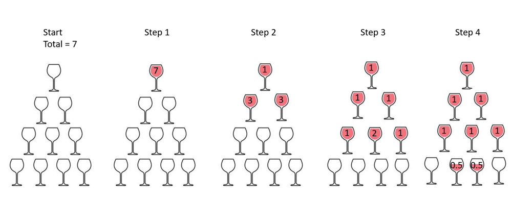

# Champagne Tower | java | c++ | kotlin | dp

**Author:** cygnus
**Votes:** 24
**Link:** [https://leetcode.com/problems/champagne-tower/solutions/911462/](https://leetcode.com/problems/champagne-tower/solutions/911462/)

---

We can think pouring the champagne as a step by step process.  Let's say a tower with 4 row ( 0-3) and we want to pour 7 glasses.  So from the picture, it is staightforward to have a dp solution with space complexity of **O(N^2)**.  Since we only care about the last row, and **every row is only depends on the previous row**, we can optimize the space complexity to **O(N)**.    All we need to do is calculate a new row from the end to start.  

If you still think it is difficult to understand, write the O(N^2) method first and try the O(N) method after that.  Step 3 row 2 (1,2,1) will be helpful to understand the O(N) solution.  Step 3 row 2 is generated from Step 2 row 1

Start.  0   0   0.  
From Right to left
Step 2 Row 2, column **2**  0   1   1
Step 2 Row 2, column **1**.  1   2   1



Time comlexity: **O(N^2)**
Space complexity: **O(N)**

If you like it, please upvote it. Thanks.


java
```
class Solution {
    public double champagneTower(int poured, int query_row, int query_glass) {
        double[] dp = new double[100];
        dp[0] = poured;
        for (int i = 1; i <= query_row; i++)
        {
		    // in order to save space, we have to calculate from the end to the start
            for (int j = i-1; j >= 0; j--)
            {
			    // this is the half of the remain and wil be poured to the next level
                double remain = (Math.max(dp[j], 1.0) - 1.0) / 2.0;
				
				// this includes the champagne from the previous calculation, we need to use add
                dp[j+1] += remain;
				
				// This is all champagne poured for this glass
                dp[j] = remain;
            }
        }
        return dp[query_glass] >= 1 ? 1: dp[query_glass];
    }
}
```

c++
```
class Solution {
public:
    double champagneTower(int poured, int query_row, int query_glass) {
        double dp[100] = {};
        dp[0] = poured;
        for (int i = 1; i <= query_row; i++)
        {
		    // this is the half of the remain and wil be poured to the next level
            for (int j = i-1; j >= 0; j--)
            {
				// this is the half of the remain and wil be poured to the next level
				double remain = (max(dp[j], 1.0) - 1.0) / 2.0;
				
				// this includes the champagne from the previous calculation, we need to use add
                dp[j+1] += remain;
				
				// This is all champagne poured for this glass
                dp[j] = remain;
            }
        }
        return dp[query_glass] >= 1 ? 1: dp[query_glass];
    }
};
```

kotlin
```
class Solution {
    fun champagneTower(poured: Int, query_row: Int, query_glass: Int): Double {
        var dp = DoubleArray(100){0.0}
        dp[0] = poured.toDouble()
        for (i in 1..query_row)
        {
            for (j in i-1 downTo 0 step 1)
            {
                val remain: Double = (Math.max(dp[j], 1.0) - 1.0) / 2.0
                dp[j+1] += remain
                dp[j] = remain
            }
        }
        return if (dp[query_glass] >= 1) 1.0 else dp[query_glass]
    }
}
```