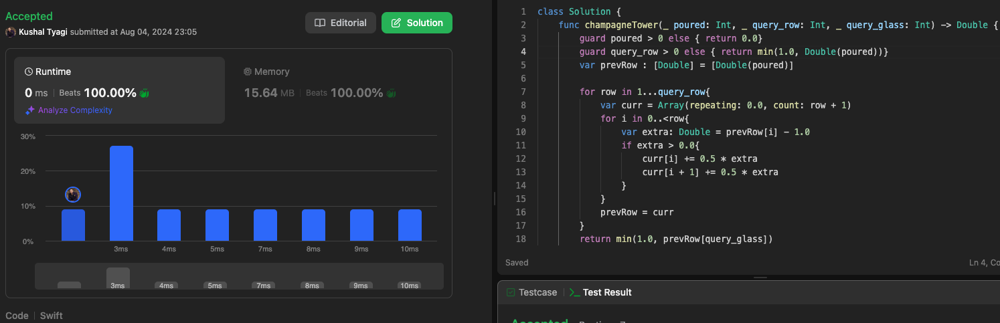

# 100% faster solution

**Author:** kushaltyagi
**Votes:** 0
**Link:** [https://leetcode.com/problems/champagne-tower/solutions/5587042/](https://leetcode.com/problems/champagne-tower/solutions/5587042/)

---

# Intuition

<!-- Describe your first thoughts on how to solve this problem. -->

# Approach
<!-- Describe your approach to solving the problem. -->

# Complexity
- Time complexity:
<!-- Add your time complexity here, e.g. $$O(n)$$ -->

- Space complexity:
<!-- Add your space complexity here, e.g. $$O(n)$$ -->

# Code
```
class Solution {
    func champagneTower(_ poured: Int, _ query_row: Int, _ query_glass: Int) -> Double {
        guard poured > 0 else { return 0.0}
        guard query_row > 0 else { return min(1.0, Double(poured))}
        var prevRow : [Double] = [Double(poured)]

        for row in 1...query_row{
            var curr = Array(repeating: 0.0, count: row + 1)
            for i in 0..<row{
                var extra: Double = prevRow[i] - 1.0
                if extra > 0.0{
                    curr[i] += 0.5 * extra
                    curr[i + 1] += 0.5 * extra
                }
            }
            prevRow = curr
        }
        return min(1.0, prevRow[query_glass])
    }
}
```