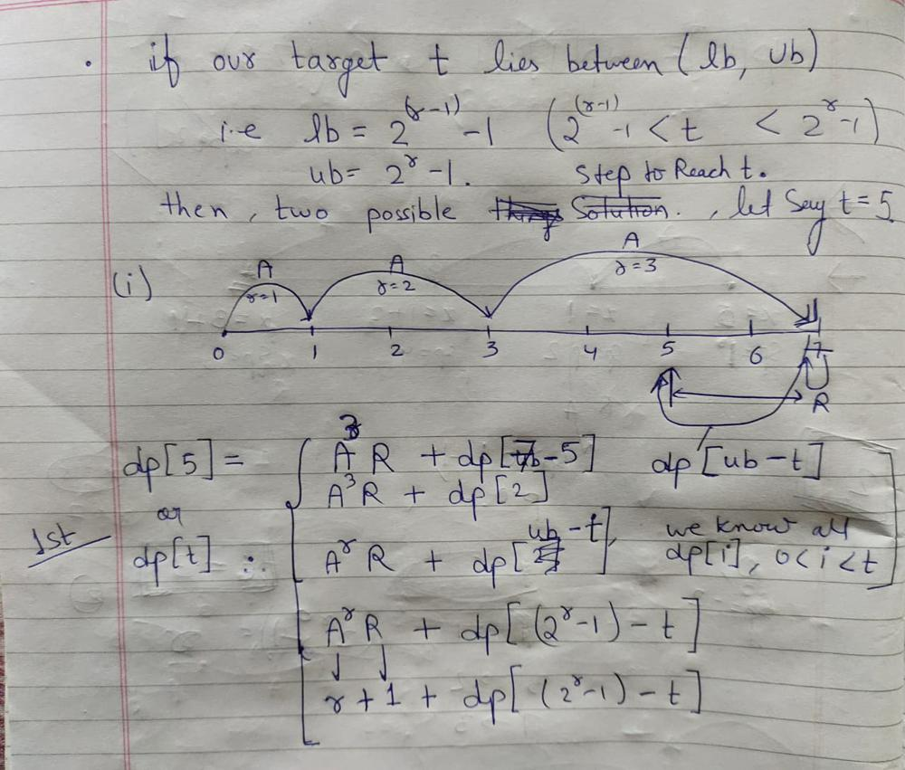
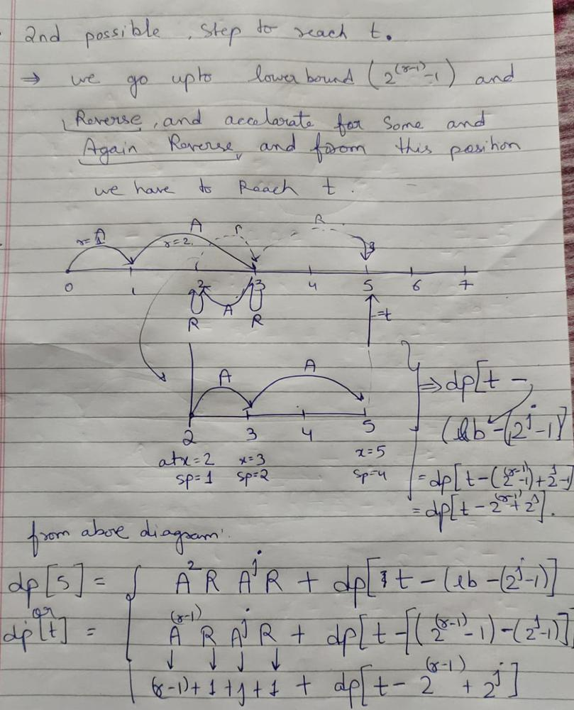

# C++ DP solution.in O( Tlog(T)) .

**Author:** mdsameer312398
**Votes:** 45
**Link:** [https://leetcode.com/problems/race-car/solutions/2462888/](https://leetcode.com/problems/race-car/solutions/2462888/)

---

# Before Solving Use Pen and Paper
*Acc=Accelerate and Rev=Reverse.*
* dp[i] = minimum Number of Step to Reach i;
1. * dp[i]=r ,  if( i== 2^r -1) use Pen and Paper.
 
    * initially x=0,sp=1, **if we Acc i.e "A"  dp[x+sp]=dp[1]=1**.
    
	* now x=1, sp=2*(prev speed)=2  , **if we Acc aggain i.e , "AA" dp[x+sp]=dp[3]=2**
	
	* if we Acc n time i.e  **AA..n times  i= 2^n-1  i.e ** dp[i]= dp[2^n-1]=n.**

2. *  if (     2^(r-1)-1        < i   < 2^(r) -1 )  then we can reach target t in two Possible Step

		1. * First Possible Step 
			
			 [
](http://)
		2. * Seconf Possible Step to Reach Target t  
				
				[
](http://)

3. * at last dp[i]= min( first posiiltiy , second possibility).

# Please Upvote if Usefull


```
class Solution {
public:
    int racecar(int t) {
        
        vector< int> dp( t+1,INT_MAX);
        int r=1;
        for( int i=1;i<=t;i++){
            
            if( i==pow( 2,r)-1){
                dp[i]=r;
                r++;
            }
            else{
                int u= pow( 2,r)-1;
                int l=pow( 2,r-1)-1;
                
                for( int j=0;j<r-1;j++){
                    dp[i]= min(dp[i], ( r-1)+1+1+j+ dp[i-l+pow(2,j)-1]);
                }
                dp[i]=min( dp[i] , r+1+dp[ u- i] );
            }
        }
        return dp[t];
    }
};
```