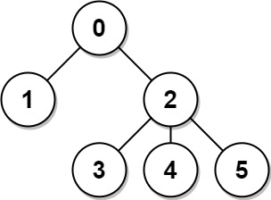

# [834. Sum of Distances in Tree](https://leetcode.com/problems/sum-of-distances-in-tree/)

| Category | Difficulty | Likes | Dislikes |
| :------: | :--------: | :---: | :------: |
| Algorithms | Hard | 5889 | 139 |

**Tags:** [`dynamic-programming`](https://leetcode.com/tag/dynamic-programming), [`tree`](https://leetcode.com/tag/tree), [`depth-first-search`](https://leetcode.com/tag/depth-first-search), [`graph`](https://leetcode.com/tag/graph)

**Companies:** `google`, `phonepe`, `amazon`, `microsoft`

## Description

There is an undirected connected tree with `n` nodes labeled from `0` to `n - 1` and `n - 1` edges.

You are given the integer `n` and the array `edges` where `edges[i] = [a_i, b_i]` indicates that there is an edge between nodes `a_i` and `b_i` in the tree.

Return an array `answer` of length `n` where `answer[i]` is the sum of the distances between the `i^th` node in the tree and all other nodes.

 

**Example 1:**


```

Input: n = 6, edges = [[0,1],[0,2],[2,3],[2,4],[2,5]]
Output: [8,12,6,10,10,10]
Explanation: The tree is shown above.
We can see that dist(0,1) + dist(0,2) + dist(0,3) + dist(0,4) + dist(0,5)
equals 1 + 1 + 2 + 2 + 2 = 8.
Hence, answer[0] = 8, and so on.

```

**Example 2:**


```

Input: n = 1, edges = []
Output: [0]

```

**Example 3:**


```

Input: n = 2, edges = [[1,0]]
Output: [1,1]

```

 

**Constraints:**

	- `1 <= n <= 3 * 10^4`

	- `edges.length == n - 1`

	- `edges[i].length == 2`

	- `0 <= a_i, b_i < n`

	- `a_i != b_i`

	- The given input represents a valid tree.

---

**Links:** [Submissions](https://leetcode.com/problems/sum-of-distances-in-tree/) | [Solutions](https://leetcode.com/problems/sum-of-distances-in-tree/)
