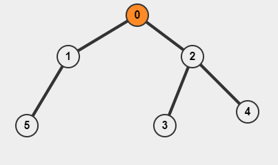
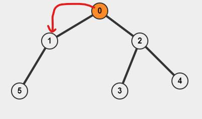

# C++ solution using dfs with explanation, O(N) time complexity

**Author:** shreyanshjn
**Votes:** 597
**Link:** [https://leetcode.com/problems/sum-of-distances-in-tree/solutions/1308366/](https://leetcode.com/problems/sum-of-distances-in-tree/solutions/1308366/)

---

**A thought before solving this problem**
This problem involves a technique which might seems difficult at first, but once you get this, you will be easily able to solve similar problem. 

**Explanation**
Let's first solve a simpler version of this problem.
Suppose we need to find the sum of distances for only root node.



Consider the tree above, with 0 as the root node.
The result for subtree with 2 as root will be 2 (we can easily count it) and  for subtree 1 is 1.

This is the recurrence relation we can use to calculate the sum of distances for root.
```
res[0] = res[2] + number of nodes in subtree with root 2
		+ res[1] + number of nodes in subtree with root 1

res[0] = 2 + 3 + 1 + 2 = 8
```


We are adding the number of nodes of subtree because every node in subtree will be 1 unit more far from the original root.

I need two arrays count and res. Count will store the number of nodes in each subtree and res will the store the answer as discussed above. Below is the code.

```
	// intially count array was initialized to 0.
	// count[parent] is the sum of count of its child + 1
	// v is the Adjacency List
	void dfs(int i, int p = -1) {
        for(auto u : v[i]) {
            if(u == p) continue;
            dfs(u, i);
            count[i] += count[u];
            res[i] += res[u] + count[u];
        }
        count[i] += 1;
    }
```

This ends the first part of our problem.

**The Original problem**
We can run the dfs function above for every node and get the solution. This will result in **O(N * N)** time complexity. But we can do this in **O(N)** time using a technique popularly known as **re-rooting** techinque.

The idea is to derive the solution of every node by shifting the root.



Suppose we shift the root from root 0 to 1, what changes can we observe. 
```count[1]``` nodes got 1 unit closer to new root and ```n - count[1]``` nodes got 1 unit away from the new root.
So, 
```res[1] = res[0] - count[1] + n - count[1]```
i.e
```res[new_root] = res[root] - count[new_root] + n - count[new_root]```

The way we are running dfs the new_root will be child and root will be parent.
Here, is the code for this part.
```
    void dfs2(int i, int n, int p = -1) {
        for(auto u : v[i]) {
            if(u == p) continue;
            res[u] = res[i] - count[u] + n - count[u];
            dfs2(u, n, i);
        }
    }
```

**Complete Code**
```
class Solution {
public:
    vector<vector<int>> v;
    vector<int> counter, res;
        
    void dfs(int i, int p = -1) {
        for(auto u : v[i]) {
            if(u == p) continue;
            dfs(u, i);
            counter[i] += counter[u];
            res[i] += res[u] + counter[u];
        }
        counter[i] += 1;
    }

    void dfs2(int i, int n, int p = -1) {
        for(auto u : v[i]) {
            if(u == p) continue;
            res[u] = res[i] - counter[u] + n - counter[u];
            dfs2(u, n, i);
        }
    }
    
    vector<int> sumOfDistancesInTree(int n, vector<vector<int>>& edges) {
        v.resize(n);
        for(int i = 0; i < n - 1; i++) {
            int a = edges[i][0];
            int b = edges[i][1];
            v[a].push_back(b);
            v[b].push_back(a);
        }
        res.resize(n);
        counter.resize(n);
        dfs(0);
        dfs2(0, n);
        return res;
    }
};
```

***P.S - Please upvote, if you find this useful***

**Edit -** Thanks for the upvote and comments, do follow me on twitter https://twitter.com/DevTalesShrey where I regularly post coding articles.
