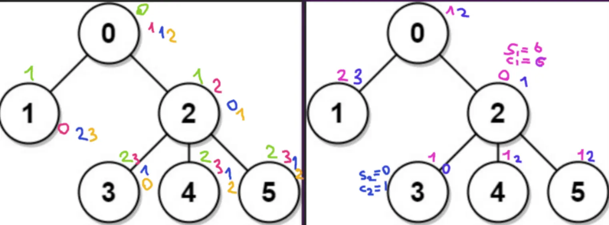
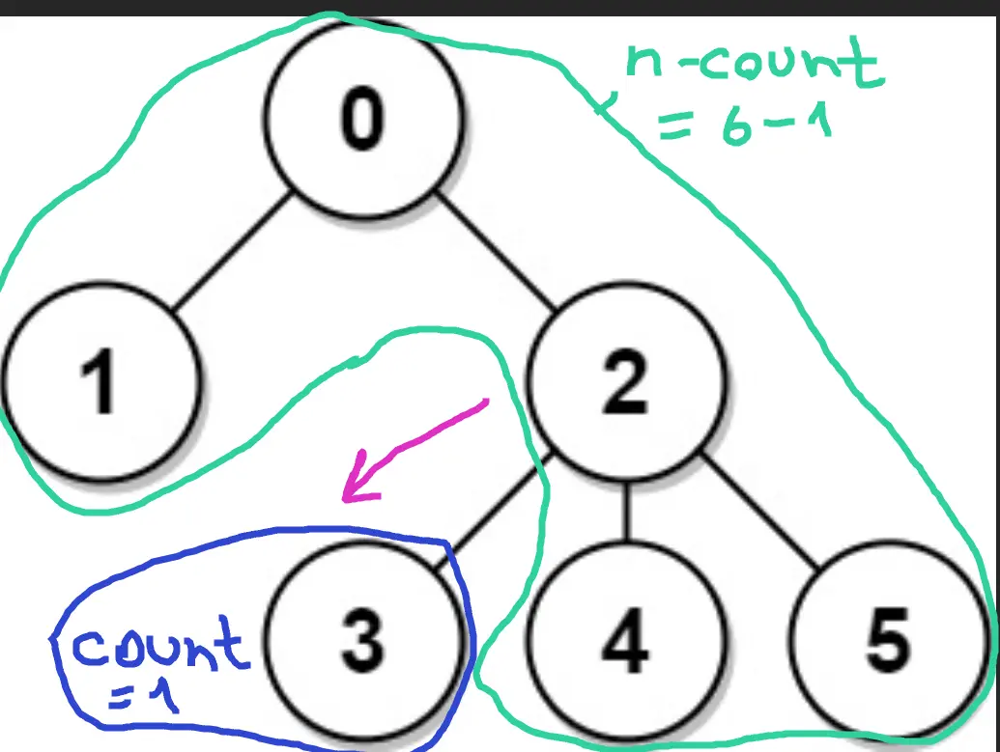
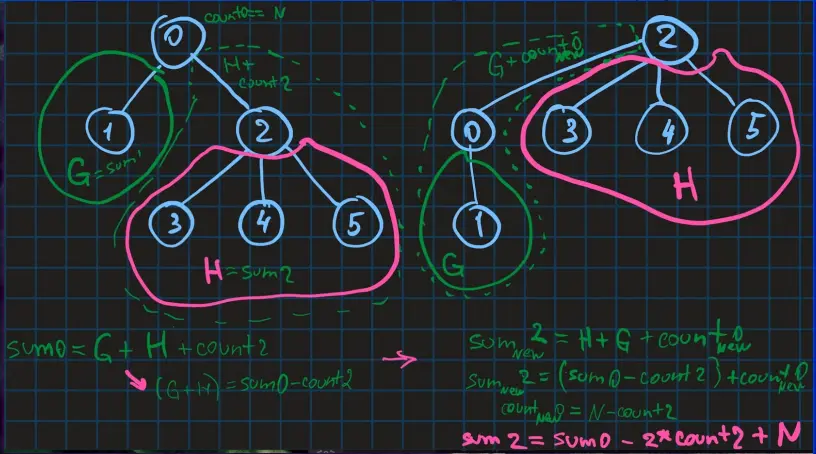

# Kotlin | Rust

**Author:** SamoylenkoDmitry
**Votes:** 4
**Link:** [https://leetcode.com/problems/sum-of-distances-in-tree/solutions/5082926/](https://leetcode.com/problems/sum-of-distances-in-tree/solutions/5082926/)

---


https://youtu.be/1ZcnM5l3V5E
#### Join me on Telegram

https://t.me/leetcode_daily_unstoppable/586

#### Problem TLDR

Sums of paths to each leafs in a tree #hard #dfs

#### Intuition

Let's observe how the result is calculated for each of the node:


As we see, there are some releationships between sibling nodes: they are differ by some law.
Our goal is to reuse the first iteration result.
When we changing the root we are decreasing all the paths that are forwards and increasing all the paths that are backwards. The number of forward and backward paths can be calculated like this:

Given that, we can derive the formula to change the root:


`new root == previous root - forward + backward`, or
`R2 = R1 - count1 + (n - count1)`


#### Approach

There are two possible ways to solve this: recursion and iteration.
* we can drop the `counts` array and just use the `result`
* for the post-order iterative solution, we also can simplify some steps: step 0 - go deeper, step 1 - return with result, that is where child nodes are ready, step 2 - again go deeper to do the root changing operation

#### Complexity

- Time complexity:
$$O(n)$$

- Space complexity:
$$O(n)$$

#### Code

```kotlin []

    fun sumOfDistancesInTree(n: Int, edges: Array<IntArray>): IntArray {
        val graph = Array(n) { mutableListOf<Int>() }
        for ((a, b) in edges) { graph[a] += b; graph[b] += a }
        val res = IntArray(n)
        fun dfs(curr: Int, from: Int, path: Int): Int = (1 + graph[curr]
            .sumOf { if (it != from) dfs(it, curr, path + 1) else 0 })
            .also { res[0] += path; if (curr > 0) res[curr] = n - 2 * it }
        fun dfs2(curr: Int, from: Int) {
            if (curr > 0) res[curr] += res[from]
            for (e in graph[curr]) if (e != from) dfs2(e, curr)
        }
        dfs(0, 0, 0); dfs2(0, 0)
        return res
    }

```
```rust []

    pub fn sum_of_distances_in_tree(n: i32, edges: Vec<Vec<i32>>) -> Vec<i32> {
        let (mut g, mut res, mut st) = (vec![vec![]; n as usize], vec![0; n as usize], vec![(0, 0, 0, 0)]);
        for e in edges { let (a, b) = (e[0] as usize, e[1] as usize); g[a].push(b); g[b].push(a) }
        while let Some((curr, from, path, step)) = st.pop() {
            if step == 0 {
                st.push((curr, from, path, 1));
                for &e in &g[curr] { if e != from { st.push((e, curr, path + 1, 0)) }}
                res[0] += path
            } else if step == 1 {
                if curr == 0 { st.push((curr, from, 0, 2)); continue }
                for &e in &g[curr] { if e != from { res[curr] -= n - res[e] }}
                res[curr] += n - 2
            } else {
                if curr > 0 { res[curr] += res[from] }
                for &e in &g[curr] { if e != from { st.push((e, curr, 0, 2)) }}
            }
        }; res
    }

```