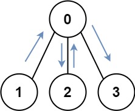
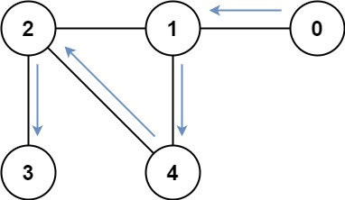

# [847. Shortest Path Visiting All Nodes](https://leetcode.com/problems/shortest-path-visiting-all-nodes/)

| Category | Difficulty | Likes | Dislikes |
| :------: | :--------: | :---: | :------: |
| Algorithms | Hard | 4578 | 181 |

**Tags:** [`dynamic-programming`](https://leetcode.com/tag/dynamic-programming), [`bit-manipulation`](https://leetcode.com/tag/bit-manipulation), [`breadth-first-search`](https://leetcode.com/tag/breadth-first-search), [`graph`](https://leetcode.com/tag/graph), [`bitmask`](https://leetcode.com/tag/bitmask)

**Companies:** `google`, `amazon`, `microsoft`

## Description

You have an undirected, connected graph of `n` nodes labeled from `0` to `n - 1`. You are given an array `graph` where `graph[i]` is a list of all the nodes connected with node `i` by an edge.

Return *the length of the shortest path that visits every node*. You may start and stop at any node, you may revisit nodes multiple times, and you may reuse edges.

 

**Example 1:**


```

Input: graph = [[1,2,3],[0],[0],[0]]
Output: 4
Explanation: One possible path is [1,0,2,0,3]

```

**Example 2:**


```

Input: graph = [[1],[0,2,4],[1,3,4],[2],[1,2]]
Output: 4
Explanation: One possible path is [0,1,4,2,3]

```

 

**Constraints:**

	- `n == graph.length`

	- `1 <= n <= 12`

	- `0 <= graph[i].length < n`

	- `graph[i]` does not contain `i`.

	- If `graph[a]` contains `b`, then `graph[b]` contains `a`.

	- The input graph is always connected.

---

**Links:** [Submissions](https://leetcode.com/problems/shortest-path-visiting-all-nodes/) | [Solutions](https://leetcode.com/problems/shortest-path-visiting-all-nodes/)
