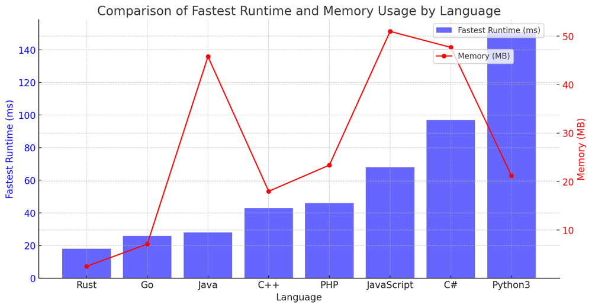

# ✅ 94.74% BFS + Bitmask

**Author:** vanAmsen
**Votes:** 116
**Link:** [https://leetcode.com/problems/shortest-path-visiting-all-nodes/solutions/4053514/](https://leetcode.com/problems/shortest-path-visiting-all-nodes/solutions/4053514/)

---

# Comprehensive Guide to Solving "Shortest Path Visiting All Nodes"

## Introduction & Problem Statement

Greetings, coding enthusiasts! Today we embark on a fascinating journey through the realm of graphs. Our mission is to discover the shortest path that visits every node in an undirected, connected graph. Intriguing, isn't it? You can start and stop at any node, you may revisit nodes multiple times, and you may reuse edges.

## Key Concepts and Constraints

### What Makes This Problem Unique?

1. **Graph Representation**:
    The problem is modeled as an undirected graph where each node has connections to other nodes. The graph is given in adjacency list format.

2. **Bitmasking for State Representation**:
    The key to solving this problem efficiently lies in representing the set of visited nodes using a bitmask. This allows us to maintain a compact and efficient representation of our progress.

3. **Constraints**: 
    - $$ 1 \\leq n \\leq 12 $$
    - $$ 0 \\leq \	ext{graph}[i].\	ext{length} < n $$

### Strategies to Tackle the Problem

1. **Breadth-First Search (BFS)**:
    BFS is a classic algorithm for exploring a graph and can be adapted to solve this problem.

---

## Live Coding BFS & More
https://youtu.be/1aJPYkZOuv8?si=wp2wcu-hPp7h-mJG

## In-Depth Explanation of BFS Algorithm in "Shortest Path Visiting All Nodes"

### What is Breadth-First Search (BFS)?

Breadth-First Search (BFS) is a graph traversal algorithm that explores nodes level by level, moving through neighbors before going deeper. In this specific problem, we employ BFS not just to explore the graph but also to search through the different "states" that the graph can be in. Each state encapsulates a set of visited nodes, the current node, and the distance covered so far.

### Detailed Breakdown of the Algorithm

#### Initialize Variables

1. **Number of Nodes (`n`)**:  
    - The variable `n` stores the total number of nodes in the graph. It helps us create initial states and determine when all nodes have been visited.

2. **Queue (`queue`)**:  
    - We initialize a queue to store the states we need to explore. A deque is used for its efficient `O(1)` append and pop operations.

3. **Visited Set (`visited`)**:  
    - A set is used to keep track of states that have already been visited. This avoids redundant work and cycles.

#### Initialization Step

- **Initial States**:  
    - Each node is used as a starting point, and for each starting node `i`, an initial state is enqueued. The state is represented as a tuple `(mask, node, dist)`. 
        - `mask = 1 << i`: Only the `i`-th bit is set, indicating that only node `i` is visited.
        - `node = i`: The current node is `i`.
        - `dist = 0`: The distance traveled so far is zero.

#### Main BFS Loop

1. **Dequeue State**:  
    - A state is dequeued from the front of the queue. This state contains:
        - `mask`: Bitmask representing the visited nodes.
        - `node`: The current node.
        - `dist`: The distance traveled to reach this state.

2. **Check for Goal State**:  
    - If the bitmask equals `(1 << n) - 1`, it means all nodes have been visited. In that case, the algorithm returns the distance for that state, effectively solving the problem.

3. **Explore Neighbors**:  
    - For the current node, all its neighbors in the graph are explored. For each neighbor, a new state is generated.
        - `new_mask = mask | (1 << neighbor)`: The new mask includes the neighbor as visited.
        - `new_node = neighbor`: The new current node is the neighbor.
        - `new_dist = dist + 1`: The distance is incremented by 1.

4. **Check and Enqueue New States**:  
    - Before enqueuing the new state, we check whether it has already been visited. If not, it's added to the `visited` set and enqueued for future exploration.

#### Termination and Result

- The BFS loop continues until the queue is empty or the goal state is reached. The shortest distance required to visit all nodes is then returned.

### Time and Space Complexity

- **Time Complexity**: $$O(2^n \	imes n)$$, where $$n$$ is the number of nodes. This is because there are $$2^n$$ possible subsets of nodes and $$n$$ nodes to consider for each subset.
- **Space Complexity**: $$O(2^n \	imes n)$$, needed for the visited set and the queue.

# Code
``` Python []
class Solution:
    def shortestPathLength(self, graph: List[List[int]]) -> int:
        n = len(graph)
        queue = deque([(1 << i, i, 0) for i in range(n)])
        visited = set((1 << i, i) for i in range(n))
        
        while queue:
            mask, node, dist = queue.popleft()
            if mask == (1 << n) - 1:
                return dist
            for neighbor in graph[node]:
                new_mask = mask | (1 << neighbor)
                if (new_mask, neighbor) not in visited:
                    visited.add((new_mask, neighbor))
                    queue.append((new_mask, neighbor, dist + 1))
```
``` Go []
type State struct {
	mask, node, dist int
}

func shortestPathLength(graph [][]int) int {
	n := len(graph)
	allVisited := (1 << n) - 1
	queue := []State{}
	visited := make(map[int]bool)

	for i := 0; i < n; i++ {
		queue = append(queue, State{1 << i, i, 0})
		visited[(1<<i)*16+i] = true
	}

	for len(queue) > 0 {
		cur := queue[0]
		queue = queue[1:]

		if cur.mask == allVisited {
			return cur.dist
		}

		for _, neighbor := range graph[cur.node] {
			newMask := cur.mask | (1 << neighbor)
			hashValue := newMask*16 + neighbor

			if !visited[hashValue] {
				visited[hashValue] = true
				queue = append(queue, State{newMask, neighbor, cur.dist + 1})
			}
		}
	}

	return -1
}
```
``` Rust []
use std::collections::{HashSet, VecDeque}; 

impl Solution {
    pub fn shortest_path_length(graph: Vec<Vec<i32>>) -> i32 {
        let n = graph.len(); 
        let all_visited = (1 << n) - 1; 
        let mut queue: VecDeque<(i32, i32, i32)> = VecDeque::new(); 
        let mut visited: HashSet<i32> = HashSet::new(); 

        for i in 0..n as i32 { 
            queue.push_back((1 << i, i, 0)); 
            visited.insert((1 << i) * 16 + i); 
        } 

        while let Some((mask, node, dist)) = queue.pop_front() { 
            if mask == all_visited as i32 { 
                return dist; 
            } 

            for &neighbor in &graph[node as usize] { 
                let new_mask = mask | (1 << neighbor); 
                let hash_value = new_mask * 16 + neighbor; 

                if visited.insert(hash_value) { 
                    queue.push_back((new_mask, neighbor, dist + 1)); 
                } 
            } 
        } 

        -1 

    }
}
```
``` C++ []
class Solution {
    struct State {
     int mask, node, dist;
    };
public:
    int shortestPathLength(vector<vector<int>>& graph) {
        int n = graph.size();
        int all_visited = (1 << n) - 1;
        queue<State> q;
        unordered_set<int> visited;
        
        for (int i = 0; i < n; ++i) {
            q.push({1 << i, i, 0});
            visited.insert((1 << i) * 16 + i);
        }
        
        while (!q.empty()) {
            State cur = q.front(); q.pop();
            
            if (cur.mask == all_visited) {
                return cur.dist;
            }
            
            for (int neighbor : graph[cur.node]) {
                int new_mask = cur.mask | (1 << neighbor);
                int hash_value = new_mask * 16 + neighbor;
                
                if (visited.find(hash_value) == visited.end()) {
                    visited.insert(hash_value);
                    q.push({new_mask, neighbor, cur.dist + 1});
                }
            }
        }
        
        return -1;
    }
};
```
``` Java []
class Solution {
    public int shortestPathLength(int[][] graph) {
        int n = graph.length;
        int allVisited = (1 << n) - 1;
        Queue<int[]> queue = new LinkedList<>();
        Set<Integer> visited = new HashSet<>();

        for (int i = 0; i < n; i++) {
            queue.offer(new int[]{1 << i, i, 0});
            visited.add((1 << i) * 16 + i);
        }

        while (!queue.isEmpty()) {
            int[] cur = queue.poll();

            if (cur[0] == allVisited) {
                return cur[2];
            }

            for (int neighbor : graph[cur[1]]) {
                int newMask = cur[0] | (1 << neighbor);
                int hashValue = newMask * 16 + neighbor;

                if (!visited.contains(hashValue)) {
                    visited.add(hashValue);
                    queue.offer(new int[]{newMask, neighbor, cur[2] + 1});
                }
            }
        }

        return -1;
    }
}
```
``` C# []
public class Solution {
    public int ShortestPathLength(int[][] graph) {
        int n = graph.Length;
        int allVisited = (1 << n) - 1;
        Queue<int[]> queue = new Queue<int[]>();
        HashSet<int> visited = new HashSet<int>();

        for (int i = 0; i < n; i++) {
            queue.Enqueue(new int[]{1 << i, i, 0});
            visited.Add((1 << i) * 16 + i);
        }

        while (queue.Count > 0) {
            int[] cur = queue.Dequeue();

            if (cur[0] == allVisited) {
                return cur[2];
            }

            foreach (int neighbor in graph[cur[1]]) {
                int newMask = cur[0] | (1 << neighbor);
                int hashValue = newMask * 16 + neighbor;

                if (!visited.Contains(hashValue)) {
                    visited.Add(hashValue);
                    queue.Enqueue(new int[]{newMask, neighbor, cur[2] + 1});
                }
            }
        }

        return -1;
    }
}
```
``` JavaScript []
/**
 * @param {number[][]} graph
 * @return {number}
 */
var shortestPathLength = function(graph) {
    const n = graph.length;
    const allVisited = (1 << n) - 1;
    const queue = [];
    const visited = new Set();

    for (let i = 0; i < n; i++) {
        queue.push([1 << i, i, 0]);
        visited.add((1 << i) * 16 + i);
    }

    while (queue.length > 0) {
        const [mask, node, dist] = queue.shift();

        if (mask === allVisited) {
            return dist;
        }

        for (const neighbor of graph[node]) {
            const newMask = mask | (1 << neighbor);
            const hashValue = newMask * 16 + neighbor;

            if (!visited.has(hashValue)) {
                visited.add(hashValue);
                queue.push([newMask, neighbor, dist + 1]);
            }
        }
    }

    return -1;
}
```
``` PHP []
class Solution {

    /**
     * @param Integer[][] $graph
     * @return Integer
     */
    function shortestPathLength($graph) {
    $n = count($graph);
    $allVisited = (1 << $n) - 1;
    $queue = new SplQueue();
    $visited = [];

    for ($i = 0; $i < $n; $i++) {
        $queue->enqueue([1 << $i, $i, 0]);
        $visited[(1 << $i) * 16 + $i] = true;
    }

    while (!$queue->isEmpty()) {
        [$mask, $node, $dist] = $queue->dequeue();

        if ($mask === $allVisited) {
            return $dist;
        }

        foreach ($graph[$node] as $neighbor) {
            $newMask = $mask | (1 << $neighbor);
            $hashValue = $newMask * 16 + $neighbor;

            if (!isset($visited[$hashValue])) {
                $visited[$hashValue] = true;
                $queue->enqueue([$newMask, $neighbor, $dist + 1]);
            }
        }
    }

    return -1;
}
}
```
## Performance

| Language   | Fastest Runtime (ms) | Memory (MB) |
|------------|----------------------|-------------|
| Rust       | 18                   | 2.5         |
| Go         | 26                   | 7.1         |
| Java       | 28                   | 45.8        |
| C++        | 43                   | 18          |
| PHP        | 46                   | 23.4        |
| JavaScript | 68                   | 51          |
| C#         | 97                   | 47.7        |
| Python3    | 151                  | 21.2        |




## Live Coding + BFS in Rust
https://youtu.be/rIdgnWYfA_w?si=accCEKNjtxdvfj48


## Rust Code Highlights and Best Practices

### Using `VecDeque` for Queue Operations
In Rust, we use the `VecDeque` data structure from the standard library for our queue. It provides efficient $$O(1)$$ operations for appending to and popping from both ends. This ensures that the queue operations in the BFS algorithm are as fast as possible, which is crucial for performance.

### Using `HashSet` for Visited States
To keep track of the visited states, Rust's `HashSet` is employed. Hash sets offer $$O(1)$$ lookups, which is essential for ensuring that we don't revisit states that we have already processed. This helps to make the algorithm more efficient by avoiding redundant work.

### Bit Manipulation for State Representation
Rust's excellent support for bit manipulation comes in handy for representing states efficiently. The `mask` variable serves as a compact representation of visited nodes, and bitwise operations like `|` and `<<` are used for updating it.

### Hash Value Calculation: `mask * 16 + i`
You might wonder why we use `mask * 16 + i` as the hash value for each state. This specific hash function ensures a unique value for each state, considering both the mask and the current node. Multiplying by 16 (which is $$2^4$$) effectively shifts the bits of `mask` to the left by 4 bits, making space for the `i` value. This enables us to uniquely identify each state with a single integer.

### Is the Hash Value used for preventing cycles?
Yes, the hash value is used to identify unique states that have been visited. By storing these in a `HashSet`, we can efficiently prevent cycles and avoid revisiting the same state, which is critical for the algorithm's performance.

Mastering this Rust implementation will not only deepen your understanding of graph algorithms and bit manipulation but also equip you with practical Rust programming skills. Are you ready to find the shortest path visiting all nodes in Rust? Let's get coding! \uD83D\uDE80