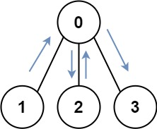

# 🚀  97.92% || BFS + Bitmask || Explained Intuition || Commented Code 🚀

**Author:** MohamedMamdouh20
**Votes:** 62
**Link:** [https://leetcode.com/problems/shortest-path-visiting-all-nodes/solutions/4053595/](https://leetcode.com/problems/shortest-path-visiting-all-nodes/solutions/4053595/)

---

# Probelm Description
Given an **undirected**, **connected** graph with `n` nodes labeled from `0` to `n - 1`, represented by an **adjacency list** in the form of an array graph, where `graph[i]` is a **list** of nodes **connected** to node `i`.
The task is to find the length of the **shortest path** that visits every node. You can start and stop at any node, **revisit** nodes multiple times, and **reuse** edges.

- **Constraints:**
    - `n` == graph.length
    - `1 <= n <= 12`
    - `0 <= graph[i].length < n`
    - The input graph is **connected**.
    - `graph[i]` does not contain `i`.
    - If `graph[a]` contains `b`, then `graph[b]` contains `a`.
    - The input **graph** is always **connected**.
    - You may **reuse** edges.
    - You may **revisit** nodes.

---


# Intuition

Hello There\uD83D\uDE00
Let's take a look on our interesting but yet challenging problem\uD83D\uDE80

The problem is that given a **adjacency lis**t of a graph, the task is to find the **shortest** path that visits **all** the nodes.
There are **two important** properties of the given graph: The graph is **undirected** and it is **unweighted** graph.

Shortest **path** and **unweighted** graph ? \uD83E\uDD14
It looks like a mission for **BFS** !\uD83D\uDC31\u200D\uD83C\uDFCD

Let's try BFS on the first example:

let's use normal BFS
```
graph = [[1,2,3],[0],[0],[0]]
Starting from node `1` : output is [1, 0, 2, 3]
Starting from node `0` : output is [0, 1, 2, 3]
```
Huh, That doesn't seem right\uD83E\uDD14 since we are not storing a path but only nodes let's try to store path.
```
Starting from node `1` : output is [1, 0, 2]
    -> 0 is visited and we won't visit it again
Starting from node `0` : output is [0, 1]
    -> 0 is visited and we won't visit it again
```
Also, doesn't seem right !!\uD83D\uDE20
The problem now is with our **visited** array. The problem states that we can **revisit** nodes but **BFS** can't do that due to the **visited** array.
But if we can't **delete** visited array since we will run into loops !!\uD83E\uDD2F

What can we do ??\uD83E\uDD14
we can use visited array but in another way.\uD83D\uDE33
Instead of storing visited **nodes** why don't we store visited **pathes**...\uD83E\uDD28
- The visited path is indicated by **two things**:
    - the **last node** visited
    - **boolean** of the nodes **visited** so far (using bitmask)

> -> Bitmask: for an integer value we will store for each bit in it if the corresponding node is visited or not
-> For nodes                           (0, 1, 2, 3, 4, 5)
-> The bitmask will be something like [1 0 1 0 0 0]
-> The value of the integer holding it equals =
1 * 1 + 2 * 0 + 4 * 1 + 8 * 0 + 16 * 0 + 32 * 0 = 5

How will that help?
- In our previous example, if we look into pathes using our new visited array:
    - `[1, 0, 2, 0, 3]` we can find that the **bitmask** for this path is `[1 1 1 1]` and the **last** node is `3`
    - `[1 0 1 0 1 0]` we can say it's **loop** for sure. The **bitmask** is `[1 1 0 0]` and the **last** node is `0`
    - `[1 0]` this is **not** a **loop** but yet is has the **same** bitmask and last node of previous example
    - `[0 1 0]` this also is **not** a **loop** and also has the **same** bitmask and last node of the two previous example

I think we got something here...\uD83D\uDE80
Yes, The **bitmasking** with **tracking** of last node visited helps us to determine if a given path is visited before or not.

Let's start from node `1`
```
-> node 1 : bitmask [0 1 0 0] , last visited : 1  (Not visited)
-> node 0 : bitmask [1 1 0 0] , last visited : 0  (Not visited)
-> node 1 : bitmask [1 1 0 0] , last visited : 1  (Not visited)
-> node 0 : bitmask [1 1 0 0] , last visited : 0  (Visited before !!)
```

we can see that the **third** line and **second** line are **same** in **bitmask** but what **distinguish** each of them that the **last** visited node.
and this is the point, we don't care about the last visited node alone or the bitmask alone.
We care about **both**.

Wow, we really did it!!\uD83D\uDC4F
we used the visited array in another way to track loops and let us revisit nodes.
With using this visited array, we can afterwards use a normal **BFS** and this is our solution to the problem. 

Let's talk about some **implementation** Details \uD83D\uDD28

Which node we **start** from our **BFS**?
Since the goal is to **minimize** our path then the answer can be found starting from **any node** of them but we don't know which...
So, We will try BFS from each node.
- We have **two** approaches:
    - use a **for loop** indicates that we are starting from some node each iteration.
    - Use **multi-souce BFS**. It is simply instead of pushing one starting node to the queue push **multiple** nodes and the shortest path will appear from anyone of them eventually.

How can we implement our **visited data structure**?
- we have **two** ways:
    - Use **2d array** `visited[bitmask][last_visited]` if it true it indicates that the path that visited the nodes in `bitmask` and ended with `last_visited` is true.
    - Use **set** of `pairs<bitmask, last_visited>`.

What are the **elements** we use in our **Queue**?
- We can use data structure that have 3 elements:
    - the **length** of the path 
    - the visited nodes so far using **bitmask** 
    - the **last** node visited

This is the full explanation. I hope everything is clear now\uD83D\uDE4F

---


# Approach
<!-- Describe your approach to solving the problem. -->
1. Initialization:
    - `numNodes` -> number of nodes in the graph.
    - `allVisitedMask` -> representing all nodes visited.
    - `visited` -> track visited states.
2. Starting Node Initialization:
    - For each node, set an **initial mask** representing that node as visited.
    - Push the **node** and its **state** into the queue.
    - Mark this **state** as **visited**.
3. Breadth-First Search (BFS):
    - **Pop** a node and its state from the queue.
    - **Check** if **all nodes** have been **visited**. If true, return the `current length - 1`.
    - For each neighbor, calculate a **new state mask** by marking the neighbor as visited.
    - If this new state has **not visited**, push the neighbor and its updated state into the queue and mark the state as visited.
4. If the loop completes **without finding a valid path**, return `-1` to indicate that no valid path was found.

---


# Complexity
- **Time complexity:**$$O(N * 2^N)$$
Since we are maintaining `visited` matrix then we are sure that we won't visit more that `(possible number of states * leading nodes)` which is `O(N * 2^N)` where `N` is the number of nodes in our graph.
- **Space complexity:**$$O(N * 2^N)$$
Since we are storing `visited` matrix that indicating if we visited specific state with some leading node so space complexity is `O(N * 2^N)` where `N` is the number of nodes in our graph.


---


# Code
```C++ []
class Solution {
public:
    int shortestPathLength(vector<vector<int>>& graph) {
        int numNodes = graph.size();
        int allVisitedMask = (1 << numNodes) - 1;
        queue<pair<int, pair<int, int>>> q;
        
        // Initialize visited array
        bool visited[allVisitedMask + 1][numNodes];
        memset(visited, false, sizeof visited);

        // Start from each node and add it to the queue as a starting point
        for (int node = 0; node < numNodes; ++node) {
            int initialMask = (1 << node);
            q.push({node, {initialMask, 1}});
            visited[initialMask][node] = true;
        }

        while (!q.empty()) {
            auto current = q.front();
            q.pop();

            int currentNode = current.first;
            int currentMask = current.second.first;
            int currentLength = current.second.second;

            // Check if all nodes have been visited
            if (currentMask == allVisitedMask)
                return currentLength - 1;

            // Explore the neighbors of the current node
            for (int i = 0; i < graph[currentNode].size(); ++i) {
                int neighbor = graph[currentNode][i];
                int newMask = currentMask | (1 << neighbor);

                // Check if this state has been visited before
                if (visited[newMask][neighbor])
                    continue;

                // Add the neighbor to the queue with updated state
                q.push({neighbor, {newMask, currentLength + 1}});
                visited[newMask][neighbor] = true;
            }
        }
        return -1;  // No valid path found
    }
};
```
```Java []
class Solution {
    public int shortestPathLength(int[][] graph) {
        int numNodes = graph.length;
        int allVisitedMask = (1 << numNodes) - 1;
        Queue<int[]> q = new LinkedList<>();

        // Initialize visited array
        boolean[][] visited = new boolean[allVisitedMask + 1][numNodes];
        for (boolean[] row : visited) {
            Arrays.fill(row, false);
        }

        // Start from each node and add it to the queue as a starting point
        for (int node = 0; node < numNodes; ++node) {
            int initialMask = (1 << node);
            q.add(new int[] { node, initialMask, 1 });
            visited[initialMask][node] = true;
        }

        while (!q.isEmpty()) {
            int[] current = q.poll();

            int currentNode = current[0];
            int currentMask = current[1];
            int currentLength = current[2];

            // Check if all nodes have been visited
            if (currentMask == allVisitedMask)
                return currentLength - 1;

            // Explore the neighbors of the current node
            for (int i = 0; i < graph[currentNode].length; ++i) {
                int neighbor = graph[currentNode][i];
                int newMask = currentMask | (1 << neighbor);

                // Check if this state has been visited before
                if (visited[newMask][neighbor])
                    continue;

                // Add the neighbor to the queue with updated state
                q.add(new int[] { neighbor, newMask, currentLength + 1 });
                visited[newMask][neighbor] = true;
            }
        }
        return -1; // No valid path found
    }
}
```
```Python []
class Solution:
    def shortestPathLength(self, graph: List[List[int]]) -> int:
        num_nodes = len(graph)
        all_visited_mask = (1 << num_nodes) - 1
        q = deque()

        # Initialize visited array
        visited = [[False for _ in range(num_nodes)] for _ in range(all_visited_mask + 1)]

        # Start from each node and add it to the queue as a starting point
        for node in range(num_nodes):
            initial_mask = (1 << node)
            q.append((node, initial_mask, 1))
            visited[initial_mask][node] = True

        while q:
            current = q.popleft()
            current_node, current_mask, current_length = current

            # Check if all nodes have been visited
            if current_mask == all_visited_mask:
                return current_length - 1

            # Explore the neighbors of the current node
            for neighbor in graph[current_node]:
                new_mask = current_mask | (1 << neighbor)

                # Check if this state has been visited before
                if visited[new_mask][neighbor]:
                    continue

                # Add the neighbor to the queue with updated state
                q.append((neighbor, new_mask, current_length + 1))
                visited[new_mask][neighbor] = True

        return -1  # No valid path found
```


