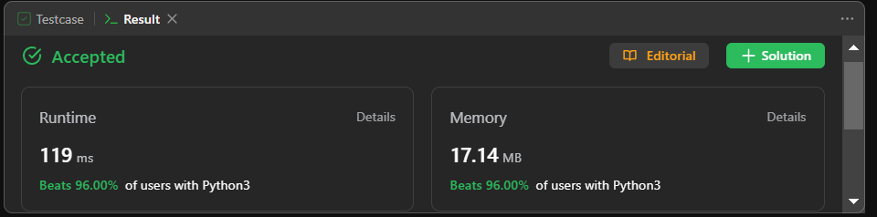

# Easy Solution || Beginner Friendly || Line By Line Explanation || Beats 95%+ || Python || Java || C+

**Author:** vaish_1929
**Votes:** 29
**Link:** [https://leetcode.com/problems/shortest-path-visiting-all-nodes/solutions/4054619/](https://leetcode.com/problems/shortest-path-visiting-all-nodes/solutions/4054619/)

---

# BEATS


# Intuition
The problem can be approached using Breadth-First Search (BFS) to explore different paths in the graph. The key insight is to use a bitmask to keep track of which nodes have been visited in a path. The goal is to find the shortest path that visits all nodes.
<!-- Describe your first thoughts on how to solve this problem. -->
# PLEASE UPVOTE IF U LIKE!!!
# RUBY CODE BEATS 100%
# Approach
Approach:

1. Calculate the number of vertices in the graph (V).

2. Initialize a deque (double-ended queue) for BFS, initially visiting all vertices one by one. Each element in the deque is a tuple (u, bit_mask), where u is the current node, and bit_mask is a bitmask representing visited nodes.

3. Calculate a bitmask where all vertices are visited (all_visited).

4. Initialize a 2D array (visited) to track visited nodes. This array has dimensions (V x all_visited + 1), where each cell (u, bit_mask) is initially set to False.

5. Mark the initial states of the BFS by setting corresponding cells in the visited array to True. Loop through all vertices (u) and set visited[u][1 << u] to True.

6. Initialize the shortest path length (path_length) to 0.

7. Start a BFS loop while the deque (curr_level) is not empty.

   - For each level of BFS, process nodes at that level:
   
     - Dequeue the current node (u) and its bitmask (bit_mask).
     
     - Check if all nodes are visited in this BFS level by comparing bit_mask to all_visited. If they match, return the current path_length as the shortest path.
     
     - Iterate through neighbors of the current node (u) in the graph:
     
       - Calculate the bitmask (next_bit_mask) after moving from u to v (a neighbor).
       
       - If v with the next bitmask has already been visited, skip to the next neighbor.
       
       - If all nodes are visited with the next bitmask (next_bit_mask equals all_visited), return path_length + 1 as the shortest path length.
       
       - Enqueue the neighbor v with the next bitmask for further exploration in the next BFS level.
       
       - Mark v as visited with the next bitmask (set visited[v][next_bit_mask] to True).
       
     - Decrement the counter (n) for the current BFS level.
     
   - Increment the path length (path_length) for the next level of BFS.

8. If no valid path is found after exploring all possibilities, return -1 as there is no path that visits all nodes.

This approach effectively finds the shortest path that visits all nodes in the graph using BFS and bitmask-based node tracking.

<!-- Describe your approach to solving the problem. -->

# Complexity
- Time complexity: The algorithm uses BFS to explore the graph, so the time complexity is $$O(V * 2^V)$$, where V is the number of vertices in the graph.
- Space complexity: The space complexity is $$O(V * 2^V)$$ as we store visited states in the 2D array and use a deque for BFS.


# Code
# Python
```
from collections import deque

class Solution:
    def shortestPathLength(self, graph: List[List[int]]) -> int:
        # Calculate the number of vertices in the graph.
        V = len(graph)
        
        # Initialize a deque for BFS, initially visiting all vertices one by one.
        curr_level = deque([(u, 1 << u) for u in range(V)])  # BFS Queue
        
        # Calculate a bitmask where all vertices are visited.
        all_visited = (1 << V) - 1  # Bitmask for when all vertices are visited
        
        # Initialize a 2D array to track visited nodes.
        visited = [[False for bit_mask in range(0, all_visited + 1)] for _ in range(V)]
        
        # Mark the initial states of the BFS by setting corresponding cells in the visited array to True.
        for u in range(V):
            visited[u][1 << u] = True
            
        # Initialize the shortest path length.
        path_length = 0
        
        # Start a BFS loop.
        while curr_level:
            n = len(curr_level)
            while n:
                # Dequeue the current node and its bitmask.
                u, bit_mask = curr_level.popleft()
                
                # Check if all nodes are visited in this BFS level.
                if bit_mask == all_visited:
                    return path_length 
                
                # Iterate through neighbors of the current node.
                for v in graph[u]:
                    # Calculate the bitmask after moving from u to v.
                    next_bit_mask = bit_mask | (1 << v)
                    
                    # If v with the next bitmask has already been visited, skip to the next neighbor.
                    if visited[v][next_bit_mask]:
                        continue 
                    
                    # If all nodes are visited with the next bitmask, return the shortest path length.
                    if next_bit_mask == all_visited: 
                        return path_length + 1
                    
                    # Enqueue the neighbor v with the next bitmask for further exploration.
                    curr_level.append((v, next_bit_mask))
                    
                    # Mark v as visited with the next bitmask.
                    visited[v][next_bit_mask] = True 
                
                n -= 1
            
            # Increment the path length for the next level of BFS.
            path_length += 1
        
        # If no valid path is found, return -1.
        return -1


```
# Java
```
import java.util.*;

public class Solution {
    public int shortestPathLength(int[][] graph) {
        int V = graph.length;
        Queue<int[]> currLevel = new LinkedList<>();
        for (int u = 0; u < V; u++) {
            currLevel.offer(new int[]{u, 1 << u});
        }
        
        int allVisited = (1 << V) - 1;
        boolean[][] visited = new boolean[V][allVisited + 1];
        for (int u = 0; u < V; u++) {
            visited[u][1 << u] = true;
        }
        
        int pathLength = 0;
        
        while (!currLevel.isEmpty()) {
            int n = currLevel.size();
            while (n > 0) {
                int[] node = currLevel.poll();
                int u = node[0];
                int bitMask = node[1];
                
                if (bitMask == allVisited) {
                    return pathLength;
                }
                
                for (int v : graph[u]) {
                    int nextBitMask = bitMask | (1 << v);
                    
                    if (visited[v][nextBitMask]) {
                        continue;
                    }
                    
                    if (nextBitMask == allVisited) {
                        return pathLength + 1;
                    }
                    
                    currLevel.offer(new int[]{v, nextBitMask});
                    visited[v][nextBitMask] = true;
                }
                
                n--;
            }
            
            pathLength++;
        }
        
        return -1;
    }
}

```
# C++
```

#include <vector>
#include <queue>
using namespace std;

class Solution {
public:
    int shortestPathLength(vector<vector<int>>& graph) {
        int V = graph.size();
        queue<pair<int, int>> currLevel;
        for (int u = 0; u < V; u++) {
            currLevel.push({u, 1 << u});
        }
        
        int allVisited = (1 << V) - 1;
        vector<vector<bool>> visited(V, vector<bool>(allVisited + 1, false));
        for (int u = 0; u < V; u++) {
            visited[u][1 << u] = true;
        }
        
        int pathLength = 0;
        
        while (!currLevel.empty()) {
            int n = currLevel.size();
            while (n > 0) {
                pair<int, int> node = currLevel.front();
                currLevel.pop();
                int u = node.first;
                int bitMask = node.second;
                
                if (bitMask == allVisited) {
                    return pathLength;
                }
                
                for (int v : graph[u]) {
                    int nextBitMask = bitMask | (1 << v);
                    
                    if (visited[v][nextBitMask]) {
                        continue;
                    }
                    
                    if (nextBitMask == allVisited) {
                        return pathLength + 1;
                    }
                    
                    currLevel.push({v, nextBitMask});
                    visited[v][nextBitMask] = true;
                }
                
                n--;
            }
            
            pathLength++;
        }
        
        return -1;
    }
};

```
# Ruby
```
# Define the method `shortest_path_length` that takes a 2D array `graph`.
def shortest_path_length(graph)
  v = graph.length  # Calculate the number of vertices in the graph.
  curr_level = []   # Initialize an array for BFS.

  # Initialize the BFS queue, visiting all vertices one by one.
  (0...v).each do |u|
    curr_level << [u, 1 << u]
  end

  all_visited = (1 << v) - 1  # Calculate a bitmask where all vertices are visited.
  visited = Array.new(v) { Array.new(all_visited + 1, false) }  # Initialize a 2D array to track visited nodes.

  # Mark the initial states of the BFS by setting corresponding cells in the visited array to `true`.
  (0...v).each do |u|
    visited[u][1 << u] = true
  end

  path_length = 0  # Initialize the shortest path length.

  # Start the BFS loop.
  until curr_level.empty?
    n = curr_level.length
    while n.positive?
      u, bit_mask = curr_level.shift  # Dequeue the current node and its bitmask.

      return path_length if bit_mask == all_visited  # Check if all nodes are visited.

      # Iterate through neighbors of the current node.
      graph[u].each do |v|
        next_bit_mask = bit_mask | (1 << v)  # Calculate the bitmask after moving from `u` to `v`.

        next if visited[v][next_bit_mask]  # Skip if `v` with the next bitmask has already been visited.

        return path_length + 1 if next_bit_mask == all_visited  # If all nodes are visited, return the shortest path length.

        curr_level << [v, next_bit_mask]  # Enqueue the neighbor `v` with the next bitmask for further exploration.
        visited[v][next_bit_mask] = true  # Mark `v` as visited with the next bitmask.
      end

      n -= 1
    end

    path_length += 1  # Increment the path length for the next level of BFS.
  end

  -1  # If no valid path is found, return -1.
end
```
# JavaScript
```
/**
 * @param {number[][]} graph
 * @return {number}
 */
var shortestPathLength = function(graph) {
    const V = graph.length;
    const currLevel = [];
    
    // Initialize the visited array.
    const allVisited = (1 << V) - 1;
    const visited = new Array(V).fill(null).map(() => new Array(allVisited + 1).fill(false));
    
    // Initialize the queue with initial states.
    for (let u = 0; u < V; u++) {
        currLevel.push([u, 1 << u]);
        visited[u][1 << u] = true;
    }
    
    let pathLength = 0;
    
    while (currLevel.length > 0) {
        let n = currLevel.length;
        
        while (n > 0) {
            const [u, bitMask] = currLevel.shift();
            
            if (bitMask === allVisited) {
                return pathLength;
            }
            
            for (const v of graph[u]) {
                const nextBitMask = bitMask | (1 << v);
                
                if (visited[v][nextBitMask]) {
                    continue;
                }
                
                if (nextBitMask === allVisited) {
                    return pathLength + 1;
                }
                
                currLevel.push([v, nextBitMask]);
                visited[v][nextBitMask] = true;
            }
            
            n--;
        }
        
        pathLength++;
    }
    
    return -1;
};
```