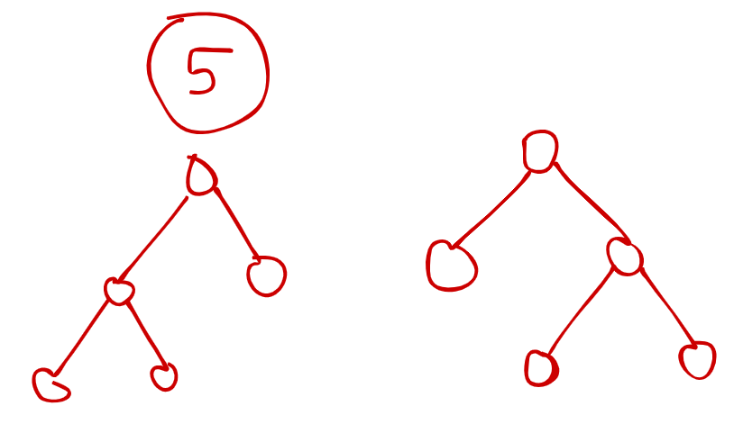

# ✔️ [Javascript + Cpp] Recursive | Memoized | Bottom-up | Explained 🚀🎉

**Author:** dhairyabahl
**Votes:** 14
**Link:** [https://leetcode.com/problems/all-possible-full-binary-trees/solutions/1466899/](https://leetcode.com/problems/all-possible-full-binary-trees/solutions/1466899/)

---

**Approach** : Approach of this question is quite simple. I am simply using a brute-force approach and in this we are simply creating all the possible trees recursively by trying out all the possible outcomes.

Most simple case to imagine the whole solution is to dry-run for ``` n=5```



Feel free to ask your doubts in comments ! 

### C++ Bottom-Up | Dynamic Programming

```
/**
 * Definition for a binary tree node.
 * struct TreeNode {
 *     int val;
 *     TreeNode *left;
 *     TreeNode *right;
 *     TreeNode() : val(0), left(nullptr), right(nullptr) {}
 *     TreeNode(int x) : val(x), left(nullptr), right(nullptr) {}
 *     TreeNode(int x, TreeNode *left, TreeNode *right) : val(x), left(left), right(right) {}
 * };
 */
class Solution {
public:
    vector<TreeNode*> allPossibleFBT(int n) {
        
        vector<vector<TreeNode*>> dp(n+1);
    
        dp[1].push_back(new TreeNode(0));

        for(int iterator = 3 ; iterator <= n ; iterator += 2) {

            for(int inner = 1 ; inner < iterator - 1 ; inner += 2 ) {

                vector<TreeNode*> left = dp[inner];
                vector<TreeNode*> right = dp[iterator - 1 - inner];
                
                for(auto currLeft : left )
                    for(auto currRight : right) {

                        TreeNode* node = new TreeNode(0,currLeft,currRight);
                        dp[iterator].push_back(node);

                    }

            }

        }

        return dp[n];
    }
};
```

### Javascript | Top-Down | Memoization

```
/**
 * Definition for a binary tree node.
 * function TreeNode(val, left, right) {
 *     this.val = (val===undefined ? 0 : val)
 *     this.left = (left===undefined ? null : left)
 *     this.right = (right===undefined ? null : right)
 * }
 */
/**
 * @param {number} n
 * @return {TreeNode[]}
 */

var solve = function(n,dp) {
    
    if(n % 2 === 0) return dp[n] = []
    
    if(dp[n] !== -1) return dp[n]
    
    if(n === 1) return dp[n] = [new TreeNode(0)]
    
    let ans = []
    
    n = n - 1
    
    for(let ctr = 1 ; ctr < n ; ctr ++) {
        
        let left = solve(ctr,dp)
        let right= solve(n-ctr,dp)
        
        for(let row = 0 ; row < left.length ; row ++)
            for(let col = 0 ; col < right.length ; col ++) {
                
                const node = new TreeNode(0)
                
                node.left = left[row]
                node.right= right[col]
                
                ans.push(node)
                
            }
    }
    
    return dp[n] = ans
    
}

var allPossibleFBT = function(n) {
    let dp = new Array(n+1).fill(-1)
    return solve(n,dp);
};
```