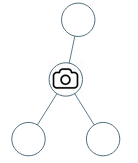

# [968. Binary Tree Cameras](https://leetcode.com/problems/binary-tree-cameras/)

| Category | Difficulty | Likes | Dislikes |
| :------: | :--------: | :---: | :------: |
| Algorithms | Hard | 5606 | 88 |

**Tags:** [`dynamic-programming`](https://leetcode.com/tag/dynamic-programming), [`tree`](https://leetcode.com/tag/tree), [`depth-first-search`](https://leetcode.com/tag/depth-first-search), [`binary-tree`](https://leetcode.com/tag/binary-tree)

**Companies:** `de-shaw`, `amazon`, `bloomberg`, `goldman-sachs`, `facebook`, `microsoft`, `dp-world`, `oracle`, `ebay`, `adobe`, `zeta`

## Description

You are given the `root` of a binary tree. We install cameras on the tree nodes where each camera at a node can monitor its parent, itself, and its immediate children.

Return *the minimum number of cameras needed to monitor all nodes of the tree*.

 

**Example 1:**


```

Input: root = [0,0,null,0,0]
Output: 1
Explanation: One camera is enough to monitor all nodes if placed as shown.

```

**Example 2:**


```

Input: root = [0,0,null,0,null,0,null,null,0]
Output: 2
Explanation: At least two cameras are needed to monitor all nodes of the tree. The above image shows one of the valid configurations of camera placement.

```

 

**Constraints:**

	- The number of nodes in the tree is in the range `[1, 1000]`.

	- `Node.val == 0`

---

**Links:** [Submissions](https://leetcode.com/problems/binary-tree-cameras/) | [Solutions](https://leetcode.com/problems/binary-tree-cameras/)
