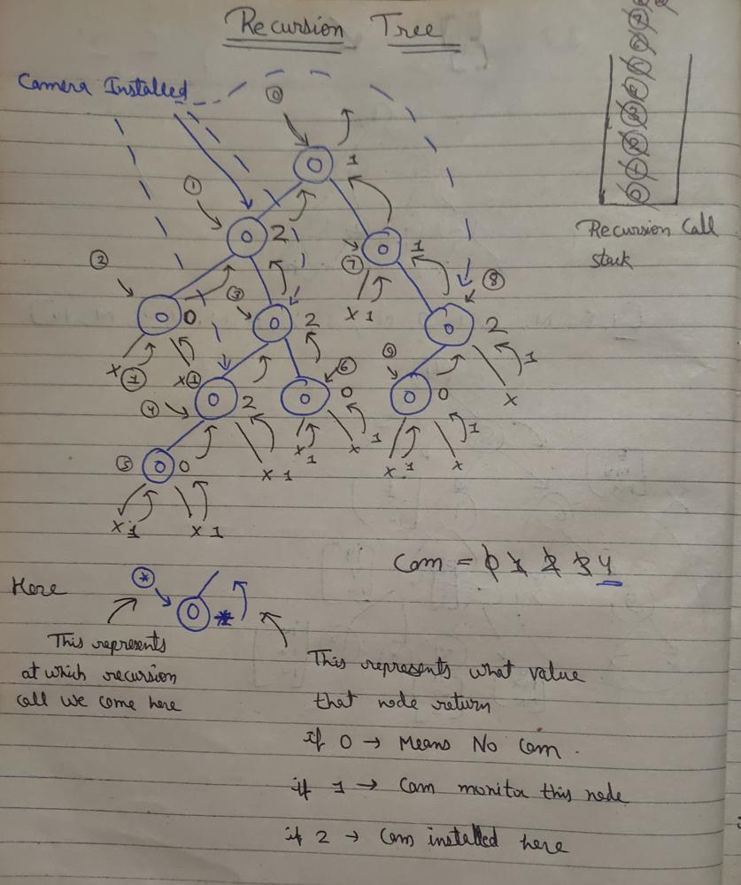

# ✅C++ | ✅Use DFS | ✅Simple and Efficient Solution | 🗓️ DLC June, Day 17

**Author:** Yash2arma
**Votes:** 31
**Link:** [https://leetcode.com/problems/binary-tree-cameras/solutions/2161571/](https://leetcode.com/problems/binary-tree-cameras/solutions/2161571/)

---

**Approach:** We start installing cameras from the bottom and go back to the root node of the tree. Heren, we are going to use couple of variables 0, 1, 2 on nodes
where:
0 -> This node needs camera to be installed (0 Cam monitor it)
1 -> This node doesn't want camera (1 Cam monitor it)
2 -> camera is already installed here (Cam fix here which monitor parent node and child nodes)

The intuition is we will reach to the leaf nodes of the tree and start installing camera to the parent of the leaf node so that it can cover max 2 leaf nodes.*/

**Time Complexity: O(N) DFS traversal
Space Complexity: O(N) Auxiliary recursion stack space**
  
 **Code:**
```
class Solution {
public:
    int minCameraCover(TreeNode* root) 
    {
        int cam = 0;
        int miniCam = cover(root, cam);
        
        if(miniCam==0) //need to install a cam here
            cam++;
        
        return cam;
    }
    
    int cover(TreeNode* root, int &cam)
    {
        if(root==NULL) return 1; //This is not a node so it doesn't need a cam
        
        //we go at the bottom of the tree i.e. at leaf nodes
        int left = cover(root->left, cam); 
        int right = cover(root->right, cam);
        
        //While returning to the top we check which node needs cam
        if(left==0 || right==0) //Node's child want cam so we install cam here 
        {
            cam++;
            return 2;
        }
        
        else if(left==2 || right==2) //Cam installed at node's child, so node doesn't need a cam
            return 1;
        
        //for (left==1 || right==1) condition, children doesn't need a cam but parents have
        return 0; 
    }
        
};
```
**Recursion Tree:** For better understanding



**Please upvote if it helps** \uD83D\uDE0A\u2764\uFE0F