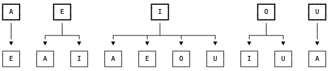

# C++ Clean code Well Explained

**Author:** DarshanAgarwal95
**Votes:** 208
**Link:** [https://leetcode.com/problems/count-vowels-permutation/solutions/2390275/](https://leetcode.com/problems/count-vowels-permutation/solutions/2390275/)

---

Each vowel allows some number of subsequent characters. These transitions are like a tree. This problem is asking, "what's the width of the tree with height n?"




My solution keeps track of the number of each vowel at a level in this tree. To calculate say 'A', we calculate how many nodes in the previous level produce 'A'. This is the number of 'E', 'I', and 'U' nodes.

```
class Solution {
public:
    int countVowelPermutation(int n) {
         long a = 1, e = 1, i = 1, o = 1, u = 1, mod = pow(10, 9)+7;
        long a2, e2, i2, o2, u2; 
        
        for (int j = 2; j <= n; j++) {
            a2 = (e + i + u) % mod;
            e2 = (a + i) % mod;
            i2 = (e + o) % mod;
            o2 = i;
            u2 = (o + i) % mod;
            
            a = a2, e = e2, i = i2, o = o2, u = u2;
        }
        return (a + e + i + o + u) % mod;
    }
};
```

**IF YOU LIKE MY SOLUTION THEN JUST PLEASE PLEASE UPVOTE IT**