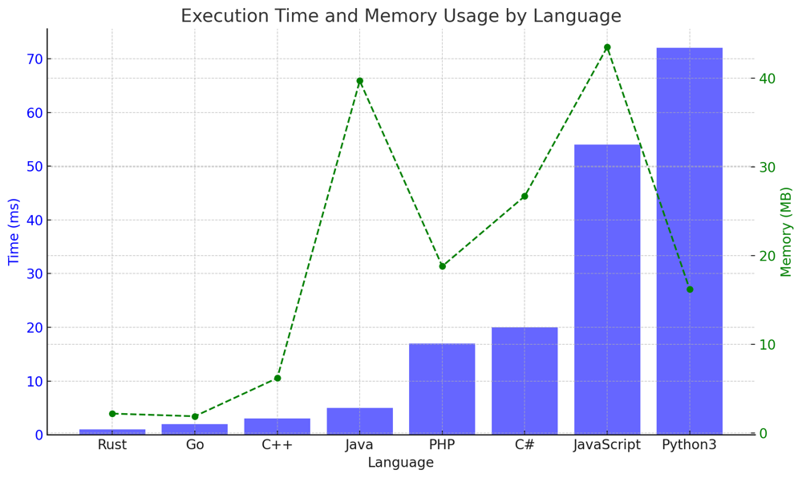

# ✅ 98.55% DP Transition Matrix

**Author:** vanAmsen
**Votes:** 90
**Link:** [https://leetcode.com/problems/count-vowels-permutation/solutions/4216117/](https://leetcode.com/problems/count-vowels-permutation/solutions/4216117/)

---

# Intuition

The essence of this problem lies in the transitions between vowels and how they form sequences. Given the constraints, not every vowel can follow every other vowel. This forms a sort of directed graph where each vowel points to the vowels it can be followed by. As we're tasked with counting the number of valid sequences, our intuition guides us to explore paths in this graph, starting from each vowel and expanding based on the transitions allowed.

# Live Coding & Logic
https://youtu.be/RmGsEWLpAXs?si=XZ0NY_M142ufcerB

# Logic Behind the Solution

1. **Understanding Transitions**: The entire problem revolves around transitions. For a given vowel, the next character in the sequence can only be certain vowels. For instance, the vowel 'a' can only be followed by 'e'. This forms the backbone of our dynamic programming approach. By understanding these transitions, we can determine the number of sequences of length $ n $ ending in a particular vowel.

2. **Recursive Nature of Problem**: If we want to find the number of sequences of length $ n $ ending in vowel 'a', we don't need to consider all possible sequences of length $ n-1 $. Instead, we only need to know the number of sequences of length $ n-1 $ ending in vowels that can precede 'a'. This recursive nature, combined with transitions, is what makes dynamic programming apt for this problem.

3. **State Maintenance**: At each step (or length), we maintain the counts of sequences ending in each vowel. This forms the state of our dynamic programming solution. As we proceed, we update these counts based on the previous state and the transitions allowed.

4. **Linear Time Complexity**: By maintaining state and ensuring that we only consider valid transitions, we ensure that our solution runs in linear time. At each step, we're essentially doing constant work, updating counts for 5 vowels.

# Approach

1. **Transition Matrix**: First, we need to understand the transition for each vowel. We can build this based on the rules provided:

    - 'a' can only be followed by 'e'
    - 'e' can be followed by 'a' or 'i'
    - 'i' cannot be followed by another 'i'
    - 'o' can be followed by 'i' or 'u'
    - 'u' can only be followed by 'a'

2. **Dynamic Programming**: We maintain a dynamic programming array for each vowel which will store the count of strings ending with that vowel for a particular length.

    - For $n = 1$, all vowels have a count of 1.
    - For each subsequent length, the count for each vowel is updated based on the previous counts of the other vowels.
    - For example, the count of strings of length $i$ ending with 'a' will be equal to the count of strings of length $i-1$ ending with 'e', because 'a' can only be followed by 'e'.

3. **Modulo Operation**: Since the answer can be large, we use modulo $10^9 + 7$ at each step to keep the numbers manageable.

4. **Final Answer**: The final answer will be the sum of counts of all vowels for length $n$.

# Complexity

- **Time complexity**: $O(n)$
    - We iterate through the numbers from 1 to $n$ once, updating the count for each vowel in constant time.

- **Space complexity**: $O(1)$
    - We are using a fixed amount of space regardless of the value of $n$ since we only maintain counts for the 5 vowels.

# Code

``` Python []
class Solution:
    def countVowelPermutation(self, n: int) -> int:
        MOD = 10**9 + 7
        
        a, e, i, o, u = 1, 1, 1, 1, 1
        
        for _ in range(1, n):
            a_next = e
            e_next = (a + i) % MOD
            i_next = (a + e + o + u) % MOD
            o_next = (i + u) % MOD
            u_next = a
            
            a, e, i, o, u = a_next, e_next, i_next, o_next, u_next
        
        return (a + e + i + o + u) % MOD
```
``` Go []
func countVowelPermutation(n int) int {
    const MOD = 1e9 + 7;
    
    a, e, i, o, u := 1, 1, 1, 1, 1
    
    for j := 1; j < n; j++ {
        a_next := e
        e_next := (a + i) % MOD
        i_next := (a + e + o + u) % MOD
        o_next := (i + u) % MOD
        u_next := a
        
        a, e, i, o, u = a_next, e_next, i_next, o_next, u_next
    }
    
    return (a + e + i + o + u) % MOD
}
```
``` Rust []
impl Solution {
    pub fn count_vowel_permutation(n: i32) -> i32 {
        const MOD: i64 = 1e9 as i64 + 7;
        
        let mut a = 1;
        let mut e = 1;
        let mut i = 1;
        let mut o = 1;
        let mut u = 1;
        
        for _ in 1..n {
            let a_next = e;
            let e_next = (a + i) % MOD;
            let i_next = (a + e + o + u) % MOD;
            let o_next = (i + u) % MOD;
            let u_next = a;
            
            a = a_next;
            e = e_next;
            i = i_next;
            o = o_next;
            u = u_next;
        }
        
        ((a + e + i + o + u) % MOD) as i32
    }
}
```
``` C++ []
class Solution {
public:
    int countVowelPermutation(int n) {
        const int MOD = 1e9 + 7;
        
        long long a = 1, e = 1, i = 1, o = 1, u = 1;
        
        for (int j = 1; j < n; j++) {
            long long a_next = e;
            long long e_next = (a + i) % MOD;
            long long i_next = (a + e + o + u) % MOD;
            long long o_next = (i + u) % MOD;
            long long u_next = a;
            
            a = a_next, e = e_next, i = i_next, o = o_next, u = u_next;
        }
        
        return (a + e + i + o + u) % MOD;
    }
};
```
``` Java []
public class Solution {
    public int countVowelPermutation(int n) {
        final int MOD = 1000000007;
        
        long a = 1, e = 1, i = 1, o = 1, u = 1;
        
        for (int j = 1; j < n; j++) {
            long a_next = e;
            long e_next = (a + i) % MOD;
            long i_next = (a + e + o + u) % MOD;
            long o_next = (i + u) % MOD;
            long u_next = a;
            
            a = a_next;
            e = e_next;
            i = i_next;
            o = o_next;
            u = u_next;
        }
        
        return (int)((a + e + i + o + u) % MOD);
    }
}
```
``` PHP []
class Solution {
    function countVowelPermutation($n) {
        $MOD = 1000000007;
        
        $a = $e = $i = $o = $u = 1;
        
        for ($j = 1; $j < $n; $j++) {
            $a_next = $e;
            $e_next = ($a + $i) % $MOD;
            $i_next = ($a + $e + $o + $u) % $MOD;
            $o_next = ($i + $u) % $MOD;
            $u_next = $a;
            
            $a = $a_next;
            $e = $e_next;
            $i = $i_next;
            $o = $o_next;
            $u = $u_next;
        }
        
        return ($a + $e + $i + $o + $u) % $MOD;
    }
}
```
``` C# []
public class Solution {
    public int CountVowelPermutation(int n) {
        const int MOD = 1000000007;
        
        long a = 1, e = 1, i = 1, o = 1, u = 1;
        
        for (int j = 1; j < n; j++) {
            long a_next = e;
            long e_next = (a + i) % MOD;
            long i_next = (a + e + o + u) % MOD;
            long o_next = (i + u) % MOD;
            long u_next = a;
            
            a = a_next;
            e = e_next;
            i = i_next;
            o = o_next;
            u = u_next;
        }
        
        return (int)((a + e + i + o + u) % MOD);
    }
}
```
```JavaScript []
var countVowelPermutation = function(n) {
        const MOD = 1e9 + 7;
        
        let a = 1, e = 1, i = 1, o = 1, u = 1;
        
        for (let j = 1; j < n; j++) {
            let a_next = e;
            let e_next = (a + i) % MOD;
            let i_next = (a + e + o + u) % MOD;
            let o_next = (i + u) % MOD;
            let u_next = a;
            
            a = a_next, e = e_next, i = i_next, o = o_next, u = u_next;
        }
        
        return (a + e + i + o + u) % MOD;
    }
```

# Performance
| Language   | Time (ms) | Memory (MB) |
|------------|-----------|-------------|
| Rust       | 1 ms      | 2.2 MB      |
| Go         | 2 ms      | 1.9 MB      |
| C++        | 3 ms      | 6.2 MB      |
| Java       | 5 ms      | 39.7 MB     |
| PHP        | 17 ms     | 18.8 MB     |
| C#         | 20 ms     | 26.7 MB     |
| JavaScript | 54 ms     | 43.5 MB     |
| Python3    | 72 ms     | 16.2 MB     |



# Why It Works ?

The given solution works primarily because of the transition rules provided and the state maintenance approach. By ensuring we only ever consider valid transitions and by utilizing previous results (counts for sequences of length $ n-1 $), we efficiently determine the counts for sequences of length $ n $. 

# Why It's Optimal ?

The solution leverages the power of dynamic programming. Instead of brute-forcing all possible sequences (which would be exponential in nature), the solution smartly reuses previously computed results, ensuring that the solution is linear in terms of time complexity. Additionally, since we're only maintaining counts for 5 vowels regardless of the length $ n $, our space complexity remains constant. This combination of linear time and constant space is what makes the solution optimal.

# What We Have Learned ?

This problem teaches us the importance of recognizing patterns and formulating transition states in dynamic programming problems. By understanding the possible transitions for each vowel, we can optimize the solution to compute the counts in linear time. This is a classic example of how dynamic programming can turn a potentially exponential problem into a linear one.
