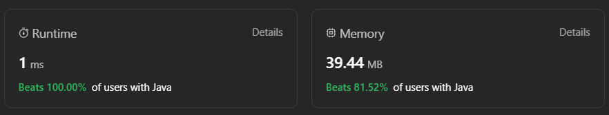
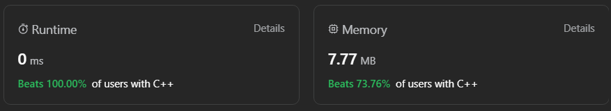
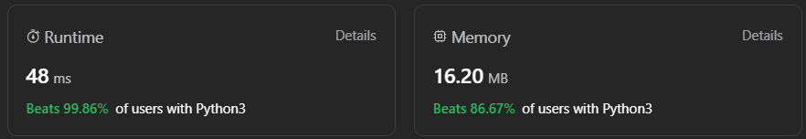

# 🔥99% Beats DP & 🔥100% Beats🔥 Matrix Exponentiation | 🔥 Explained Intuition & Approach |

**Author:** Akhilesh21
**Votes:** 45
**Link:** [https://leetcode.com/problems/count-vowels-permutation/solutions/4216275/](https://leetcode.com/problems/count-vowels-permutation/solutions/4216275/)

---

# 1st Method : Bottom-Up Dynamic Programming \uD83D\uDD25
## Intuition \uD83D\uDE80:
The problem asks you to count the number of valid strings of length `n` using the given rules for vowel transitions. You can think of this as a dynamic programming problem where you calculate the number of valid strings of different lengths and build up to the desired length `n`. The approach involves using a bottom-up dynamic programming approach to compute the counts efficiently.

## Approach \uD83D\uDE80:
1. Define a constant `MOD` to handle modular arithmetic to avoid integer overflow.

2. Initialize five variables: `countA`, `countE`, `countI`, `countO`, and `countU`, each representing the count of valid strings of length 1 ending with the respective vowel ('a', 'e', 'i', 'o', 'u').

3. Use a for loop to iterate from `length = 1` to `n - 1` because we already have the counts for length 1, and we want to calculate the counts for lengths 2 to `n`.

4. Inside the loop, calculate the counts for each vowel for the next length based on the counts for the current length. The transitions are based on the given rules:
   - `countA` for the next length is the count of strings ending with 'e'.
   - `countE` for the next length is the count of strings ending with 'a' or 'i'.
   - `countI` for the next length is the count of strings ending with 'a', 'e', 'o', or 'u'.
   - `countO` for the next length is the count of strings ending with 'i' or 'u'.
   - `countU` for the next length is the count of strings ending with 'a'.

5. Update the variables `countA`, `countE`, `countI`, `countO`, and `countU` with the newly calculated counts for the next length.

6. After the loop, the variables contain the counts of valid strings of length `n` ending with each vowel.

7. Calculate the total count of valid strings for length `n` by summing up the counts for all vowels and take the result modulo `MOD`.

8. Return the total count as an integer.

The approach uses dynamic programming to efficiently compute the counts for different string lengths, following the rules for vowel transitions, and calculates the final result for length `n`.

## Complexity \uD83D\uDE81
### \uD83C\uDFF9Time complexity: O(n)
1. The loop from `length = 1` to `n - 1` iterates `n` times.
2. Inside the loop, there are constant time calculations for each vowel transition.
3. Therefore, the time complexity is O(n).

### \uD83C\uDFF9Space complexity: O(1)
1. The space complexity is determined by the variables used to store counts for each vowel. There are five variables (`countA`, `countE`, `countI`, `countO`, and `countU`) that store the counts for each iteration of the loop.
2. Since the loop iterates up to `n - 1`, the space complexity is O(1), which is constant, because the number of variables used does not depend on the input size.

So, the time complexity is O(n), and the space complexity is O(1) for the given code.
## \u2712\uFE0FCode
``` Java []
public class Solution {
    public int countVowelPermutation(int n) {
        final int MOD = 1000000007;
        
        long countA = 1, countE = 1, countI = 1, countO = 1, countU = 1;
        
        for (int length = 1; length < n; length++) {
            // Calculate the next counts for each vowel based on the previous counts
            long nextCountA = countE;
            long nextCountE = (countA + countI) % MOD;
            long nextCountI = (countA + countE + countO + countU) % MOD;
            long nextCountO = (countI + countU) % MOD;
            long nextCountU = countA;
            
            // Update the counts with the newly calculated values for the next length
            countA = nextCountA;
            countE = nextCountE;
            countI = nextCountI;
            countO = nextCountO;
            countU = nextCountU;
        }
        
        // Calculate the total count of valid strings for length n
        long totalCount = (countA + countE + countI + countO + countU) % MOD;
        
        return (int) totalCount;
    }
}

```
``` C++ []
class Solution {
public:
    int countVowelPermutation(int n) {
        const int MOD = 1000000007;

        // Initialize counts for each vowel for length 1
        long countA = 1, countE = 1, countI = 1, countO = 1, countU = 1;

        // Iterate from length 1 to n - 1
        for (int length = 1; length < n; length++) {
            // Calculate the next counts for each vowel based on the previous counts
            long nextCountA = countE;
            long nextCountE = (countA + countI) % MOD;
            long nextCountI = (countA + countE + countO + countU) % MOD;
            long nextCountO = (countI + countU) % MOD;
            long nextCountU = countA;

            // Update the counts with the newly calculated values for the next length
            countA = nextCountA;
            countE = nextCountE;
            countI = nextCountI;
            countO = nextCountO;
            countU = nextCountU;
        }

        // Calculate the total count of valid strings for length n
        long totalCount = (countA + countE + countI + countO + countU) % MOD;

        return static_cast<int>(totalCount);
    }
};
```
``` Python []
class Solution:
    def countVowelPermutation(self, n: int) -> int:
        MOD = 1000000007

        # Initialize counts for each vowel for length 1
        countA = 1
        countE = 1
        countI = 1
        countO = 1
        countU = 1

        # Iterate from length 1 to n - 1
        for length in range(1, n):
            # Calculate the next counts for each vowel based on the previous counts
            nextCountA = countE
            nextCountE = (countA + countI) % MOD
            nextCountI = (countA + countE + countO + countU) % MOD
            nextCountO = (countI + countU) % MOD
            nextCountU = countA

            # Update the counts with the newly calculated values for the next length
            countA = nextCountA
            countE = nextCountE
            countI = nextCountI
            countO = nextCountO
            countU = nextCountU

        # Calculate the total count of valid strings for length n
        totalCount = (countA + countE + countI + countO + countU) % MOD

        return int(totalCount)
```
``` JavaScript []
var countVowelPermutation = function(n) {
    const MOD = 1000000007;
    
    let countA = 1, countE = 1, countI = 1, countO = 1, countU = 1;
    
    for (let length = 1; length < n; length++) {
        // Calculate the next counts for each vowel based on the previous counts
        let nextCountA = countE;
        let nextCountE = (countA + countI) % MOD;
        let nextCountI = (countA + countE + countO + countU) % MOD;
        let nextCountO = (countI + countU) % MOD;
        let nextCountU = countA;
        
        // Update the counts with the newly calculated values for the next length
        countA = nextCountA;
        countE = nextCountE;
        countI = nextCountI;
        countO = nextCountO;
        countU = nextCountU;
    }
    
    // Calculate the total count of valid strings for length n
    let totalCount = (countA + countE + countI + countO + countU) % MOD;
    
    return totalCount;
};
```
``` C# []
public class Solution {
    public int CountVowelPermutation(int n) {
        const int MOD = 1000000007;
        
        long countA = 1, countE = 1, countI = 1, countO = 1, countU = 1;
        
        for (int length = 1; length < n; length++) {
            // Calculate the next counts for each vowel based on the previous counts
            long nextCountA = countE;
            long nextCountE = (countA + countI) % MOD;
            long nextCountI = (countA + countE + countO + countU) % MOD;
            long nextCountO = (countI + countU) % MOD;
            long nextCountU = countA;
            
            // Update the counts with the newly calculated values for the next length
            countA = nextCountA;
            countE = nextCountE;
            countI = nextCountI;
            countO = nextCountO;
            countU = nextCountU;
        }
        
        // Calculate the total count of valid strings for length n
        long totalCount = (countA + countE + countI + countO + countU) % MOD;
        
        return (int)totalCount;
    }
}
```
``` PHP []
class Solution {
    function countVowelPermutation($n) {
        // Define the modulo constant
        $MOD = 1000000007;

        // Initialize counts for vowels 'a', 'e', 'i', 'o', and 'u'
        $countA = 1;
        $countE = 1;
        $countI = 1;
        $countO = 1;
        $countU = 1;

        // Iterate from length 1 to n - 1
        for ($length = 1; $length < $n; $length++) {
            // Calculate the next counts for each vowel based on the previous counts
            $nextCountA = $countE;
            $nextCountE = ($countA + $countI) % $MOD;
            $nextCountI = ($countA + $countE + $countO + $countU) % $MOD;
            $nextCountO = ($countI + $countU) % $MOD;
            $nextCountU = $countA;

            // Update the counts with the newly calculated values for the next length
            $countA = $nextCountA;
            $countE = $nextCountE;
            $countI = $nextCountI;
            $countO = $nextCountO;
            $countU = $nextCountU;
        }

        // Calculate the total count of valid strings for length n
        $totalCount = ($countA + $countE + $countI + $countO + $countU) % $MOD;

        return (int)$totalCount;
    }
}
```
``` Kotlin []
class Solution {
    fun countVowelPermutation(n: Int): Int {
        // Define the modulo constant
        val MOD = 1000000007

        // Initialize counts for vowels 'a', 'e', 'i', 'o', and 'u'
        var countA = 1L
        var countE = 1L
        var countI = 1L
        var countO = 1L
        var countU = 1L

        // Iterate from length 1 to n - 1
        for (length in 1 until n) {
            // Calculate the next counts for each vowel based on the previous counts
            val nextCountA = countE
            val nextCountE = (countA + countI) % MOD
            val nextCountI = (countA + countE + countO + countU) % MOD
            val nextCountO = (countI + countU) % MOD
            val nextCountU = countA

            // Update the counts with the newly calculated values for the next length
            countA = nextCountA
            countE = nextCountE
            countI = nextCountI
            countO = nextCountO
            countU = nextCountU
        }

        // Calculate the total count of valid strings for length n
        val totalCount = (countA + countE + countI + countO + countU) % MOD

        return totalCount.toInt()
    }
}
```


---

# 2nd Method : Matrix Exponentiation \uD83D\uDD25

## Intuition \uD83D\uDE80:
The problem asks us to count the number of valid strings of length `n` using lowercase vowels ('a', 'e', 'i', 'o', 'u') following specific rules. To solve this efficiently, the code employs a matrix exponentiation approach, which is a dynamic programming technique. The code uses matrices to represent the state transitions between vowels and computes the count of valid strings based on these transitions. The matrix exponentiation method optimizes this process by raising the transition matrix to the power of `n - 1` to calculate the count.

## Approach \uD83D\uDE80:

1. **Initialize the Count Matrix:** A 1x5 matrix `count` is initialized to represent the count of each vowel ('a', 'e', 'i', 'o', 'u') at the beginning. This matrix starts with all counts as 1.

2. **Transition Matrix 'base':** If `n` is greater than 1, a transition matrix `base` is defined. This matrix represents the valid transitions between vowels based on the problem rules. It's a 5x5 matrix where each element indicates whether a transition between two vowels is valid.

3. **Matrix Exponentiation:** The code uses a matrix exponentiation approach to calculate the transition matrix raised to the power of `n - 1`. The `matrixPow` function is a recursive function that optimizes matrix exponentiation by using divide-and-conquer to calculate the matrix raised to a power efficiently.

4. **Matrix Multiplication:** The `matrixMul` function is used for matrix multiplication. It multiplies two matrices and calculates the result with modulo M to avoid integer overflow.

5. **Final Count:** The code then multiplies the initial `count` matrix with the result of matrix exponentiation to get the final matrix `finalMatrix`, which represents the count of valid strings of length `n`. The final answer is obtained by summing up the values in the first row of `finalMatrix`.

6. **Modulo Operation:** To ensure the result does not exceed the modulo value `M`, the code takes the modulo of the result.

7. **Return Result:** The code returns the final result as an integer.

The approach uses matrix operations to efficiently compute the count of valid strings while following the given rules. It leverages dynamic programming and matrix exponentiation to optimize the computation, making it much faster than naive approaches.

## Complexity \uD83D\uDE81
### \uD83C\uDFF9Time Complexity: O(log(n) * k^3)
- `countVowelPermutation(int n)`: The main function iterates to calculate the final result, but the most time-consuming part is the matrix exponentiation and matrix multiplication.
  - Matrix Exponentiation (`matrixPow`) has a time complexity of O(log(n)).
  - Matrix Multiplication (`matrixMul`) has a time complexity of O(k^3), where k is the dimension of the matrices, in this case, k is 5 (for the 5 vowels). The matrix multiplication is called log(n) times in the exponentiation function.
- Overall, the time complexity is O(log(n) * k^3), where k is a constant (5 in this case).

### \uD83C\uDFF9Space Complexity: O(1)
- The space complexity is determined by the data structures used in the code:
  - `count` and `finalMatrix` are 2D arrays of size 1x5, which is constant.
  - The recursive function `matrixPow` creates several 2D arrays for intermediate calculations, but their combined space usage is also bounded by a constant.
  - `matrixMul` uses additional space for temporary arrays, but again, this space is bounded by a constant.
- Therefore, the space complexity is O(1), as the space usage does not depend on the input value `n`.






## Code \u2712\uFE0F
``` Java []
class Solution {
    private static final int M = 1_000_000_007;

    public int countVowelPermutation(int n) {
        // Initialize a count matrix with one row representing the counts of 'a', 'e', 'i', 'o', and 'u'.
        long[][] count = {{1, 1, 1, 1, 1}};
        long[][] finalMatrix;

        // If n is greater than 1, perform matrix operations to calculate the count.
        if (n > 1) {
            // Define the base transition matrix that represents the vowel transitions.
            long[][] base = {
                {0, 1, 1, 0, 1},
                {1, 0, 1, 0, 0},
                {0, 1, 0, 1, 0},
                {0, 0, 1, 0, 0},
                {0, 0, 1, 1, 0}
            };

            // Calculate the final matrix by raising the base matrix to the power (n - 1).
            finalMatrix = matrixMul(count, matrixPow(base, n - 1));
        } else {
            finalMatrix = count; // If n is 1, the result is the same as the initial count matrix.
        }

        // Calculate the result by summing up the values in the finalMatrix and taking the modulo M.
        long result = 0;
        for (long l : finalMatrix[0]) {
            result += l;
        }
        result %= M;
        return Math.toIntExact(result);
    }

    // Function to calculate the matrix raised to a power using a recursive approach.
    private long[][] matrixPow(long[][] base, int pow) {
        if (pow == 1) {
            return base;
        }
        if (pow == 2) {
            return matrixMul(base, base);
        }
        long[][] matrixPow = matrixPow(base, pow / 2);
        long[][] matrix = matrixMul(matrixPow, matrixPow);
        if (pow % 2 == 0) {
            return matrix;
        } else {
            return matrixMul(matrix, base);
        }
    }

    // Function to perform matrix multiplication.
    private long[][] matrixMul(long[][] a, long[][] b) {
        int ai = a.length;
        int bi = b.length;
        int bj = b[0].length;
        long[][] result = new long[ai][bj];
        for (int i = 0; i < ai; i++) {
            for (int j = 0; j < bj; j++) {
                long sum = 0;
                for (int k = 0; k < bi; k++) {
                    sum += a[i][k] * b[k][j];
                    sum %= M;
                }
                result[i][j] = sum;
            }
        }
        return result;
    }
}
```
``` C++ []
class Solution {
private:
    static const int M = 1'000'000'007;

public:
    int countVowelPermutation(int n) {
        // Initialize a count matrix with one row representing the counts of 'a', 'e', 'i', 'o', and 'u'.
        std::vector<std::vector<long>> count = {{1, 1, 1, 1, 1}};
        std::vector<std::vector<long>> finalMatrix;

        // If n is greater than 1, perform matrix operations to calculate the count.
        if (n > 1) {
            // Define the base transition matrix that represents the vowel transitions.
            std::vector<std::vector<long>> base = {
                {0, 1, 1, 0, 1},
                {1, 0, 1, 0, 0},
                {0, 1, 0, 1, 0},
                {0, 0, 1, 0, 0},
                {0, 0, 1, 1, 0}
            };

            // Calculate the final matrix by raising the base matrix to the power (n - 1).
            finalMatrix = matrixPow(base, n - 1);
            finalMatrix = matrixMul(count, finalMatrix);
        } else {
            finalMatrix = count; // If n is 1, the result is the same as the initial count matrix.
        }

        // Calculate the result by summing up the values in the finalMatrix and taking the modulo M.
        long result = 0;
        for (long l : finalMatrix[0]) {
            result += l;
        }
        result %= M;
        return static_cast<int>(result);
    }

private:
    // Function to calculate the matrix raised to a power using a recursive approach.
    std::vector<std::vector<long>> matrixPow(const std::vector<std::vector<long>>& base, int pow) {
        if (pow == 1) {
            return base;
        }
        if (pow == 2) {
            return matrixMul(base, base);
        }
        std::vector<std::vector<long>> matrixPowResult = matrixPow(base, pow / 2);
        std::vector<std::vector<long>> matrix = matrixMul(matrixPowResult, matrixPowResult);
        if (pow % 2 == 0) {
            return matrix;
        } else {
            return matrixMul(matrix, base);
        }
    }

    // Function to perform matrix multiplication.
    std::vector<std::vector<long>> matrixMul(const std::vector<std::vector<long>>& a, const std::vector<std::vector<long>>& b) {
        int ai = a.size();
        int bi = b.size();
        int bj = b[0].size();
        std::vector<std::vector<long>> result(ai, std::vector<long>(bj, 0));
        for (int i = 0; i < ai; i++) {
            for (int j = 0; j < bj; j++) {
                long sum = 0;
                for (int k = 0; k < bi; k++) {
                    sum += a[i][k] * b[k][j];
                    sum %= M;
                }
                result[i][j] = sum;
            }
        }
        return result;
    }
};

```
``` Python []
class Solution:
    M = 1_000_000_007

    def countVowelPermutation(self, n: int) -> int:
        # Initialize a count matrix with one row representing the counts of 'a', 'e', 'i', 'o', and 'u'.
        count = [[1, 1, 1, 1, 1]]
        finalMatrix = []

        # If n is greater than 1, perform matrix operations to calculate the count.
        if n > 1:
            # Define the base transition matrix that represents the vowel transitions.
            base = [
                [0, 1, 1, 0, 1],
                [1, 0, 1, 0, 0],
                [0, 1, 0, 1, 0],
                [0, 0, 1, 0, 0],
                [0, 0, 1, 1, 0]
            ]

            # Calculate the final matrix by raising the base matrix to the power (n - 1).
            finalMatrix = self.matrixMul(count, self.matrixPow(base, n - 1))
        else:
            finalMatrix = count  # If n is 1, the result is the same as the initial count matrix.

        # Calculate the result by summing up the values in the finalMatrix and taking the modulo M.
        result = 0
        for l in finalMatrix[0]:
            result += l
        result %= self.M
        return int(result)

    # Function to calculate the matrix raised to a power using a recursive approach.
    def matrixPow(self, base, pow):
        if pow == 1:
            return base
        if pow == 2:
            return self.matrixMul(base, base)
        matrixPow = self.matrixPow(base, pow // 2)
        matrix = self.matrixMul(matrixPow, matrixPow)
        if pow % 2 == 0:
            return matrix
        else:
            return self.matrixMul(matrix, base)

    # Function to perform matrix multiplication.
    def matrixMul(self, a, b):
        ai = len(a)
        bi = len(b)
        bj = len(b[0])
        result = [[0 for _ in range(bj)] for _ in range(ai)]
        for i in range(ai):
            for j in range(bj):
                sum = 0
                for k in range(bi):
                    sum += a[i][k] * b[k][j]
                    sum %= self.M
                result[i][j] = sum
        return result
```
``` JavaScript []
var countVowelPermutation = function(n) {
    const MOD = 1000000007;
    
    // Initialize a 2D DP array to store counts for each vowel ending at position i.
    // dp[i][j] represents the count of strings of length (i + 1) ending with vowel j.
    const dp = new Array(n).fill(0).map(() => new Array(5).fill(0));
    
    // Initialize the base case: strings of length 1 ending with each vowel are 1.
    for (let j = 0; j < 5; j++) {
        dp[0][j] = 1;
    }
    
    // Fill the DP table for strings of length 2 to n.
    for (let i = 1; i < n; i++) {
        dp[i][0] = (dp[i - 1][1] + dp[i - 1][2] + dp[i - 1][4]) % MOD; // 'a' can follow 'e', 'i', or 'u'
        dp[i][1] = (dp[i - 1][0] + dp[i - 1][2]) % MOD; // 'e' can follow 'a' or 'i'
        dp[i][2] = (dp[i - 1][1] + dp[i - 1][3]) % MOD; // 'i' can follow 'e' or 'o'
        dp[i][3] = dp[i - 1][2]; // 'o' can only follow 'i'
        dp[i][4] = (dp[i - 1][2] + dp[i - 1][3]) % MOD; // 'u' can follow 'i' or 'o'
    }
    
    // Calculate the sum of all counts for strings of length n ending with each vowel.
    let result = 0;
    for (let j = 0; j < 5; j++) {
        result = (result + dp[n - 1][j]) % MOD;
    }
    
    return result;
};

const n = 144;
console.log(countVowelPermutation(n)); // Output: 18208803
```
``` PHP []
time limit exceed
class Solution {
    const MOD = 1000000007;

    function countVowelPermutation($n) {
        // Initialize a count matrix with one row representing the counts of 'a', 'e', 'i', 'o', and 'u'.
        $count = array(array(1, 1, 1, 1, 1));
        $finalMatrix = array();

        // If n is greater than 1, perform matrix operations to calculate the count.
        if ($n > 1) {
            // Define the base transition matrix that represents the vowel transitions.
            $base = array(
                array(0, 1, 1, 0, 1),
                array(1, 0, 1, 0, 0),
                array(0, 1, 0, 1, 0),
                array(0, 0, 1, 0, 0),
                array(0, 0, 1, 1, 0)
            );

            // Calculate the final matrix by raising the base matrix to the power ($n - 1).
            $finalMatrix = $this->matrixMul($count, $this->matrixPow($base, $n - 1));
        } else {
            $finalMatrix = $count; // If n is 1, the result is the same as the initial count matrix.
        }

        // Calculate the result by summing up the values in the finalMatrix and taking the modulo MOD.
        $result = 0;
        foreach ($finalMatrix[0] as $value) {
            $result += $value;
            $result %= self::MOD;
        }
        return $result;
    }

    // Function to calculate the matrix raised to a power using a recursive approach.
    function matrixPow($base, $pow) {
        if ($pow == 1) {
            return $base;
        }
        if ($pow == 2) {
            return $this->matrixMul($base, $base);
        }
        $matrixPow = $this->matrixPow($base, $pow / 2);
        $matrix = $this->matrixMul($matrixPow, $matrixPow);
        if ($pow % 2 == 0) {
            return $matrix;
        } else {
            return $this->matrixMul($matrix, $base);
        }
    }

    // Function to perform matrix multiplication.
    function matrixMul($a, $b) {
        $ai = count($a);
        $bi = count($b);
        $bj = count($b[0]);
        $result = array();

        for ($i = 0; $i < $ai; $i++) {
            for ($j = 0; $j < $bj; $j++) {
                $sum = 0;
                for ($k = 0; $k < $bi; $k++) {
                    $sum += $a[$i][$k] * $b[$k][$j];
                    $sum %= self::MOD;
                }
                $result[$i][$j] = $sum;
            }
        }
        return $result;
    }
}

```
``` Kotlin []
class Solution {
    companion object {
        const val MOD = 1_000_000_007
    }

    fun countVowelPermutation(n: Int): Int {
        // Initialize a count matrix with one row representing the counts of 'a', 'e', 'i', 'o', and 'u'.
        val count = arrayOf(longArrayOf(1, 1, 1, 1, 1))
        val finalMatrix: Array<LongArray>

        // If n is greater than 1, perform matrix operations to calculate the count.
        finalMatrix = if (n > 1) {
            // Define the base transition matrix that represents the vowel transitions.
            val base = arrayOf(
                longArrayOf(0, 1, 1, 0, 1),
                longArrayOf(1, 0, 1, 0, 0),
                longArrayOf(0, 1, 0, 1, 0),
                longArrayOf(0, 0, 1, 0, 0),
                longArrayOf(0, 0, 1, 1, 0)
            )

            // Calculate the final matrix by raising the base matrix to the power (n - 1).
            matrixMul(count, matrixPow(base, n - 1))
        } else {
            count // If n is 1, the result is the same as the initial count matrix.
        }

        // Calculate the result by summing up the values in the finalMatrix and taking the modulo MOD.
        var result: Long = 0
        for (value in finalMatrix[0]) {
            result += value
            result %= MOD
        }
        return result.toInt()
    }

    // Function to calculate the matrix raised to a power using a recursive approach.
    private fun matrixPow(base: Array<LongArray>, pow: Int): Array<LongArray> {
        return when {
            pow == 1 -> base
            pow == 2 -> matrixMul(base, base)
            else -> {
                val matrixPow = matrixPow(base, pow / 2)
                val matrix = matrixMul(matrixPow, matrixPow)
                if (pow % 2 == 0) matrix else matrixMul(matrix, base)
            }
        }
    }

    // Function to perform matrix multiplication.
    private fun matrixMul(a: Array<LongArray>, b: Array<LongArray>): Array<LongArray> {
        val ai = a.size
        val bi = b.size
        val bj = b[0].size
        val result = Array(ai) { LongArray(bj) }

        for (i in 0 until ai) {
            for (j in 0 until bj) {
                var sum: Long = 0
                for (k in 0 until bi) {
                    sum += a[i][k] * b[k][j]
                    sum %= MOD
                }
                result[i][j] = sum
            }
        }
        return result
    }
}

```


# Up Vote Guys
