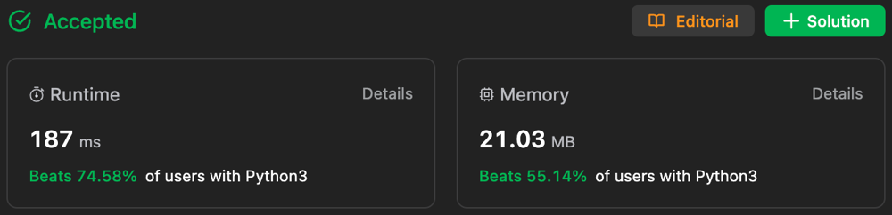

# ✅ Beats 97.08% 🔥 || 2 Approaches of DP ||

**Author:** Gourav-2002
**Votes:** 7
**Link:** [https://leetcode.com/problems/count-vowels-permutation/solutions/4216483/](https://leetcode.com/problems/count-vowels-permutation/solutions/4216483/)

---

# Approach 1: Tabulation with O(n) Space


# Intuition :
**If we know the number of strings of length n - 1, for each of the vowels ending in each of the vowels, then we can know the number of strings of length n. For example, if we know the number of strings ending in a, e, and i of length n - 1, then we know the number of strings ending in a, e, i, o, u of length n. The answer will be the sum of these strings. We can use dynamic programming to store the number of strings of length n ending in each vowel.**

# Algorithm :
1. Let dp[i][j] be the number of strings of length i that ends with the j-th vowel. We can compute dp[i][j] from dp[i - 1][*] in O(1) time.
2. The answer will be the sum of dp[n - 1][*].
3. We can improve the space complexity to O(1) by using only 5 variables to store the current row of dp.
4. We can improve the time complexity to O(n) by using matrix multiplication to compute dp[i] from dp[i - 1].

# Complexity Analysis :
- Time Complexity: ***O(n)***, where n is the input number. We can compute dp[i] from dp[i - 1] in O(1) time.
- Space Complexity: ***O(n)***.

# Code 
``` Python []
class Solution:
    def countVowelPermutation(self, n: int) -> int:
        MOD = 10 ** 9 + 7
        dp = [[0] * 5 for _ in range(n)]
        for i in range(5):
            dp[0][i] = 1
        for i in range(1, n):
            dp[i][0] = (dp[i - 1][1] + dp[i - 1][2] + dp[i - 1][4]) % MOD
            dp[i][1] = (dp[i - 1][0] + dp[i - 1][2]) % MOD
            dp[i][2] = (dp[i - 1][1] + dp[i - 1][3]) % MOD
            dp[i][3] = dp[i - 1][2]
            dp[i][4] = (dp[i - 1][2] + dp[i - 1][3]) % MOD
        return sum(dp[-1]) % MOD
```
``` C++ []
class Solution {
public:
    int countVowelPermutation(int n) {
        const int MOD = 1e9 + 7;
        vector<vector<long long>> dp(n, vector<long long>(5, 0));
        
        for (int i = 0; i < 5; ++i) {
            dp[0][i] = 1;
        }
        
        for (int i = 1; i < n; ++i) {
            dp[i][0] = (dp[i - 1][1] + dp[i - 1][2] + dp[i - 1][4]) % MOD;
            dp[i][1] = (dp[i - 1][0] + dp[i - 1][2]) % MOD;
            dp[i][2] = (dp[i - 1][1] + dp[i - 1][3]) % MOD;
            dp[i][3] = dp[i - 1][2];
            dp[i][4] = (dp[i - 1][2] + dp[i - 1][3]) % MOD;
        }
        
        long long total = 0;
        for (int i = 0; i < 5; ++i) {
            total = (total + dp[n - 1][i]) % MOD;
        }
        
        return total;
    }
};
```
``` Java []
class Solution {
    public int countVowelPermutation(int n) {
        final int MOD = (int) 1e9 + 7;
        long[][] dp = new long[n][5];
        
        for (int i = 0; i < 5; ++i) {
            dp[0][i] = 1;
        }
        
        for (int i = 1; i < n; ++i) {
            dp[i][0] = (dp[i - 1][1] + dp[i - 1][2] + dp[i - 1][4]) % MOD;
            dp[i][1] = (dp[i - 1][0] + dp[i - 1][2]) % MOD;
            dp[i][2] = (dp[i - 1][1] + dp[i - 1][3]) % MOD;
            dp[i][3] = dp[i - 1][2];
            dp[i][4] = (dp[i - 1][2] + dp[i - 1][3]) % MOD;
        }
        
        long total = 0;
        for (int i = 0; i < 5; ++i) {
            total = (total + dp[n - 1][i]) % MOD;
        }
        
        return (int) total;
    }
}
```

#### \u2705 Both the time and space complexity of the above approach can be improved. We can use only 5 variables to store the current row of dp. We can also use matrix multiplication to compute dp[i] from dp[i - 1]. 

# Approach 2: Tabulation with O(1) Space


# Difference between Approach 1 and Approach 2 :
- In Approach 1, we use dp[i][j] to denote the number of strings of length i that ends with the j-th vowel. We can compute dp[i][j] from dp[i - 1][*] in O(1) time.
- In Approach 2, we use dp[j] to denote the number of strings of length i that ends with the j-th vowel. We can compute dp[j] from dp[*] in O(1) time.

# Algorithm :
1. Let dp[j] be the number of strings of length i that ends with the j-th vowel. We can compute dp[j] from dp[*] in O(1) time.
2. The answer will be the sum of dp[*].
3. We can improve the space complexity to O(1) by using only 5 variables to store the current row of dp.
4. We can improve the time complexity to O(n) by using matrix multiplication to compute dp[i] from dp[i - 1].

# Complexity Analysis :
- Time Complexity: ***O(n)***, where n is the input number. We can compute dp[i] from dp[i - 1] in O(1) time.
- Space Complexity: ***O(n)***.
# Code
``` Python []
class Solution:
    def countVowelPermutation(self, n: int) -> int:
        MOD = 10 ** 9 + 7
        a_count = e_count = i_count = o_count = u_count = 1
        for _ in range(1, n):
            a_count, e_count, i_count, o_count, u_count = \\
                (e_count + i_count + u_count) % MOD, \\
                (a_count + i_count) % MOD, \\
                (e_count + o_count) % MOD, \\
                i_count, \\
                (i_count + o_count) % MOD
        return (a_count + e_count + i_count + o_count + u_count) % MOD
```
``` C++ []
class Solution {
public:
    int countVowelPermutation(int n) {
        const int MOD = 1e9 + 7;
        long long a_count = 1, e_count = 1, i_count = 1, o_count = 1, u_count = 1;
        
        for (int _ = 1; _ < n; ++_) {
            long long new_a = (e_count + i_count + u_count) % MOD;
            long long new_e = (a_count + i_count) % MOD;
            long long new_i = (e_count + o_count) % MOD;
            long long new_o = i_count;
            long long new_u = (i_count + o_count) % MOD;
            
            a_count = new_a;
            e_count = new_e;
            i_count = new_i;
            o_count = new_o;
            u_count = new_u;
        }
        
        long long total = (a_count + e_count + i_count + o_count + u_count) % MOD;
        
        return static_cast<int>(total);
    }
};
```
``` Java []
class Solution {
    public int countVowelPermutation(int n) {
        final int MOD = (int) 1e9 + 7;
        long a_count = 1, e_count = 1, i_count = 1, o_count = 1, u_count = 1;
        
        for (int i = 1; i < n; ++i) {
            long new_a = (e_count + i_count + u_count) % MOD;
            long new_e = (a_count + i_count) % MOD;
            long new_i = (e_count + o_count) % MOD;
            long new_o = i_count;
            long new_u = (i_count + o_count) % MOD;
            
            a_count = new_a;
            e_count = new_e;
            i_count = new_i;
            o_count = new_o;
            u_count = new_u;
        }
        
        long total = (a_count + e_count + i_count + o_count + u_count) % MOD;
        
        return (int) total;
    }
}
```
``` JavaScipt []
/**
 * @param {number} n
 * @return {number}
 */
var countVowelPermutation = function(n) {
    const MOD = 1e9 + 7;
        let a_count = 1, e_count = 1, i_count = 1, o_count = 1, u_count = 1;
        
        for (let i = 1; i < n; ++i) {
            const new_a = (e_count + i_count + u_count) % MOD;
            const new_e = (a_count + i_count) % MOD;
            const new_i = (e_count + o_count) % MOD;
            const new_o = i_count;
            const new_u = (i_count + o_count) % MOD;
            
            a_count = new_a;
            e_count = new_e;
            i_count = new_i;
            o_count = new_o;
            u_count = new_u;
        }
        
        const total = (a_count + e_count + i_count + o_count + u_count) % MOD;
        
        return total;
};
```
``` TypeScript []
function countVowelPermutation(n: number): number {
const MOD = 1e9 + 7;
        let a_count = 1, e_count = 1, i_count = 1, o_count = 1, u_count = 1;
        
        for (let i = 1; i < n; ++i) {
            const new_a = (e_count + i_count + u_count) % MOD;
            const new_e = (a_count + i_count) % MOD;
            const new_i = (e_count + o_count) % MOD;
            const new_o = i_count;
            const new_u = (i_count + o_count) % MOD;
            
            a_count = new_a;
            e_count = new_e;
            i_count = new_i;
            o_count = new_o;
            u_count = new_u;
        }
        
        const total = (a_count + e_count + i_count + o_count + u_count) % MOD;
        
        return total;
};
```
``` C# []
public class Solution {
    public int CountVowelPermutation(int n) {
        const int MOD = 1000000007;
        long a_count = 1, e_count = 1, i_count = 1, o_count = 1, u_count = 1;
        
        for (int i = 1; i < n; ++i) {
            long new_a = (e_count + i_count + u_count) % MOD;
            long new_e = (a_count + i_count) % MOD;
            long new_i = (e_count + o_count) % MOD;
            long new_o = i_count;
            long new_u = (i_count + o_count) % MOD;
            
            a_count = new_a;
            e_count = new_e;
            i_count = new_i;
            o_count = new_o;
            u_count = new_u;
        }
        
        long total = (a_count + e_count + i_count + o_count + u_count) % MOD;
        
        return (int)total;
    }
}
```
``` PHP []
class Solution {

    /**
     * @param Integer $n
     * @return Integer
     */
    function countVowelPermutation($n) {
        $MOD = 1000000007;
        $a_count = $e_count = $i_count = $o_count = $u_count = 1;
        
        for ($i = 1; $i < $n; ++$i) {
            $new_a = ($e_count + $i_count + $u_count) % $MOD;
            $new_e = ($a_count + $i_count) % $MOD;
            $new_i = ($e_count + $o_count) % $MOD;
            $new_o = $i_count;
            $new_u = ($i_count + $o_count) % $MOD;
            
            $a_count = $new_a;
            $e_count = $new_e;
            $i_count = $new_i;
            $o_count = $new_o;
            $u_count = $new_u;
        }
        
        $total = ($a_count + $e_count + $i_count + $o_count + $u_count) % $MOD;
        
        return $total;
    }
}
```
``` Kotlin []
class Solution {
    fun countVowelPermutation(n: Int): Int {
        val MOD = 1_000_000_007
        var aCount = 1L
        var eCount = 1L
        var iCount = 1L
        var oCount = 1L
        var uCount = 1L

        for (i in 1 until n) {
            val newA = (eCount + iCount + uCount) % MOD
            val newE = (aCount + iCount) % MOD
            val newI = (eCount + oCount) % MOD
            val newO = iCount
            val newU = (iCount + oCount) % MOD

            aCount = newA
            eCount = newE
            iCount = newI
            oCount = newO
            uCount = newU
        }

        return ((aCount + eCount + iCount + oCount + uCount) % MOD).toInt()
    }
}
```

# Please UpVote \u2B06\uFE0F if this healps you


