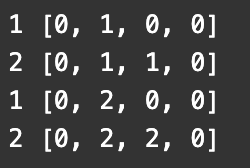

# 【Video】Give me 10 minutes - How we think abou a solution - Python, JavaScript, Java, C++

**Author:** niits
**Votes:** 37
**Link:** [https://leetcode.com/problems/number-of-ways-to-stay-in-the-same-place-after-some-steps/solutions/4169623/](https://leetcode.com/problems/number-of-ways-to-stay-in-the-same-place-after-some-steps/solutions/4169623/)

---

Welcome to my post! This post starts with "How we think about a solution". In other words, that is my thought process to solve the question. This post explains how I get to my solution instead of just posting solution codes or out of blue algorithms. I hope it is helpful for someone.

# Intuition
We only care about steps / 2

---

# Solution Video

https://youtu.be/uC0nI4E7ozw

\u25A0 Timeline of the video
`0:04` How we think about a solution
`0:05` Two key points to solve this question
`0:21` Explain the first key point
`1:28` Explain the second key point
`2:36` Break down and explain real algorithms
`6:09` Demonstrate how it works
`10:17` Coding
`12:58` Time Complexity and Space Complexity

### \u2B50\uFE0F\u2B50\uFE0F Don't forget to subscribe to my channel! \u2B50\uFE0F\u2B50\uFE0F

**\u25A0 Subscribe URL**
http://www.youtube.com/channel/UC9RMNwYTL3SXCP6ShLWVFww?sub_confirmation=1

Subscribers: 2,714
My initial goal is 10,000
Thank you for your support!

---

# Approach

### How we think about a solution

This is a very simple solution. First of all, we have to come back to start position `index 0`, so the first thing that I came up with right after I read description is this.


---

\u2B50\uFE0F Points

We can move half length of input `steps` at most because we need some steps to go back to start position. In other words we don't have to care about input length of array greater than `steps / 2`.


---

- How we can calculate number of ways to each position.

This is also simple idea. The description says "you can move 1 position to the left, 1 position to the right in the array, or stay in the same place".


---

\u2B50\uFE0F Points
Calculation of number of ways for current position is simply
```
current position = a[postion] + a[postion - 1] + a[postion + 1]

a: array
position: stay
position - 1: from left side
position + 1: from righ side

```

---

Since we need to keep current number of ways so far, seems like we can use dynamic programing.

- How it works

Let's see the key points with simple concrete example.

```
Input: steps = 2, arrLen = 4
```

First of all, we take max position where we can go by

```
min(steps // 2 + 1, arrLen)
= min(2 // 2 + 1, 4)
= 2

```
- **why +1?**

The reason why we need `+1` is simply, this example gives us `2` steps, so we need `2` positions to calculate ways.

We start from `index 1`(we consider index 1 as start position(index 0) in arrays for dynamic programming). In that case, we can move until `index 2` which is half of steps,  so we need `index 2` to check the ways.

- **Why we start from `index 1`?**

Actually you can start from `index 0` but if you start from `index 1`, you don't have to check out of bounds in the loop.


Look at these Python code.

```
cur_ways = [0] * (max_position + 2)
next_ways = [0] * (max_position + 2)
```

That's because we will calcuate total of `stay`, `left`, `right` positions, so having two extra position enables us to write code easy. we don't have to check out of bounds in the loop.

```
0,1,2,3
```
In this case, we really need `index 1` and `index 2` and we added `index 0` and `index 3` as extra `2` positions.

So, when we calculate start position(index 1), we can simply calculate 

```
index 0 + index 1 + index 2
```

No need if statement or something.

`index 3` is also the same idea when we calculate `index 2` and both sides of indices are always `0`, so they prevent out of bounds and doesn't affect result of calculation.

---

\u2B50\uFE0F Points

- Having two extra positions will prevent us from out of bounds
- the extra splace always 0 value, so they don't affect results of calculation.

---

We will create two arrays(`cur_ways`, `next_ways`) and will update `next_ways`, then swap `next_ways` with `cur_ways`, because (current) next ways is the next current ways.

We check all positions from 1 to `max_position` by number of steps. I print `next_ways` variable. The first number is position(`pos`). 



In the end if we have 

```
Input: steps = 2, arrLen = 4
```

`next_way` will be updated like that, so we should return `2` at `index1`.

I think the two ways are 
```
"stay", "stay"
"right", "left"

```
We can't go "left", "right", because that is out of bounds. The description says "The pointer should not be placed outside the array at any time".

Let's see a real algorithm!


### Algorithm Overview:
The algorithm employs dynamic programming to calculate the number of ways to reach the starting position after a specified number of steps on an array of tiles.

### Detailed Explanation:
1. **Initialization**:
   - Calculate the maximum position (`max_position`) based on the minimum of half the steps plus one and the array length. This restricts the position within the array.
   - Initialize arrays `cur_ways` and `next_ways` of length `(max_position + 2)` and fill them with zeros. These arrays store the number of ways to reach each position.
   - Set `cur_ways[1]` to 1 since there's one way to start at position 1.
   - Define a variable `mod` to store the modulo value (`10^9 + 7`) for overflow prevention.

2. **Dynamic Programming**:
   - Iterate through the steps, decrementing the count with each iteration.
   - For each step:
     - Iterate through each position from `1` to `max_position`.
     - Update `next_ways[pos]` using the rule: the sum of the number of ways from the previous step at the current position, the previous position, and the next position, all modulo `mod` to prevent overflow.
   - Swap `cur_ways` and `next_ways` to update the current ways for the next step.

3. **Return Result**:
   - After the iterations, return the number of ways to reach the first position (`cur_ways[1]`) after the specified number of steps. This represents the total number of ways to reach the starting position.

# Complexity
- Time complexity: O(steps * min(steps // 2 + 1, arrLen))

- Space complexity: O(steps)


```python []
class Solution:
    def numWays(self, steps: int, arrLen: int) -> int:
        max_position = min(steps // 2 + 1, arrLen)
        cur_ways = [0] * (max_position + 2)
        next_ways = [0] * (max_position + 2)
        cur_ways[1] = 1
        mod = 10 ** 9 + 7

        while steps > 0:
            for pos in range(1, max_position + 1):
                next_ways[pos] = (cur_ways[pos] + cur_ways[pos - 1] + cur_ways[pos + 1]) % mod

            cur_ways, next_ways = next_ways, cur_ways
            steps -= 1

        return cur_ways[1]        
```
```javascript []
var numWays = function(steps, arrLen) {
    const maxPosition = Math.min(Math.floor(steps / 2) + 1, arrLen);
    let curWays = new Array(maxPosition + 2).fill(0);
    let nextWays = new Array(maxPosition + 2).fill(0);
    curWays[1] = 1;
    const mod = 10 ** 9 + 7;

    while (steps > 0) {
        for (let pos = 1; pos <= maxPosition; pos++) {
            nextWays[pos] = (curWays[pos] + curWays[pos - 1] + curWays[pos + 1]) % mod;
        }

        // Swap arrays using a temporary variable
        let temp = curWays;
        curWays = nextWays;
        nextWays = temp;
        steps--;
    }

    return curWays[1];    
};
```
```java []
class Solution {
    public int numWays(int steps, int arrLen) {
        int maxPosition = Math.min(steps / 2 + 1, arrLen);
        int[] curWays = new int[maxPosition + 2];
        int[] nextWays = new int[maxPosition + 2];
        curWays[1] = 1;
        int mod = 1000000007;

        while (steps > 0) {
            for (int pos = 1; pos <= maxPosition; pos++) {
                nextWays[pos] = (int)(((long)curWays[pos] + curWays[pos - 1] + curWays[pos + 1]) % mod);
            }

            int[] temp = curWays;
            curWays = nextWays;
            nextWays = temp;
            steps--;
        }

        return curWays[1];        
    }
}
```
```C++ []
class Solution {
public:
    int numWays(int steps, int arrLen) {
        int maxPosition = min(steps / 2 + 1, arrLen);
        vector<int> curWays(maxPosition + 2, 0);
        vector<int> nextWays(maxPosition + 2, 0);
        curWays[1] = 1;
        const int mod = 1000000007;

        while (steps > 0) {
            for (int pos = 1; pos <= maxPosition; pos++) {
                nextWays[pos] = ((long)curWays[pos] + curWays[pos - 1] + curWays[pos + 1]) % mod;
            }

            swap(curWays, nextWays);
            steps--;
        }

        return curWays[1];        
    }
};
```

---

Thank you for reading my post.
\u2B50\uFE0F Please upvote it and don't forget to subscribe to my channel!

\u25A0 My next post and video for daily coding challenge

post
https://leetcode.com/problems/pascals-triangle-ii/solutions/4173366/video-give-me-10-minutes-how-we-think-about-a-solution-python-javascript-java-c/

video
https://youtu.be/1162hVzZ3sM

\u25A0 Timeline of the video
`0:04` Key point to solve this question
`0:05` Two key points to solve this question
`0:16` Actually there is a formula for Pascal's Triangle
`0:32` Explain basic idea and the key point
`2:38` Demonstrate real algorithms
`6:39` Coding
`7:43` Time Complexity and Space Complexity

\u25A0 My previous post and video for daily coding challenge

post
https://leetcode.com/problems/min-cost-climbing-stairs/solutions/4162780/video-give-me-10-minutes-how-we-think-about-a-solution-python-javascript-java-c/

video
https://youtu.be/LopoDDa4dLY

\u25A0 Timeline of the video

`0:00` Read the question of Min Cost Climbing Stairs
`1:43` Explain a basic idea to solve Min Cost Climbing Stairs
`6:03` Coding
`8:21` Summarize the algorithm of Min Cost Climbing Stairs

