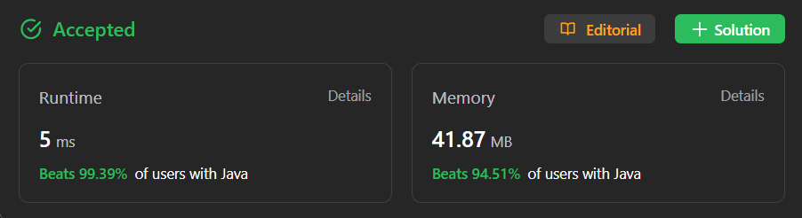

# ✅ Not so Hard ✅ Multiple Approaches Brute to Optimal ✅ Recursive + DP ✅ Fastest Beats 100%

**Author:** millenium103
**Votes:** 31
**Link:** [https://leetcode.com/problems/number-of-ways-to-stay-in-the-same-place-after-some-steps/solutions/4169828/](https://leetcode.com/problems/number-of-ways-to-stay-in-the-same-place-after-some-steps/solutions/4169828/)

---



# YouTube Video Explanation
[https://youtu.be/BXVO1cwRbo8](https://youtu.be/BXVO1cwRbo8)

\uD83D\uDD25 ***Please like, share, and subscribe to support our channel's mission of making complex concepts easy to understand.***

Subscribe Link: https://www.youtube.com/@leetlogics/?sub_confirmation=1

***Subscribe Goal: 100 Subscribers
Current Subscribers: 68***

# Intuition
The problem can be approached using dynamic programming. We want to find the number of ways to return to index 0 in an array of size `arrLen` after taking `steps` steps. The three approaches will solve this problem by considering various cases of stepping left, right, or staying in the same position.
<!-- Describe your first thoughts on how to solve this problem. -->

# Approaches
## 1. Recursive Approach:(Time Limit Exceeded)
In the recursive approach, we calculate the number of ways to reach index 0 by making choices for each step. The base cases ensure that we don't go out of bounds and return 0 or 1 accordingly. We then sum the number of ways by taking different steps (left, right, or stay). This approach can be very inefficient for larger inputs.

```
class Solution {
    private static final int MOD = 1000000007;
    public int numWays(int steps, int arrLen) {
        return countWays(steps, 0, arrLen);
    }
    private int countWays(int steps, int position, int arrLen) {
        if (position < 0 || position >= arrLen) {
            return 0;
        }
        if (steps == 0) {
            return position == 0 ? 1 : 0;
        }
        int ways = countWays(steps - 1, position, arrLen);
        ways = (ways + countWays(steps - 1, position - 1, arrLen)) % MOD;
        ways = (ways + countWays(steps - 1, position + 1, arrLen)) % MOD;
        return ways;
    }
}
```

## 2. Top-Down Approach (Memoization):
The top-down approach improves efficiency by memoizing intermediate results. It uses a 2D array to store previously computed results to avoid redundant calculations. It calculates the number of ways to reach index 0 by considering steps left, right, or staying in the same position.
```
class Solution {
    //memoized
    static final int MOD = 1_000_000_007;
    public int numWays(int steps, int arrLen) {
        arrLen = Math.min(steps / 2 + 1, arrLen);
        int[][] dp = new int[arrLen][steps + 1];
        for (int i = 0; i < dp.length; i++) Arrays.fill(dp[i], -1);
        return calculateWays(steps, 0, dp);
    }
    
    private static int calculateWays(int steps, int pos, int[][] dp) {
        if (steps < pos) return 0;
        if (steps == 0) return 1;
        if (dp[pos][steps] != -1) return dp[pos][steps];
        int ways = 0;
        if (pos < dp.length - 1) ways = (ways + calculateWays(steps - 1, pos + 1, dp)) % MOD;
        if (pos > 0) ways = (ways + calculateWays(steps - 1, pos - 1, dp)) % MOD;
        ways = (ways + calculateWays(steps - 1, pos, dp)) % MOD;
        dp[pos][steps] = ways;
        return ways;
    }
}
```


## 3. Bottom-Up Approach:
The bottom-up approach uses a 2D array to store results from subproblems. It iterates through the steps and positions, calculating the number of ways to reach the current position by taking steps left, right, or staying. This approach reduces space complexity by using only two rows of the array.
```
class Solution {
    public int numWays(int steps, int arrLen) {
        //bottom up
        int mod = 1000000007;
        int maxCol = Math.min(steps, arrLen - 1);
        //  int[][] dp = new int[steps + 1][maxCol + 1];
        int[][] dp = new int[2][maxCol + 1];
        dp[0][0] = 1;

        for (int i = 1; i <= steps; i++) {
            for (int j = 0; j <= maxCol; j++) {
                // dp[i][j] = dp[i - 1][j];
                dp[i % 2][j] = dp[(i - 1) % 2][j];
                if (j - 1 >= 0) {
                    //dp[i][j] = (dp[i][j] + dp[i - 1][j - 1]) % mod;
                    dp[i % 2][j] = (dp[i % 2][j] + dp[(i - 1) % 2][j - 1]) % mod;
                }
                if (j + 1 <= maxCol) {
                    // dp[i][j] = (dp[i][j] + dp[i - 1][j + 1]) % mod;
                    dp[i % 2][j] = (dp[i % 2][j] + dp[(i - 1) % 2][j + 1]) % mod;
                }
            }
        }

        return dp[steps % 2][0];
    }
}
```

<!-- Describe your approach to solving the problem. -->

# Complexity
- Time complexity:
    - Time Complexity for Approach 1: O(3^steps) - Exponential
    - Time Complexity for Approach 2: O(steps * arrLen) - Polynomial
    - Time Complexity for Approach 3: O(steps * arrLen) - Polynomial
<!-- Add your time complexity here, e.g. $$O(n)$$ -->

- Space complexity:
    - Space Complexity for Approach 2: O(steps * arrLen) - Polynomial
    - Space Complexity for Approach 3: O(min(steps, arrLen - 1)) - Linear
<!-- Add your space complexity here, e.g. $$O(n)$$ -->

# Code In Different Languages

<iframe src="https://leetcode.com/playground/Yy48itkA/shared" frameBorder="0" width="600" height="500"></iframe>

---


