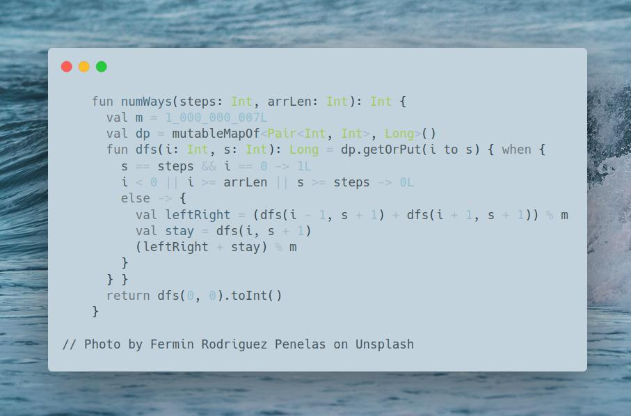

# Kotlin | dfs + cache

**Author:** SamoylenkoDmitry
**Votes:** 1
**Link:** [https://leetcode.com/problems/number-of-ways-to-stay-in-the-same-place-after-some-steps/solutions/4170099/](https://leetcode.com/problems/number-of-ways-to-stay-in-the-same-place-after-some-steps/solutions/4170099/)

---



#### Join me on Telegram

https://t.me/leetcode_daily_unstoppable/371

#### Problem TLDR

Number of ways to return to `0` after moving `left, right` or `stay` `steps` time

#### Intuition

We can do a brute force Depth First Search, each time moving position to the `left`, `right` or stay, adjusting `steps` left. After all the steps used, we count the way if it is at `0` position.
The result will only depend on the inputs, so can be cached.

#### Approach

* use `when` instead of `if - else`, because you can forget `else`:

```kotlin
if (some) 0L
if (other) 1L // must be `else if`
```

#### Complexity

- Time complexity:
$$O(s^2)$$, max index can be no more than number of steps, as we move by 1 at a time

- Space complexity:
$$O(s^2)$$

#### Code

```kotlin

    fun numWays(steps: Int, arrLen: Int): Int {
      val m = 1_000_000_007L
      val dp = mutableMapOf<Pair<Int, Int>, Long>()
      fun dfs(i: Int, s: Int): Long = dp.getOrPut(i to s) { when {
        s == steps && i == 0 -> 1L
        i < 0 || i >= arrLen || s >= steps -> 0L
        else -> {
          val leftRight = (dfs(i - 1, s + 1) + dfs(i + 1, s + 1)) % m
          val stay = dfs(i, s + 1)
          (leftRight + stay) % m
        }
      } }
      return dfs(0, 0).toInt()
    }

```