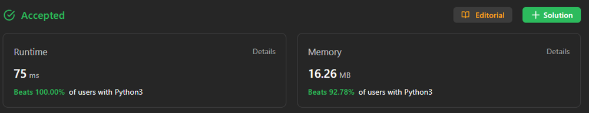

# Dynamic Programming Staircase || Beginner Friendly || Easy To Understand || Python || Beats 100 % ||

**Author:** vaish_1929
**Votes:** 29
**Link:** [https://leetcode.com/problems/number-of-ways-to-stay-in-the-same-place-after-some-steps/solutions/4169943/](https://leetcode.com/problems/number-of-ways-to-stay-in-the-same-place-after-some-steps/solutions/4169943/)

---

# BEATS 100%


# Intuition


Imagine you are standing at the beginning of a long staircase. You want to reach the top, but you can only take one or two steps at a time. How many different ways can you reach the top?

The number of ways to reach the top of the staircase depends on the number of ways to reach the previous step and the next step. This can be modeled using a dynamic programming recurrence relation.

# Approach

The following algorithm is used to calculate the number of ways to reach the top of the staircase:

1. **Define a modulo constant** to prevent integer overflow.
2. **Calculate the maximum possible position** on the staircase that can be reached.
3. **Initialize an array** to store the number of ways to reach each position on the staircase.
4. **Set the base case:** There is one way to stay at the initial position.
5. **Iterate through the number of steps taken:**
    * Set a variable `left` to 0.
    * Iterate through possible positions on the staircase, considering bounds:
        * Calculate the number of ways to reach the current position `j` using the dynamic programming recurrence relation and considering the `left` value.
        * Update `left` and `ways[j]`.
6. **Return the value of `ways[0]`,** which represents the number of ways to reach the top of the staircase.

# Complexity

* **Time complexity:** $O(n)$
* **Space complexity:** $O(n)$

where $n$ is the number of steps taken.

# Code

```python
class Solution:
    def numWays(self, steps: int, arrLen: int) -> int:
        # Define a modulo constant to prevent integer overflow
        modulo = 1000000007

        # Calculate the maximum possible position on the staircase that can be reached
        max_len = min(arrLen, 1 + steps // 2)

        # Initialize an array to store the number of ways to reach each position on the staircase
        ways = [0] * (max_len + 1)

        # Set the base case: There is one way to stay at the initial position
        ways[0] = 1

        # Iterate through the number of steps taken
        for i in range(steps):
            left = 0

            # Iterate through possible positions on the staircase, considering bounds
            for j in range(min(max_len, i + 2, steps - i + 3)):
                # Calculate the number of ways to reach the current position `j`
                # using the dynamic programming recurrence relation and considering the `left` value
                left, ways[j] = ways[j], (ways[j] + left + ways[j + 1]) % modulo

        # The `ways[0]` value represents the number of ways to reach the top of the staircase
        return ways[0]
```
# RUBY
```
def num_ways(steps, max_position)
  @max = max_position - 1
  @memo = Array.new(max_position) { {} }
  ways(0, steps) % 1000000007
end

def ways(current_position, remaining_steps)
  return (current_position == 0 ? 1 : 0) if remaining_steps == 0
  return @memo[current_position][remaining_steps] if @memo[current_position][remaining_steps]

  total = ways(current_position, remaining_steps - 1)
  total += ways(current_position - 1, remaining_steps - 1) unless current_position == 0
  total += ways(current_position + 1, remaining_steps - 1) unless current_position == @max

  @memo[current_position][remaining_steps] = total
end

```

# C++
```
const int MOD = 1e9 + 7;

const int maxPositions = 250 + 3;
const int maxSteps = 500 + 3;

class Solution {
public:
    int dp[maxSteps][maxPositions];

    int calculateWays(int currentPosition, int remainingSteps, int maxPosition) {
        if (remainingSteps == 0)
            return dp[remainingSteps][currentPosition] = (currentPosition == 0) ? 1 : 0;

        if (dp[remainingSteps][currentPosition] != -1)
            return dp[remainingSteps][currentPosition];

        int ways = 0;
        for (int dir = -1; dir <= 1; dir++) {
            int nextPosition = currentPosition + dir;

            if (nextPosition >= remainingSteps)
                continue;

            if (nextPosition >= 0 && nextPosition < maxPosition) {
                ways += calculateWays(nextPosition, remainingSteps - 1, maxPosition);
                ways %= MOD;
            }
        }

        return dp[remainingSteps][currentPosition] = ways;
    }

    int numWays(int steps, int maxPosition) {
        memset(dp, -1, sizeof(dp));
        return calculateWays(0, steps, maxPosition);
    }
};

```
# Java
```
class Solution {
    public int numWays(int steps, int arrLen) {
        if (arrLen == 1) {
            return 1;
        }
        
        arrLen = Math.min(steps / 2 + 1, arrLen);
        long modulo = 1_000_000_007;

        long[] current = new long[arrLen];
        current[0] = 1;
        current[1] = 1;
        long[] next = new long[arrLen];

        for (int i = 2; i <= steps; i++) {
            int maxPos = Math.min(i + 1, arrLen);
            next[0] = (current[0] + current[1]) % modulo;
            for (int j = 1; j < maxPos - 1; j++) {
                next[j] = (current[j - 1] + current[j] + current[j + 1]) % modulo;
            }
            next[maxPos - 1] = (current[maxPos - 2] + current[maxPos - 1]) % modulo;

            long[] temp = current;
            current = next;
            next = temp;
        }

        return (int) current[0];
    }
}

```

# JavaScript
```
var numWays = function(numSteps, arrayLength) {
    // Define a modulus value for taking the modulo operation to avoid overflow.
    const mod = 1000000007;

    // Calculate the maximum position the pointer can reach, which is the minimum of numSteps/2 and arrayLength - 1.
    const maxPosition = Math.min(Math.floor(numSteps / 2), arrayLength - 1);

    // Create a 2D array dp to store the number of ways to reach a specific position at each step.
    const dp = new Array(numSteps + 1).fill().map(() => new Array(maxPosition + 1).fill(0));

    // Initialize the number of ways to stay at position 0 after 0 steps to 1.
    dp[0][0] = 1;

    // Loop through the number of steps.
    for (let i = 1; i <= numSteps; i++) {
        for (let j = 0; j <= maxPosition; j++) {
            // Initialize the number of ways to stay at the current position with the number of ways to stay at the same position in the previous step.
            dp[i][j] = dp[i - 1][j];

            // If the current position is greater than 0, add the number of ways to reach it by moving left.
            if (j > 0) {
                dp[i][j] = (dp[i][j] + dp[i - 1][j - 1]) % mod;
            }

            // If the current position is less than the maximum position, add the number of ways to reach it by moving right.
            if (j < maxPosition) {
                dp[i][j] = (dp[i][j] + dp[i - 1][j + 1]) % mod;
            }
        }
    }

    // The final result is stored in dp[numSteps][0], representing the number of ways to reach the initial position after taking 'numSteps' steps.
    return dp[numSteps][0];
};


```
# PHP
```
class Solution {
    function numWays($numSteps, $arrayLength) {
        // Define a modulus value for taking the modulo operation to avoid overflow.
        $mod = 1000000007;
        
        // Calculate the maximum position the pointer can reach, which is the minimum of numSteps/2 and arrayLength - 1.
        $maxPosition = min($numSteps / 2, $arrayLength - 1);
        
        // Create a 2D array dp to store the number of ways to reach a specific position at each step.
        $dp = array_fill(0, $numSteps + 1, array_fill(0, $maxPosition + 1, 0));
        
        // Initialize the number of ways to stay at position 0 after 0 steps to 1.
        $dp[0][0] = 1;
        
        // Loop through the number of steps.
        for ($i = 1; $i <= $numSteps; $i++) {
            for ($j = 0; $j <= $maxPosition; $j++) {
                // Initialize the number of ways to stay at the current position with the number of ways to stay at the same position in the previous step.
                $dp[$i][$j] = $dp[$i - 1][$j];
                
                // If the current position is greater than 0, add the number of ways to reach it by moving left.
                if ($j > 0) {
                    $dp[$i][$j] = ($dp[$i][$j] + $dp[$i - 1][$j - 1]) % $mod;
                }
                
                // If the current position is less than the maximum position, add the number of ways to reach it by moving right.
                if ($j < $maxPosition) {
                    $dp[$i][$j] = ($dp[$i][$j] + $dp[$i - 1][$j + 1]) % $mod;
                }
            }
        }
        
        // The final result is stored in dp[numSteps][0], representing the number of ways to reach the initial position after taking 'numSteps' steps.
        return $dp[$numSteps][0];
    }
}

```