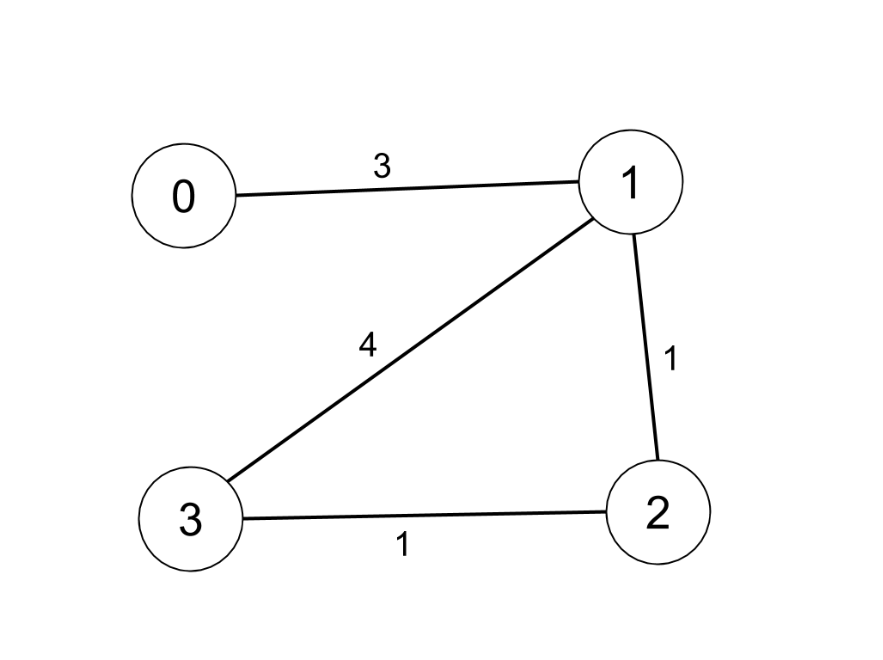
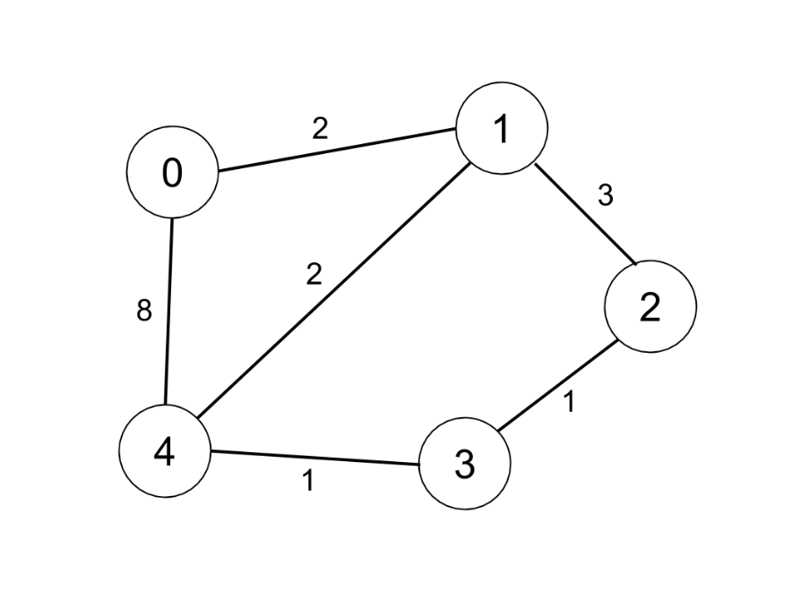

# [1334. Find the City With the Smallest Number of Neighbors at a Threshold Distance](https://leetcode.com/problems/find-the-city-with-the-smallest-number-of-neighbors-at-a-threshold-distance/)

| Category | Difficulty | Likes | Dislikes |
| :------: | :--------: | :---: | :------: |
| Algorithms | Medium | 3539 | 153 |

**Tags:** [`dynamic-programming`](https://leetcode.com/tag/dynamic-programming), [`graph`](https://leetcode.com/tag/graph), [`shortest-path`](https://leetcode.com/tag/shortest-path)

**Companies:** `google`, `amazon`, `microsoft`, `facebook`, `expedia`, `uber`

## Description

There are `n` cities numbered from `0` to `n-1`. Given the array `edges` where `edges[i] = [from_i, to_i, weight_i]` represents a bidirectional and weighted edge between cities `from_i` and `to_i`, and given the integer `distanceThreshold`.

Return the city with the smallest number of cities that are reachable through some path and whose distance is **at most** `distanceThreshold`, If there are multiple such cities, return the city with the greatest number.

Notice that the distance of a path connecting cities ***i*** and ***j*** is equal to the sum of the edges' weights along that path.

 

**Example 1:**



```

Input: n = 4, edges = [[0,1,3],[1,2,1],[1,3,4],[2,3,1]], distanceThreshold = 4
Output: 3
Explanation: The figure above describes the graph.&nbsp;
The neighboring cities at a distanceThreshold = 4 for each city are:
City 0 -&gt; [City 1, City 2]&nbsp;
City 1 -&gt; [City 0, City 2, City 3]&nbsp;
City 2 -&gt; [City 0, City 1, City 3]&nbsp;
City 3 -&gt; [City 1, City 2]&nbsp;
Cities 0 and 3 have 2 neighboring cities at a distanceThreshold = 4, but we have to return city 3 since it has the greatest number.

```

**Example 2:**



```

Input: n = 5, edges = [[0,1,2],[0,4,8],[1,2,3],[1,4,2],[2,3,1],[3,4,1]], distanceThreshold = 2
Output: 0
Explanation: The figure above describes the graph.&nbsp;
The neighboring cities at a distanceThreshold = 2 for each city are:
City 0 -&gt; [City 1]&nbsp;
City 1 -&gt; [City 0, City 4]&nbsp;
City 2 -&gt; [City 3, City 4]&nbsp;
City 3 -&gt; [City 2, City 4]
City 4 -&gt; [City 1, City 2, City 3]&nbsp;
The city 0 has 1 neighboring city at a distanceThreshold = 2.

```

 

**Constraints:**

	- `2 <= n <= 100`

	- `1 <= edges.length <= n * (n - 1) / 2`

	- `edges[i].length == 3`

	- `0 <= from_i < to_i < n`

	- `1 <= weight_i, distanceThreshold <= 10^4`

	- All pairs `(from_i, to_i)` are distinct.

---

**Links:** [Submissions](https://leetcode.com/problems/find-the-city-with-the-smallest-number-of-neighbors-at-a-threshold-distance/) | [Solutions](https://leetcode.com/problems/find-the-city-with-the-smallest-number-of-neighbors-at-a-threshold-distance/)
