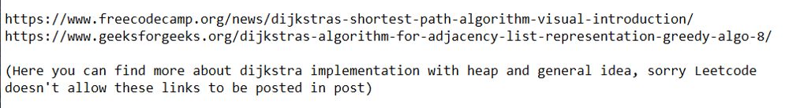
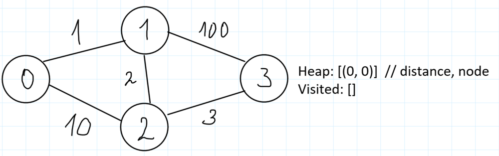
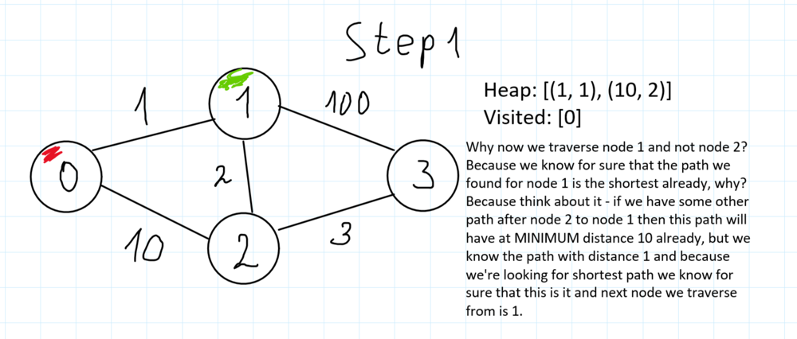
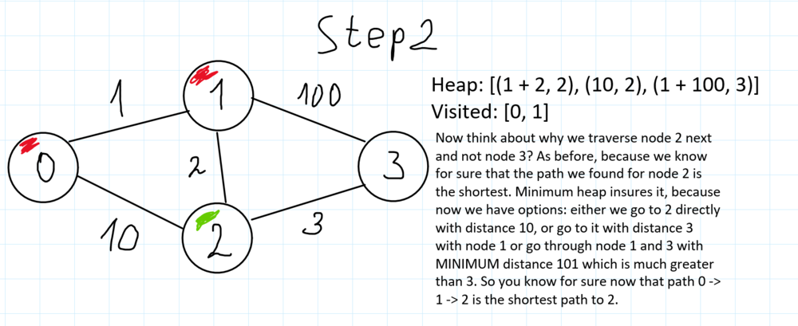
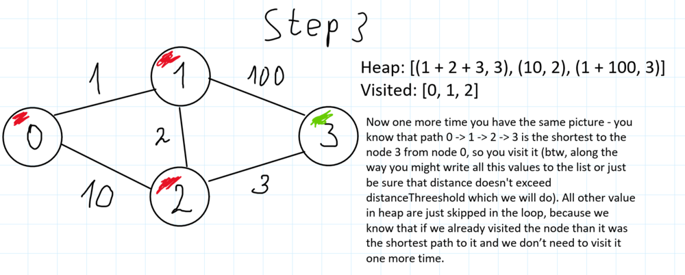

# ✅💯🔥Explanations No One Will Give You🎓🧠2 Detailed Approaches🎯🔥Extremely Simple And Effective🔥

**Author:** heir-of-god
**Votes:** 47
**Link:** [https://leetcode.com/problems/find-the-city-with-the-smallest-number-of-neighbors-at-a-threshold-distance/solutions/5537644/](https://leetcode.com/problems/find-the-city-with-the-smallest-number-of-neighbors-at-a-threshold-distance/solutions/5537644/)

---

<blockquote>
        <p>
            <b>
                It ain\u2019t about how hard you hit. It\u2019s about how hard you can get hit and keep moving forward.
            </b>        
        </p>
        <p>
            --- Sylvester Stallone ---
        </p>
</blockquote>

# \uD83D\uDC51Problem Explanation and Understanding:

## \uD83C\uDFAF Problem Description
You are given a graph of `n` nodes numbered from 0 to n - 1 and array `edges` which contains arrays `[node1, node2, distance]` which means you can reach from `node1 from node2` going distance `distance` and wise versa. You're also given integer `distanceThreshold`. You want to find and return the node with MAXIMUM value that has MINIMUM number of nodes we can reach from this node not exceeding distance `distanceThreshold`. 

## \uD83D\uDCE5\u2935\uFE0F Input:
- Integer `n` representing number of nodes in graph ||| 2 <= n <= 100
- Array of arrays [int, int, int] `edges` representing edges between nodes
- Integer `distanceThreshold` representing maximum distance you can travel from one node to another ||| 1 <= weight, distanceThreshold <= 10^4
Also guys, ALWAYS look at constraints since this is your tip about how efficient your algorithm must be!

## \uD83D\uDCE4\u2934\uFE0F Output:
The number of node which has the biggest value and minimum number of neighbors in reach 

---

# 1\uFE0F\u20E3\u2728 Approach 1: Pretty Dijkstra

# \uD83E\uDD14 Intuition
- The first thought I had after looking at the problem description is "Can we actually do better than brute-force solution?". As it turns out - no, we do need to traverse graph starting from every node and counting number of cities we can reach for each of them
- For traverse we can't use standard BFS because there might be the case where we can reach B from A with 1 edge spending distance 100 or with 3 edges spending distance 10 in sum. Do you know some BFS-like algorithm which finds only SHORTEST path from node to node? The first algorithm I thought about - Dijkstra, but we actually don't need the minimum distances from node to node, all we need - counting of how many nodes we can reach, that would be enough.
- Why we can use Djikstra here? First of all, as I said, it considers only shortest path between nodes, second, the constraints says that 1 <= weight <= 10^4 which means all edges have positive value (which is requirement for djikstra) and third, look at the constraints, number of nodes is not exceed 100 which gives us only up to 10^8 iterations even if complexity will be O(10^4) which seems pretty hard to exceed
- One of the implementation of dijkstra is using adjacency list represantation and minimum heap



- In general, dijkstra is a greedy graph algorithm to find shortest path distance to every node from source. Why does it works? Well, we always choose next to traverse node to which we have minimum distance now, exactly this node will get us to the shortest path in the next "round", why? Let's look at the example (here's the heap represented as we "visualize" it, in fact elements might have different order to match heap structure): 









Hope this example helped you to understand why djikstra works, if not - feel free to ask any question in comments. Let's move on to the code

# \uD83D\uDC69\uD83C\uDFFB\u200D\uD83D\uDCBB Coding 
- Convert the graph to an adjacency list representation:
- Define the `get_number_of_neighbors_in_distance` function to calculate the number of reachable neighbors within the distance threshold from a given source node:
    - Initialize a priority queue with the source node and distance 0.
    - Create a set to keep track of visited nodes.
    - While the queue is not empty, pop the node with the smallest distance.
    - If the current node has not been visited, add it to the visited set.
    - Iterate through the neighbors of the current node, calculating the distance from the source.
    - If the distance is within the threshold, push the neighbor and updated distance onto the queue.
    - Return the number of visited nodes minus one to exclude the source node itself.
- Initialize `minimum_number` to the number of nodes `n` and `res` to `None` to keep track of the result.
- Iterate through each node as the source, calculate the number of reachable neighbors, and update `minimum_number` and `res` if the current node has fewer or equal neighbors (with preference for larger node values in case of ties).
- Return the node with the smallest number of reachable neighbors.

# \uD83D\uDCD2 Complexity Analysis
- \u23F0 Time complexity: O(n^3 * log n), since you use Djikstra which is O(n^2 * log n) (number of edges proportional to n^2 and n - number of nodes) for every node which is O(n) so overall this is O(n * n^2 * log n) = O(n^3 * log n)
- \uD83E\uDDFA Space complexity: O(n), since we use adjacency list with size up to `n` and `queue` with has maximum sizes proportional to `n` so O(n)

# \uD83D\uDCBB Code
``` python []
class Solution:
    def findTheCity(self, n: int, edges: list[list[int]], distanceThreshold: int) -> int:
        # first convert graph to adjacency list representation
        graph: list[list[int]] = [[] for _ in range(n)]  # i-th nodes will have graph[i] neighbors
        for node1, node2, distance in edges:
            graph[node1].append([node2, distance])
            graph[node2].append([node1, distance])

        def get_number_of_neighbors_in_distance(source: int) -> int:
            queue: list[tuple[int, int]] = [
                (0, source)
            ]  # distance to node itself is 0, first store distance so heap is "sorted" b distance
            visited = set()

            while queue:
                distance_to_this_node, cur_node = heappop(queue)
                if not cur_node in visited:
                    visited.add(cur_node)
                    for neighbor, distance in graph[cur_node]:
                        distance_from_source = distance_to_this_node + distance
                        if distance_from_source <= distanceThreshold:  # ensure that we're allowed to go to this node
                            heappush(queue, (distance_from_source, neighbor))

            # actually you can return len(visited) and with math there will be nothing wrong but actually we have len(visited) - 1 neighbors since we're not neighbor of ourselves
            return len(visited) - 1

        minimum_number: int = n
        res: int = None

        for source in range(n):
            neighbors: int = get_number_of_neighbors_in_distance(source)
            # we iterate source from smaller to bigger this ensures that we choose node with greater value if they have equal number of neighbors
            if neighbors <= minimum_number:
                minimum_number = neighbors
                res = source

        return res
```
``` C++ []
class Solution {
public:
    int findTheCity(int n, vector<vector<int>>& edges, int distanceThreshold) {
        // first convert graph to adjacency list representation
        vector<vector<pair<int, int>>> graph(n); // i-th nodes will have graph[i] neighbors
        for (const auto& edge : edges) {
            int node1 = edge[0], node2 = edge[1], distance = edge[2];
            graph[node1].emplace_back(node2, distance);
            graph[node2].emplace_back(node1, distance);
        }

        auto get_number_of_neighbors_in_distance = [&](int source) -> int {
            priority_queue<pair<int, int>, vector<pair<int, int>>, greater<>> queue;
            queue.emplace(0, source); // distance to node itself is 0
            set<int> visited;

            while (!queue.empty()) {
                auto [distance_to_this_node, cur_node] = queue.top();
                queue.pop();
                if (!visited.count(cur_node)) {
                    visited.insert(cur_node);
                    for (const auto& [neighbor, distance] : graph[cur_node]) {
                        int distance_from_source = distance_to_this_node + distance;
                        if (distance_from_source <= distanceThreshold) { // ensure that we're allowed to go to this node
                            queue.emplace(distance_from_source, neighbor);
                        }
                    }
                }
            }
            // actually you can return visited.size() and with math there will be nothing wrong but actually we have visited.size() - 1 neighbors since we're not neighbor of ourselves
            return visited.size() - 1;
        };

        int minimum_number = n;
        int res = -1;

        for (int source = 0; source < n; ++source) {
            int neighbors = get_number_of_neighbors_in_distance(source);
            // we iterate source from smaller to bigger this ensures that we choose node with greater value if they have equal number of neighbors
            if (neighbors <= minimum_number) {
                minimum_number = neighbors;
                res = source;
            }
        }

        return res;
    }
};
```
``` JavaScript []
var findTheCity = function(n, edges, distanceThreshold) {
    // first convert graph to adjacency list representation
    const graph = Array.from({ length: n }, () => []);
    for (const [node1, node2, distance] of edges) {
        graph[node1].push([node2, distance]);
        graph[node2].push([node1, distance]);
    }

    const get_number_of_neighbors_in_distance = (source) => {
        const minHeap = new MinPriorityQueue({ priority: (a) => a[0] });
        minHeap.enqueue([0, source]); // distance to node itself is 0
        const visited = new Set();

        while (minHeap.size()) {
            const [distance_to_this_node, cur_node] = minHeap.dequeue().element;
            if (!visited.has(cur_node)) {
                visited.add(cur_node);
                for (const [neighbor, distance] of graph[cur_node]) {
                    const distance_from_source = distance_to_this_node + distance;
                    if (distance_from_source <= distanceThreshold) { // ensure that we're allowed to go to this node
                        minHeap.enqueue([distance_from_source, neighbor]);
                    }
                }
            }
        }
        // actually you can return visited.size and with math there will be nothing wrong but actually we have visited.size - 1 neighbors since we're not neighbor of ourselves
        return visited.size - 1;
    };

    let minimum_number = n;
    let res = null;

    for (let source = 0; source < n; source++) {
        const neighbors = get_number_of_neighbors_in_distance(source);
        // we iterate source from smaller to bigger this ensures that we choose node with greater value if they have equal number of neighbors
        if (neighbors <= minimum_number) {
            minimum_number = neighbors;
            res = source;
        }
    }

    return res;
};
```
``` Java []
class Solution {
    public int findTheCity(int n, int[][] edges, int distanceThreshold) {
        // first convert graph to adjacency list representation
        List<List<int[]>> graph = new ArrayList<>();
        for (int i = 0; i < n; i++) {
            graph.add(new ArrayList<>());
        }
        for (int[] edge : edges) {
            int node1 = edge[0], node2 = edge[1], distance = edge[2];
            graph.get(node1).add(new int[]{node2, distance});
            graph.get(node2).add(new int[]{node1, distance});
        }

        int minimum_number = n;
        int res = -1;

        for (int source = 0; source < n; source++) {
            int neighbors = get_number_of_neighbors_in_distance(graph, source, n, distanceThreshold);
            // we iterate source from smaller to bigger this ensures that we choose node with greater value if they have equal number of neighbors
            if (neighbors <= minimum_number) {
                minimum_number = neighbors;
                res = source;
            }
        }

        return res;
    }

    private int get_number_of_neighbors_in_distance(List<List<int[]>> graph, int source, int n, int distanceThreshold) {
        PriorityQueue<int[]> minHeap = new PriorityQueue<>(Comparator.comparingInt(a -> a[0]));
        minHeap.add(new int[]{0, source}); // distance to node itself is 0
        Set<Integer> visited = new HashSet<>();

        while (!minHeap.isEmpty()) {
            int[] top = minHeap.poll();
            int distance_to_this_node = top[0], cur_node = top[1];
            if (!visited.contains(cur_node)) {
                visited.add(cur_node);
                for (int[] neighbor : graph.get(cur_node)) {
                    int distance_from_source = distance_to_this_node + neighbor[1];
                    if (distance_from_source <= distanceThreshold) { // ensure that we're allowed to go to this node
                        minHeap.add(new int[]{distance_from_source, neighbor[0]});
                    }
                }
            }
        }
        // actually you can return visited.size() and with math there will be nothing wrong but actually we have visited.size() - 1 neighbors since we're not neighbor of ourselves
        return visited.size() - 1;
    }
}
```

# 2\uFE0F\u20E3\uD83E\uDDE0 Approach 2: Floyd-Warshall

# \uD83E\uDD14 Intuition
- Another thing after solving problem with Dijkstra - can we do better? As it turns out we can.
- There's Floyd-Warshall algorithm wich finds shortest path between EVERY pair of nodes in graph in O(n^3) time. In most cases this is redundant and pretty slow, but with Djikstra we had O(n^3 * log n) which means that Floyd-Warshall algorithm is ideal for us.
- We can use Floyd-Warshall because this is obvius that this graph will not contain cycles with negative values.
- The whole Floyd-Warshall algorithm is only 1 formula and concept understanding - you have 3 loops: for souce node, for destination node and for middle node. Then, let's say for nodes `i`, `j` as source and destination and `k` as middle node you apply formula `distance[i][j] = min(distance[i][j], distance[i][k] + distance[k][j])` where distance is the matrix which contains minimum distance from node `i` to `j` (at the end `distance[i][j]` == `distance[j][i]` because graph is bidirectional and the shortest path from i to j is the shortest path from j to i) 

# \uD83D\uDC69\uD83C\uDFFB\u200D\uD83D\uDCBB Coding 
- Initialize a 2D list `distance` with dimensions `n x n`, filled with infinity (`float("inf")`) to represent the initial distances between nodes.
- Set the distance from each node to itself as 0.
- For each edge, set the initial distance between the connected nodes based on the given edge weights.
- Use the Floyd-Warshall algorithm to compute the shortest paths between all pairs of nodes:
    - Iterate over each possible intermediate node `midle`.
    - For each pair of source and destination nodes, update the distance to be the minimum of the current distance and the distance through the intermediate node `midle`.
- Initialize `minimum_number` to the number of nodes `n` and `res` to `None` to keep track of the result.
- Iterate through each node as the source:
    - Count the number of destination nodes within the distance threshold for the current source.
    - If the count is less than or equal to `minimum_number`, update `minimum_number` and `res` to the current source (with preference for larger node values in case of ties).
- Return the node with the smallest number of reachable neighbors.

# \uD83D\uDCD5 Complexity Analysis
- \u23F0 Time complexity: O(n^3), since we use Floyd-Washall algorithm O(n^3) and also then iterate through whole matrix O(n^2) -> O(n^3)
- \uD83E\uDDFA Space complexity: O(n^2), since we use matrix `distance` with sizes `n x n`

# \uD83D\uDCBB Code
``` python []
class Solution:
    def findTheCity(self, n: int, edges: list[list[int]], distanceThreshold: int) -> int:
        distance: list[list[int]] = [[float("inf") for _ in range(n)] for _ in range(n)]
        for node in range(n):
            distance[node][node] = 0  # distance to itself is 0

        # The distance between nodes which are connected temporary distance between them
        for node1, node2, dist in edges:
            distance[node1][node2] = dist
            distance[node2][node1] = dist

        for midle in range(n):
            for source in range(n):
                for destination in range(n):
                    distance[source][destination] = min(
                        distance[source][destination], distance[source][midle] + distance[midle][destination]
                    )  # the minimum distance is either current value or new value with path that goes through midle

        minimum_number: int = n
        res: int = None

        for source in range(n):
            source_count = 0
            for destination in range(n):
                if distance[source][destination] <= distanceThreshold:
                    source_count += 1

            if source_count <= minimum_number:  # as in dijkstra when number equal we choose greater node
                minimum_number = source_count
                res = source

        return res
```
``` C++ []
class Solution {
public:
    int findTheCity(int n, vector<vector<int>>& edges, int distanceThreshold) {
        vector<vector<int>> distance(n, vector<int>(n, INT_MAX));
        for (int i = 0; i < n; ++i) {
            distance[i][i] = 0;  // distance to itself is 0
        }

        // The distance between nodes which are connected temporary distance between them
        for (const auto& edge : edges) {
            int node1 = edge[0], node2 = edge[1], dist = edge[2];
            distance[node1][node2] = dist;
            distance[node2][node1] = dist;
        }

        for (int midle = 0; midle < n; ++midle) {
            for (int source = 0; source < n; ++source) {
                for (int destination = 0; destination < n; ++destination) {
                    if (distance[source][midle] < INT_MAX && distance[midle][destination] < INT_MAX) {
                        distance[source][destination] = min(
                            distance[source][destination], distance[source][midle] + distance[midle][destination]
                        );  // the minimum distance is either current value or new value with path that goes through midle
                    }
                }
            }
        }

        int minimum_number = n;
        int res = -1;

        for (int source = 0; source < n; ++source) {
            int source_count = 0;
            for (int destination = 0; destination < n; ++destination) {
                if (distance[source][destination] <= distanceThreshold) {
                    ++source_count;
                }
            }

            if (source_count <= minimum_number) {  // as in dijkstra when number equal we choose greater node
                minimum_number = source_count;
                res = source;
            }
        }

        return res;
    }
};
```
``` JavaScript []
var findTheCity = function(n, edges, distanceThreshold) {
    const distance = Array.from({ length: n }, () => Array(n).fill(Infinity));
    for (let i = 0; i < n; i++) {
        distance[i][i] = 0;  // distance to itself is 0
    }

    // The distance between nodes which are connected temporary distance between them
    for (const [node1, node2, dist] of edges) {
        distance[node1][node2] = dist;
        distance[node2][node1] = dist;
    }

    for (let midle = 0; midle < n; midle++) {
        for (let source = 0; source < n; source++) {
            for (let destination = 0; destination < n; destination++) {
                distance[source][destination] = Math.min(
                    distance[source][destination], distance[source][midle] + distance[midle][destination]
                );  // the minimum distance is either current value or new value with path that goes through midle
            }
        }
    }

    let minimum_number = n;
    let res = -1;

    for (let source = 0; source < n; source++) {
        let source_count = 0;
        for (let destination = 0; destination < n; destination++) {
            if (distance[source][destination] <= distanceThreshold) {
                source_count++;
            }
        }

        if (source_count <= minimum_number) {  // as in dijkstra when number equal we choose greater node
            minimum_number = source_count;
            res = source;
        }
    }

    return res;
};
```
``` Java []
class Solution {
    public int findTheCity(int n, int[][] edges, int distanceThreshold) {
        int[][] distance = new int[n][n];
        for (int i = 0; i < n; i++) {
            Arrays.fill(distance[i], Integer.MAX_VALUE);
            distance[i][i] = 0;  // distance to itself is 0
        }

        // The distance between nodes which are connected temporary distance between them
        for (int[] edge : edges) {
            int node1 = edge[0], node2 = edge[1], dist = edge[2];
            distance[node1][node2] = dist;
            distance[node2][node1] = dist;
        }

        for (int midle = 0; midle < n; midle++) {
            for (int source = 0; source < n; source++) {
                for (int destination = 0; destination < n; destination++) {
                    if (distance[source][midle] < Integer.MAX_VALUE && distance[midle][destination] < Integer.MAX_VALUE) {
                        distance[source][destination] = Math.min(
                            distance[source][destination], distance[source][midle] + distance[midle][destination]
                        );  // the minimum distance is either current value or new value with path that goes through midle
                    }
                }
            }
        }

        int minimum_number = n;
        int res = -1;

        for (int source = 0; source < n; source++) {
            int source_count = 0;
            for (int destination = 0; destination < n; destination++) {
                if (distance[source][destination] <= distanceThreshold) {
                    source_count++;
                }
            }

            if (source_count <= minimum_number) {  // as in dijkstra when number equal we choose greater node
                minimum_number = source_count;
                res = source;
            }
        }

        return res;
    }
}
```


## \uD83D\uDCA1\uD83D\uDCA1\uD83D\uDCA1I encourage you to check out [my profile](https://leetcode.com/heir-of-god/) and [Project-S](https://github.com/Heir-of-God/Project-S) project for detailed explanations and code for different problems (not only Leetcode). Happy coding and learning!\uD83D\uDCDA

### Please consider *upvote*\u2B06\uFE0F\u2B06\uFE0F\u2B06\uFE0F because I try really hard not just to put here my code and rewrite testcase to show that it works but explain you WHY it works and HOW. Thank you\u2764\uFE0F

## If you have any doubts or questions feel free to ask them in comments. I will be glad to help you with understanding\u2764\uFE0F\u2764\uFE0F\u2764\uFE0F


