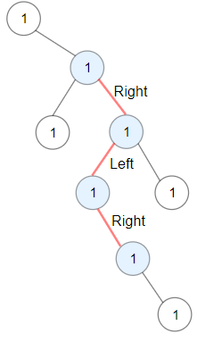
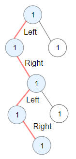

# [1372. Longest ZigZag Path in a Binary Tree](https://leetcode.com/problems/longest-zigzag-path-in-a-binary-tree/)

| Category | Difficulty | Likes | Dislikes |
| :------: | :--------: | :---: | :------: |
| Algorithms | Medium | 3715 | 85 |

**Tags:** [`dynamic-programming`](https://leetcode.com/tag/dynamic-programming), [`tree`](https://leetcode.com/tag/tree), [`depth-first-search`](https://leetcode.com/tag/depth-first-search), [`binary-tree`](https://leetcode.com/tag/binary-tree)

**Companies:** `amazon`

## Description

You are given the `root` of a binary tree.

A ZigZag path for a binary tree is defined as follow:

	- Choose **any **node in the binary tree and a direction (right or left).

	- If the current direction is right, move to the right child of the current node; otherwise, move to the left child.

	- Change the direction from right to left or from left to right.

	- Repeat the second and third steps until you can't move in the tree.

Zigzag length is defined as the number of nodes visited - 1. (A single node has a length of 0).

Return *the longest **ZigZag** path contained in that tree*.

 

**Example 1:**


```

Input: root = [1,null,1,1,1,null,null,1,1,null,1,null,null,null,1]
Output: 3
Explanation: Longest ZigZag path in blue nodes (right -&gt; left -&gt; right).

```

**Example 2:**


```

Input: root = [1,1,1,null,1,null,null,1,1,null,1]
Output: 4
Explanation: Longest ZigZag path in blue nodes (left -&gt; right -&gt; left -&gt; right).

```

**Example 3:**

```

Input: root = [1]
Output: 0

```

 

**Constraints:**

	- The number of nodes in the tree is in the range `[1, 5 * 10^4]`.

	- `1 <= Node.val <= 100`

---

**Links:** [Submissions](https://leetcode.com/problems/longest-zigzag-path-in-a-binary-tree/) | [Solutions](https://leetcode.com/problems/longest-zigzag-path-in-a-binary-tree/)
