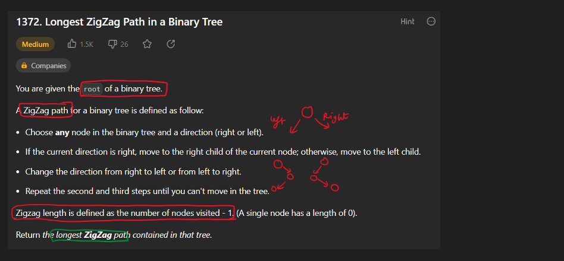
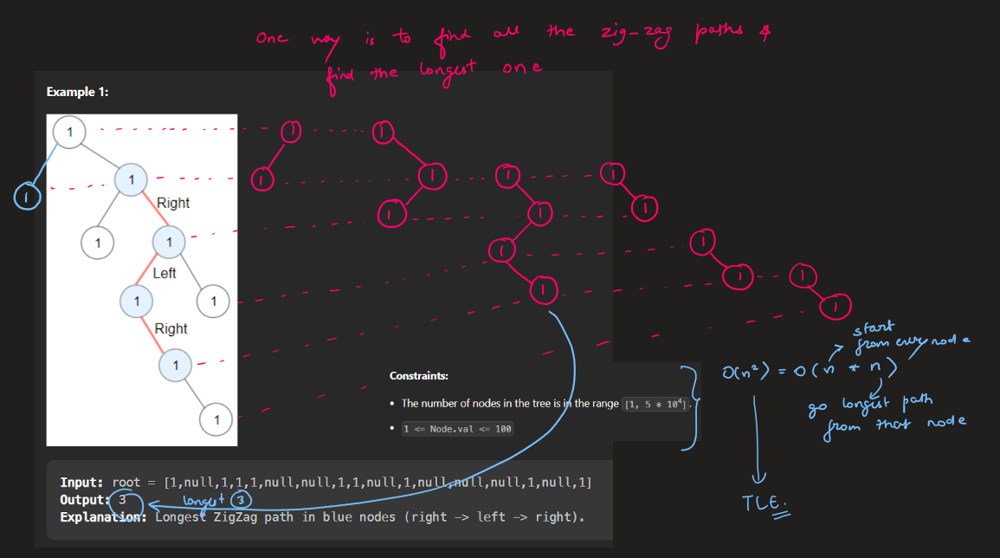
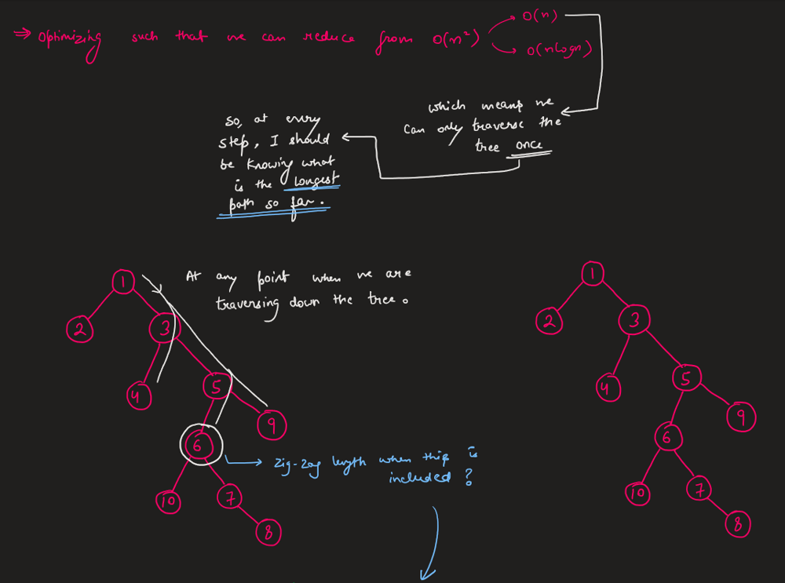
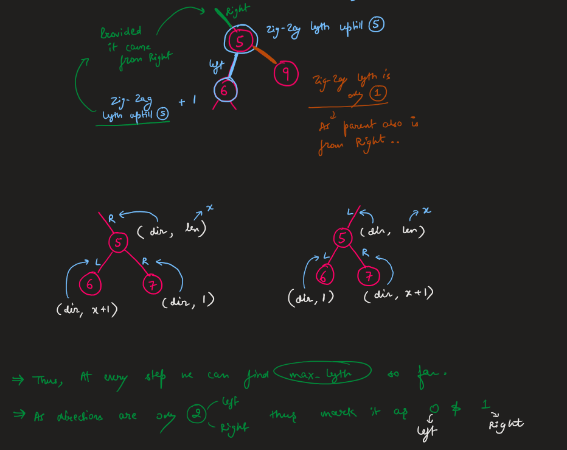
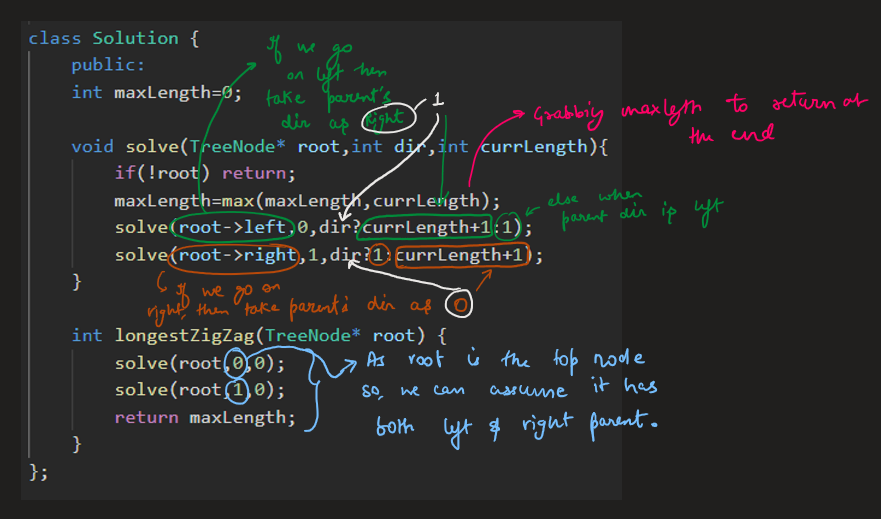
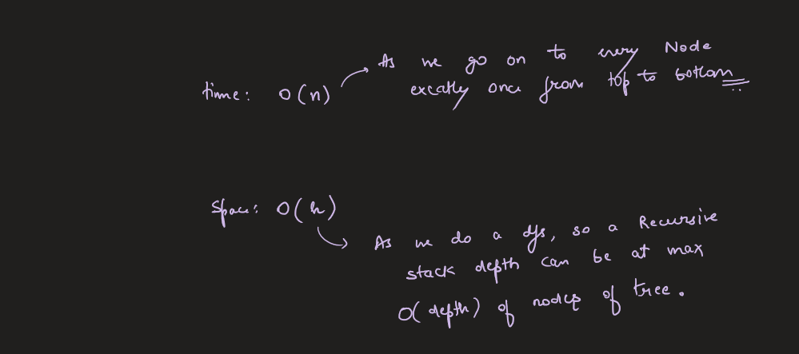

# Image Explanation🏆- [Easy & Complete Intuition] - C++/Java/Python

**Author:** aryan_0077
**Votes:** 95
**Link:** [https://leetcode.com/problems/longest-zigzag-path-in-a-binary-tree/solutions/3433060/](https://leetcode.com/problems/longest-zigzag-path-in-a-binary-tree/solutions/3433060/)

---

# Video Solution (`Aryan Mittal`) - Link in LeetCode Profile
`Longest ZigZag Path in a Binary Tree` by `Aryan Mittal`


# Approach & Intution








# Code
```C++ []
class Solution {
    public:
    int maxLength=0;

    void solve(TreeNode* root,int dir,int currLength){
        if(!root) return;
        maxLength=max(maxLength,currLength);
        solve(root->left,0,dir?currLength+1:1);
        solve(root->right,1,dir?1:currLength+1);
    }

    int longestZigZag(TreeNode* root) {
        solve(root,0,0);
        solve(root,1,0);
        return maxLength;
    }
};
```
```Java []
class Solution {
    public int maxLength=0;
    public void solve(TreeNode root,int dir,int currLength){
        if(root==null) return;
        maxLength=Math.max(maxLength,currLength);
        if(dir==1){
            solve(root.left,0,currLength+1);
            solve(root.right,1,1);
        }
        else{
            solve(root.right,1,currLength+1);
            solve(root.left,0,1);
        }
    }

    public int longestZigZag(TreeNode root) {
        solve(root,0,0);
        solve(root,1,0);
        return maxLength;
    }
}
```
```Python []
class Solution:
    def longestZigZag(self, root: Optional[TreeNode]) -> int:
        self.maxLength = 0
        def solve(node, deep, dir):
            self.maxLength = max(self.maxLength, deep)

            if node.left is not None:
                solve(node.left, deep+1,'left') if dir != 'left' else solve(node.left, 1, 'left')
            if node.right is not None:
                solve(node.right, deep+1, 'right') if dir != 'right' else solve(node.right, 1, 'right')
        solve(root, 0, '')
        return self.maxLength
```
