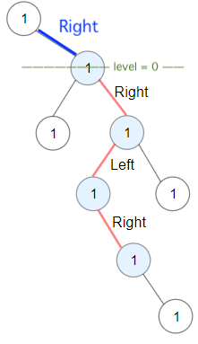

# [Java/Python/Kotlin/Golang] intuitive DFS recursive Solution

**Author:** chenon
**Votes:** 4
**Link:** [https://leetcode.com/problems/longest-zigzag-path-in-a-binary-tree/solutions/3434378/](https://leetcode.com/problems/longest-zigzag-path-in-a-binary-tree/solutions/3434378/)

---

# Intuition
At first , it looks like a DFS to calculate the height of a BST.
Then the zigzag forces to alternate direction (right or left). If previous node explored was `left`, then the next node must be `right` ( vice-versa). We have to keep track if the current node should explore left or right.

# Approach

We have to keep track if the current node should explore left or right.
In addition not to have a global variable, the level is passed in parameter to the recursive function.

```Java []
class Solution {
    public int longestZigZag(TreeNode root) {
        return Math.max(longestZigZag(root, true, 0), longestZigZag(root, false, 0));
    }

    public int longestZigZag(TreeNode root, boolean isLeft, int level) {
        //System.out.println("isLeft = " + isLeft + " root = " + root + " level = "+ level);
        if(root == null) return level;
        
        if(isLeft){
            if(root.left == null) return level;
            return longestZigZag(root.left, false, level + 1);
        }else{
            if(root.right == null) return level;
            return longestZigZag(root.right, true, level + 1);
        }

    }
}
```

At first, my initial implementation worked on all except the first example. I assumed the longest always starts from the root node.




But example 1, the longest zig zag doesn't start at the root node. But at the first right child of the root node.
`If direction stays the same twice, we have to reset the level to zero`. Otherwise increment the level by one.

## Illustration from a left Node
```
    // TDLR
    return Math.max(longestZigZag(root.left, false, level + 1), longestZigZag(root.left, true, 0));

    // more detail on this one line.
    /**
    *
    *      x
    *     /
    *    x
    *   /
    *  x
    *
    **/
    int leftOfLeft = longestZigZag(root.left, true, 0); // reset level to 0

    /**
    *
    *      x
    *     /
    *    x
    *     \\
    *      x
    *
    **/
    int rightOfLeft = longestZigZag(root.left, false, level + 1); // keep the zig zag, so increment the level

```

# Complexity

- Time complexity:
O(n) , we explore all tree nodes

- Space complexity:
O(height)

# Code

```Java []
class Solution {
    public int longestZigZag(TreeNode root) {
        return Math.max(longestZigZag(root, true, 0), longestZigZag(root, false, 0));
    }

    public int longestZigZag(TreeNode root, boolean isLeft, int level) {
        if(root == null) return level;
        
        if(isLeft){
            if(root.left == null) return level;
            // the BST doesn't have to start from the root node. If the same direction is done twice, reset the level to 0
            return Math.max(longestZigZag(root.left, false, level + 1), longestZigZag(root.left, true, 0));
        }else{
            if(root.right == null) return level;
            return Math.max(longestZigZag(root.right, true, level + 1), longestZigZag(root.right, false, 0));
        }

    }
}
```
```python []
# Definition for a binary tree node.
# class TreeNode:
#     def __init__(self, val=0, left=None, right=None):
#         self.val = val
#         self.left = left
#         self.right = right
class Solution:
    def longestZigZag(self, root: Optional[TreeNode]) -> int:
        def longestZigZag(root: Optional[TreeNode], isLeft: bool, level: int) -> int:
            if root is None:
                return level
            
            if isLeft:
                if root.left is None: return level
                return max(longestZigZag(root.left, False, level + 1), longestZigZag(root.left, True, 0))
            else:
                if root.right is None: return level
                return max(longestZigZag(root.right, True, level + 1), longestZigZag(root.right, False, 0))
        
        return max(longestZigZag(root, True, 0), longestZigZag(root, False, 0))
```
```kotlin []
/**
 * Example:
 * var ti = TreeNode(5)
 * var v = ti.`val`
 * Definition for a binary tree node.
 * class TreeNode(var `val`: Int) {
 *     var left: TreeNode? = null
 *     var right: TreeNode? = null
 * }
 */
class Solution {
    fun longestZigZag(root: TreeNode?): Int {
        return maxOf(longestZigZag(root, true, 0),  longestZigZag(root, false, 0))
    }

    fun longestZigZag(root: TreeNode?, isLeft: Boolean, level: Int): Int {
        if(root == null) return level

        if(isLeft){
            return root?.left?.let{
                 maxOf(longestZigZag(it, false, level + 1), longestZigZag(it,  true, 0))
            } ?: level
        }else{
            return root?.right?.let{
                 maxOf(longestZigZag(it, true, level + 1), longestZigZag(it, false, 0))
            } ?: level
        }
    }
}

```
```golang []
/**
 * Definition for a binary tree node.
 * type TreeNode struct {
 *     Val int
 *     Left *TreeNode
 *     Right *TreeNode
 * }
 */
func longestZigZag(root *TreeNode) int {
	return max(longestZigZagRec(root, true, 0), longestZigZagRec(root, false, 0))
}

func longestZigZagRec(root *TreeNode, isLeft bool, level int) int {
	if root == nil {
		return level
	}

	if isLeft {
		left := root.Left
		if left == nil { return  level}
		return max(longestZigZagRec(left, false, level +1 ), longestZigZagRec(left, true, 0))
	}else{
		right := root.Right
		if right == nil {return  level}
		return max(longestZigZagRec(right, true, level+1), longestZigZagRec(right, false, 0))
	}
}

func max(a, b int) int {
	if a > b {
		return a
	}
	return b
}
```

Thanks for reading until the end.
If some code is not fluent in their native programming language, please suggest in the comment section.
