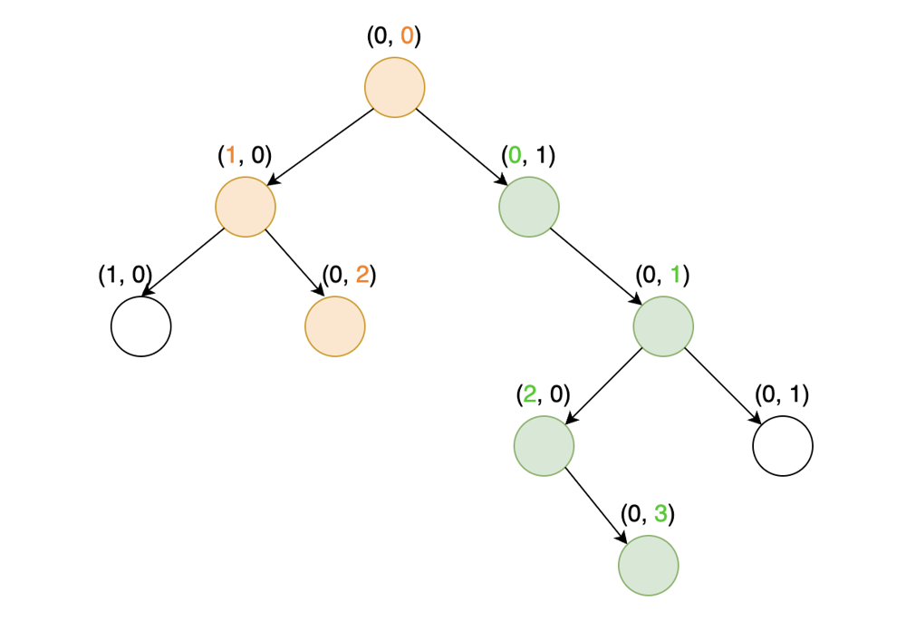

# 🟢 Python 🐍 Clean Solution Without Pain 🟢 [Image and Explanation] 🟢 Beats 98% 🟢

**Author:** thunderp1nk
**Votes:** 68
**Link:** [https://leetcode.com/problems/longest-zigzag-path-in-a-binary-tree/solutions/3862418/](https://leetcode.com/problems/longest-zigzag-path-in-a-binary-tree/solutions/3862418/)

---

# Intuition
Many solutions to this problem on LeetCode can lead to eye strain due to their convoluted logic or excessive code. Here, we're aiming to provide a simple and clean solution, which doesn't compromise on efficiency or readability.

To understand the approach, consider the test case: 

```[1,1,1,1,1,null,1,null,null,null,null,1,1,null,1]```

On the associated tree diagram, we have highlighted two significant ZigZag paths. An orange path, of length 2, proceeds leftwards from the root, and a green path, of length 3, originates from the right branch of the root.


# Approach
Our algorithm is rooted in the idea of tracking the length of the ZigZag paths as we traverse the tree, using depth-first search (DFS). The current path length is maintained in two variables - `left` and `right`. At each node, if we go left, we update `left` by adding 1 to `right` and reset `right` to 0. Conversely, if we go right, we add 1 to `left` and reset `left` to 0. This way, we always start a new path with either (0,1) or (1,0).

Each ZigZag path length is continuously compared to a global maximum (`self.maxi`), and `self.maxi` is updated whenever a larger ZigZag path is found. At the end, `self.maxi` holds the length of the longest ZigZag path in the tree.

# Complexity
- Time complexity: : O(n), where n is the number of nodes in the tree. This is because we are doing a single DFS traversal of the tree.

- Space complexity: O(h), where h is the height of the tree. This accounts for the maximum size of the implicit call stack for the DFS traversal.

---

This solution manages to achieve excellent performance without resorting to eye-gouging code, providing an accessible and elegant approach to a potentially complex problem.

# Code
```
# Definition for a binary tree node.
# class TreeNode:
#     def __init__(self, val=0, left=None, right=None):
#         self.val = val
#         self.left = left
#         self.right = right
class Solution:
    def longestZigZag(self, root: Optional[TreeNode]) -> int:
        self.maxi = 0

        def dfs(node, left, right):
            self.maxi = max(self.maxi, left, right)

            if node.left:
                dfs(node.left, right + 1, 0)

            if node.right:
                dfs(node.right, 0, left + 1)

        dfs(root, 0, 0)
        return self.maxi

```