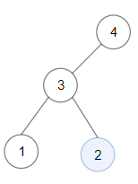

# [1373. Maximum Sum BST in Binary Tree](https://leetcode.com/problems/maximum-sum-bst-in-binary-tree/)

| Category | Difficulty | Likes | Dislikes |
| :------: | :--------: | :---: | :------: |
| Algorithms | Hard | 2918 | 198 |

**Tags:** [`dynamic-programming`](https://leetcode.com/tag/dynamic-programming), [`tree`](https://leetcode.com/tag/tree), [`depth-first-search`](https://leetcode.com/tag/depth-first-search), [`binary-search-tree`](https://leetcode.com/tag/binary-search-tree), [`binary-tree`](https://leetcode.com/tag/binary-tree)

**Companies:** `amazon`, `google`, `facebook`, `bloomberg`

## Description

Given a **binary tree** `root`, return *the maximum sum of all keys of **any** sub-tree which is also a Binary Search Tree (BST)*.

Assume a BST is defined as follows:

	- The left subtree of a node contains only nodes with keys **less than** the node's key.

	- The right subtree of a node contains only nodes with keys **greater than** the node's key.

	- Both the left and right subtrees must also be binary search trees.

 

**Example 1:**


```

Input: root = [1,4,3,2,4,2,5,null,null,null,null,null,null,4,6]
Output: 20
Explanation: Maximum sum in a valid Binary search tree is obtained in root node with key equal to 3.

```

**Example 2:**



```

Input: root = [4,3,null,1,2]
Output: 2
Explanation: Maximum sum in a valid Binary search tree is obtained in a single root node with key equal to 2.

```

**Example 3:**

```

Input: root = [-4,-2,-5]
Output: 0
Explanation: All values are negatives. Return an empty BST.

```

 

**Constraints:**

	- The number of nodes in the tree is in the range `[1, 4 * 10^4]`.

	- `-4 * 10^4 <= Node.val <= 4 * 10^4`

---

**Links:** [Submissions](https://leetcode.com/problems/maximum-sum-bst-in-binary-tree/) | [Solutions](https://leetcode.com/problems/maximum-sum-bst-in-binary-tree/)
