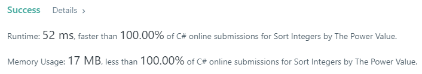

# [C#] 100%/100% Both Iterative and Recursive

**Author:** laprade
**Votes:** 4
**Link:** [https://leetcode.com/problems/sort-integers-by-the-power-value/solutions/548552/](https://leetcode.com/problems/sort-integers-by-the-power-value/solutions/548552/)

---

Proof
-


Explanation
-
We store powers in a Dictionary (HashMap for you Java people) so that we don't need to recompute powers each time we see them. This is especially helpful due to the fact that all numbers converge on the same sequence of powers of 2.

Core Code
-
```
public class Solution {
    
    private static readonly Dictionary<int,int> powers = new Dictionary<int,int>();
    
    static Solution() {
        powers[1] = 0;
    }
    
    public int GetKth(int lo, int hi, int k) {
        return Enumerable.Range(lo, hi-lo+1).OrderBy(GetPower).ElementAt(k-1);
    }
}
```
Recursive
-
```
	private static int GetPower(int num) {
        if (powers.ContainsKey(num)) return powers[num];
        var power = 1 + GetPower(num%2==0 ? num/2 : 3*num+1);
        powers[num] = power;
        return power;
    }
```
Iterative
-
```
    private static int GetPower(int x) {
        var stack = new Stack<int>();
        while (!powers.ContainsKey(x)) {
            stack.Push(x);
            x = x%2==0 ? x/2 : 3*x+1;
        }
        var power = powers[x];
        while (stack.Count != 0) {
            powers[stack.Pop()] = ++power;
        }
        return power;
    }
```