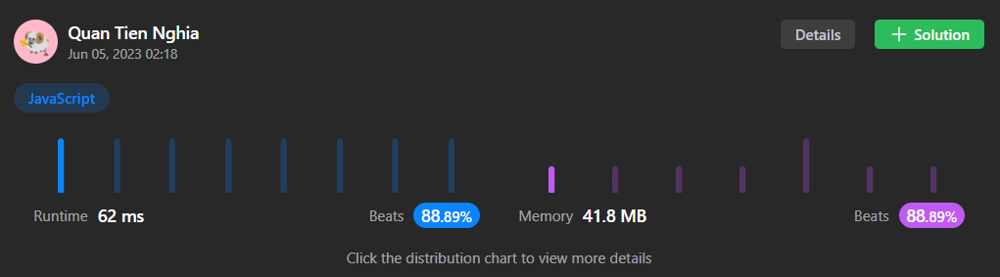

# JS - Ridiculously optimized solution

**Author:** CuteTN
**Votes:** 1
**Link:** [https://leetcode.com/problems/number-of-ways-to-paint-n-3-grid/solutions/3598203/](https://leetcode.com/problems/number-of-ways-to-paint-n-3-grid/solutions/3598203/)

---



# Approach
- `biColor[i]` is the number of ways to paint a `3 * i` grid, with exactly **2** colors on the last column.
- `triColor[i]` is the number of ways to paint a `3 * i` grid, with exactly **3** colors on the last column.
- After penning down all cases, we should get the formulas:
    - `biColor[i] = 3*biColor[i-1] + 2*triColor[i-1]`
    - `triColor[i] = 2*biColor[i-1] + 2*triColor[i-1]`
- As the new states only depend on their previous version, we can optimize the memory usage by using only variables representing the last computed DP items.

# Complexity
- Time complexity: $$O(n)$$
- Space complexity: $$O(1)$$

# Code
```js
/**
 * @param {number} n
 * @return {number}
 */
var numOfWays = function(n) {
  const MOD = 1000000007;
  let biColor = 6;
  let triColor = 6;

  while (--n) {
    triColor = (((triColor + biColor) % MOD) * 2) % MOD;
    biColor = (biColor + triColor) % MOD;
  }

  return (biColor + triColor) % MOD;
};
```