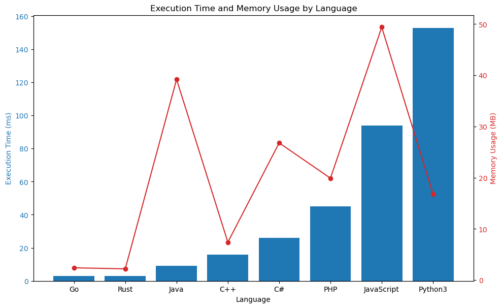

# ✅ 90.27% Dynamic Programming Optimized

**Author:** vanAmsen
**Votes:** 75
**Link:** [https://leetcode.com/problems/build-array-where-you-can-find-the-maximum-exactly-k-comparisons/solutions/4139874/](https://leetcode.com/problems/build-array-where-you-can-find-the-maximum-exactly-k-comparisons/solutions/4139874/)

---

# Intuition

Upon reading the problem, we're tasked with finding the number of arrays of length `n` with values in the range `[1, m]` such that the array has exactly `k`  cost. The challenge is not only in understanding what constitutes this cost but also in devising an efficient algorithm to count these arrays given the constraints.

## Live Coding & Explaining
https://youtu.be/BmMJP_qVBXM?si=4qwN0ijOwMVIygC8

# Approach

The problem can be tackled with dynamic programming, where we try to build the solution incrementally. We can break down the problem into sub-problems where we consider smaller arrays and try to determine the number of valid arrays we can form given a certain cost and maximum value. 

We use the following states:
- `i`: the length of the array.
- `maxNum`: the maximum number in the array.
- `cost`: the cost of the array.

We define `dp[i][maxNum][cost]` as the number of arrays of length `i` with a maximum value of `maxNum` and a cost of `cost`. To compute this, we consider two cases:

1. The last number added to the array isn't a new maximum. In this case, it can be any number from 1 to `maxNum`, and the cost remains unchanged.
2. The last number added is a new maximum. Here, the previous maximum could be any number from 1 to `maxNum - 1`, and the cost decreases by 1 since we've added a new maximum.

However, summing over possible maximums for each state would be inefficient. To accelerate this, we introduce a prefix sum array that keeps track of the sum of valid arrays for a given cost up to the current maximum.

# Complexity

- **Time complexity:** $$O(n \	imes m \	imes k)$$
    The main loop iterates `n` times. For each iteration, we consider `m` possible maximum values and `k` possible costs, making the time complexity cubic.

- **Space complexity:** $$O(m \	imes k)$$
    We use two 2D arrays, `dp` and `prefix`, each of size $$m \	imes k$$, and two other arrays, `prevDp` and `prevPrefix`, for storing the previous state. Hence, the space complexity is quadratic.

# Code
``` Python []
class Solution:
    def numOfArrays(self, n: int, m: int, k: int) -> int:
        mod = 10**9 + 7
        
        dp = [[0] * (k+1) for _ in range(m+1)]
        prefix = [[0] * (k+1) for _ in range(m+1)]
        prevDp = [[0] * (k+1) for _ in range(m+1)]
        prevPrefix = [[0] * (k+1) for _ in range(m+1)]
        
        for j in range(1, m+1):
            prevDp[j][1] = 1
            prevPrefix[j][1] = j
        
        for _ in range(2, n+1):
            dp = [[0] * (k+1) for _ in range(m+1)]
            prefix = [[0] * (k+1) for _ in range(m+1)]
            
            for maxNum in range(1, m+1):
                for cost in range(1, k+1):
                    dp[maxNum][cost] = (maxNum * prevDp[maxNum][cost]) % mod
                    
                    if maxNum > 1 and cost > 1:
                        dp[maxNum][cost] += prevPrefix[maxNum - 1][cost - 1]
                        dp[maxNum][cost] %= mod
                    
                    prefix[maxNum][cost] = (prefix[maxNum - 1][cost] + dp[maxNum][cost]) % mod
            
            prevDp, prevPrefix = [row[:] for row in dp], [row[:] for row in prefix]
        
        return prefix[m][k]
```
``` Go []
func numOfArrays(n int, m int, k int) int {
    mod := int(1e9 + 7)

    dp := make([][]int, m+1)
    prefix := make([][]int, m+1)
    prevDp := make([][]int, m+1)
    prevPrefix := make([][]int, m+1)

    for i := range dp {
        dp[i] = make([]int, k+1)
        prefix[i] = make([]int, k+1)
        prevDp[i] = make([]int, k+1)
        prevPrefix[i] = make([]int, k+1)
    }

    for j := 1; j <= m; j++ {
        prevDp[j][1] = 1
        prevPrefix[j][1] = j
    }

    for i := 2; i <= n; i++ {
        for maxNum := 1; maxNum <= m; maxNum++ {
            for cost := 1; cost <= k; cost++ {
                dp[maxNum][cost] = (maxNum * prevDp[maxNum][cost]) % mod

                if maxNum > 1 && cost > 1 {
                    dp[maxNum][cost] = (dp[maxNum][cost] + prevPrefix[maxNum-1][cost-1]) % mod
                }

                prefix[maxNum][cost] = (prefix[maxNum-1][cost] + dp[maxNum][cost]) % mod
            }
        }

        for j := 1; j <= m; j++ {
            copy(prevDp[j], dp[j])
            copy(prevPrefix[j], prefix[j])
        }
    }

    return prefix[m][k]
}
```
``` Rust []
impl Solution {
    pub fn num_of_arrays(n: i32, m: i32, k: i32) -> i32 {
        const MOD: i32 = 1_000_000_007;

        let mut dp = vec![vec![0; (k + 1) as usize]; (m + 1) as usize];
        let mut prefix = vec![vec![0; (k + 1) as usize]; (m + 1) as usize];
        let mut prevDp = vec![vec![0; (k + 1) as usize]; (m + 1) as usize];
        let mut prevPrefix = vec![vec![0; (k + 1) as usize]; (m + 1) as usize];

        for j in 1..=m {
            prevDp[j as usize][1] = 1;
            prevPrefix[j as usize][1] = j;
        }

        for _ in 2..=n {
            for maxNum in 1..=m {
                for cost in 1..=k {
                    dp[maxNum as usize][cost as usize] = 
                        ((maxNum as i64 * prevDp[maxNum as usize][cost as usize] as i64) % MOD as i64) as i32;
                    
                    if maxNum > 1 && cost > 1 {
                        dp[maxNum as usize][cost as usize] = 
                            (dp[maxNum as usize][cost as usize] + prevPrefix[(maxNum-1) as usize][(cost-1) as usize]) % MOD;
                    }

                    prefix[maxNum as usize][cost as usize] = 
                        (prefix[(maxNum-1) as usize][cost as usize] + dp[maxNum as usize][cost as usize]) % MOD;
                }
            }

            prevDp = dp.clone();
            prevPrefix = prefix.clone();
        }

        prefix[m as usize][k as usize]
    }
}
```
``` C++ []
class Solution {
public:
    int numOfArrays(int n, int m, int k) {
        const int mod = 1e9 + 7;

        vector<vector<int>> dp(m+1, vector<int>(k+1, 0));
        vector<vector<int>> prefix(m+1, vector<int>(k+1, 0));
        vector<vector<int>> prevDp(m+1, vector<int>(k+1, 0));
        vector<vector<int>> prevPrefix(m+1, vector<int>(k+1, 0));

        for (int j = 1; j <= m; j++) {
            prevDp[j][1] = 1;
            prevPrefix[j][1] = j;
        }

        for (int _ = 2; _ <= n; _++) {
            dp.assign(m+1, vector<int>(k+1, 0));
            prefix.assign(m+1, vector<int>(k+1, 0));

            for (int maxNum = 1; maxNum <= m; maxNum++) {
                for (int cost = 1; cost <= k; cost++) {
                    dp[maxNum][cost] = (static_cast<long long>(maxNum) * prevDp[maxNum][cost]) % mod;
                    
                    if (maxNum > 1 && cost > 1) {
                        dp[maxNum][cost] = (dp[maxNum][cost] + prevPrefix[maxNum - 1][cost - 1]) % mod;
                    }
                    
                    prefix[maxNum][cost] = (prefix[maxNum - 1][cost] + dp[maxNum][cost]) % mod;
                }
            }

            prevDp = dp;
            prevPrefix = prefix;
        }

        return prefix[m][k];
    }
};
```
``` Java []
public class Solution {
    public int numOfArrays(int n, int m, int k) {
        final int mod = 1000000007;

        int[][] dp = new int[m+1][k+1];
        int[][] prefix = new int[m+1][k+1];
        int[][] prevDp = new int[m+1][k+1];
        int[][] prevPrefix = new int[m+1][k+1];

        for (int j = 1; j <= m; j++) {
            prevDp[j][1] = 1;
            prevPrefix[j][1] = j;
        }

        for (int i = 2; i <= n; i++) {
            for (int maxNum = 1; maxNum <= m; maxNum++) {
                for (int cost = 1; cost <= k; cost++) {
                    dp[maxNum][cost] = (int)(((long)maxNum * prevDp[maxNum][cost]) % mod);

                    if (maxNum > 1 && cost > 1) {
                        dp[maxNum][cost] = (dp[maxNum][cost] + prevPrefix[maxNum - 1][cost - 1]) % mod;
                    }

                    prefix[maxNum][cost] = (prefix[maxNum - 1][cost] + dp[maxNum][cost]) % mod;
                }
            }

            for (int j = 1; j <= m; j++) {
                System.arraycopy(dp[j], 0, prevDp[j], 0, k+1);
                System.arraycopy(prefix[j], 0, prevPrefix[j], 0, k+1);
            }
        }

        return prefix[m][k];
    }
}
```
``` JavaScript []
var numOfArrays = function(n, m, k){
        const mod = 1e9 + 7;

        let dp = Array.from({ length: m + 1 }, () => Array(k + 1).fill(0));
        let prefix = Array.from({ length: m + 1 }, () => Array(k + 1).fill(0));
        let prevDp = Array.from({ length: m + 1 }, () => Array(k + 1).fill(0));
        let prevPrefix = Array.from({ length: m + 1 }, () => Array(k + 1).fill(0));

        for (let j = 1; j <= m; j++) {
            prevDp[j][1] = 1;
            prevPrefix[j][1] = j;
        }

        for (let _ = 2; _ <= n; _++) {
            dp = Array.from({ length: m + 1 }, () => Array(k + 1).fill(0));
            prefix = Array.from({ length: m + 1 }, () => Array(k + 1).fill(0));

            for (let maxNum = 1; maxNum <= m; maxNum++) {
                for (let cost = 1; cost <= k; cost++) {
                    dp[maxNum][cost] = (maxNum * prevDp[maxNum][cost]) % mod;

                    if (maxNum > 1 && cost > 1) {
                        dp[maxNum][cost] = (dp[maxNum][cost] + prevPrefix[maxNum - 1][cost - 1]) % mod;
                    }

                    prefix[maxNum][cost] = (prefix[maxNum - 1][cost] + dp[maxNum][cost]) % mod;
                }
            }

            prevDp = dp;
            prevPrefix = prefix;
        }

        return prefix[m][k];
    }
```
``` PHP []
class Solution {
    function numOfArrays($n, $m, $k) {
        $mod = 1000000007;

        $dp = array_fill(0, $m+1, array_fill(0, $k+1, 0));
        $prefix = array_fill(0, $m+1, array_fill(0, $k+1, 0));
        $prevDp = array_fill(0, $m+1, array_fill(0, $k+1, 0));
        $prevPrefix = array_fill(0, $m+1, array_fill(0, $k+1, 0));

        for ($j = 1; $j <= $m; $j++) {
            $prevDp[$j][1] = 1;
            $prevPrefix[$j][1] = $j;
        }

        for ($i = 2; $i <= $n; $i++) {
            for ($maxNum = 1; $maxNum <= $m; $maxNum++) {
                for ($cost = 1; $cost <= $k; $cost++) {
                    $dp[$maxNum][$cost] = ($maxNum * $prevDp[$maxNum][$cost]) % $mod;

                    if ($maxNum > 1 && $cost > 1) {
                        $dp[$maxNum][$cost] = ($dp[$maxNum][$cost] + $prevPrefix[$maxNum - 1][$cost - 1]) % $mod;
                    }

                    $prefix[$maxNum][$cost] = ($prefix[$maxNum - 1][$cost] + $dp[$maxNum][$cost]) % $mod;
                }
            }

            $prevDp = $dp;
            $prevPrefix = $prefix;
        }

        return $prefix[$m][$k];
    }
}
```
``` C# []
public class Solution {
    public int NumOfArrays(int n, int m, int k) {
        const int mod = 1000000007;

        int[][] dp = new int[m+1][];
        int[][] prefix = new int[m+1][];
        int[][] prevDp = new int[m+1][];
        int[][] prevPrefix = new int[m+1][];

        for (int i = 0; i <= m; i++) {
            dp[i] = new int[k+1];
            prefix[i] = new int[k+1];
            prevDp[i] = new int[k+1];
            prevPrefix[i] = new int[k+1];
        }

        for (int j = 1; j <= m; j++) {
            prevDp[j][1] = 1;
            prevPrefix[j][1] = j;
        }

        for (int i = 2; i <= n; i++) {
            for (int maxNum = 1; maxNum <= m; maxNum++) {
                for (int cost = 1; cost <= k; cost++) {
                    dp[maxNum][cost] = (int)(((long)maxNum * prevDp[maxNum][cost]) % mod);

                    if (maxNum > 1 && cost > 1) {
                        dp[maxNum][cost] = (dp[maxNum][cost] + prevPrefix[maxNum - 1][cost - 1]) % mod;
                    }

                    prefix[maxNum][cost] = (prefix[maxNum - 1][cost] + dp[maxNum][cost]) % mod;
                }
            }

            for (int j = 1; j <= m; j++) {
                Array.Copy(dp[j], prevDp[j], k+1);
                Array.Copy(prefix[j], prevPrefix[j], k+1);
            }
        }

        return prefix[m][k];
    }
}
```

# Performance
| Language  | Execution Time (ms) | Memory Usage (MB) |
|-----------|---------------------|-------------------|
| Go        | 3                   | 2.4               |
| Rust      | 3                   | 2.2               |
| Java      | 9                   | 39.2              |
| C++       | 16                  | 7.4               |
| C#        | 26                  | 26.8              |
| PHP       | 45                  | 19.9              |
| JavaScript| 94                  | 49.4              |
| Python3   | 153                 | 16.8              |




# Why does it work?

The approach works because at each stage we're considering all possible ways an array can be formed based on its last element. We're effectively breaking down the problem into smaller subproblems (smaller arrays) and using solutions to these subproblems to build solutions to larger ones.

# Logic behind the solution

The logic is rooted in dynamic programming, where we leverage previously computed results to avoid redundant computations. The introduction of the prefix sum array is a common optimization technique in dynamic programming to quickly sum up results from prior states.

# Naive vs. Optimized version

The naive approach would involve brute-forcing every possible array, calculating the cost for each one, and checking if it matches the desired cost. This approach would be factorial in time complexity and thus infeasible.

Our current solution, on the other hand, is much more optimized. It avoids redundant calculations by storing and reusing prior results in the `dp` and `prefix` tables.

# What we learned?

- **Problem Decomposition:** We learned how to break down a seemingly complex problem into smaller, more manageable subproblems.
  
- **Dynamic Programming:** This problem reinforced the utility of dynamic programming in solving problems where subproblems overlap.
  
- **Optimization:** The use of prefix sums showcased how to optimize certain operations in dynamic programming to improve efficiency.