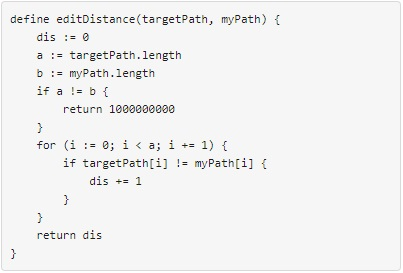
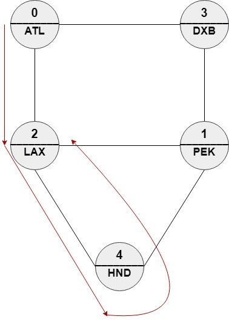
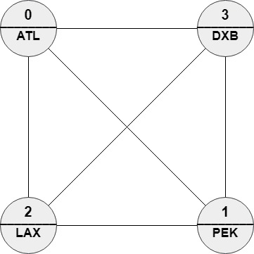
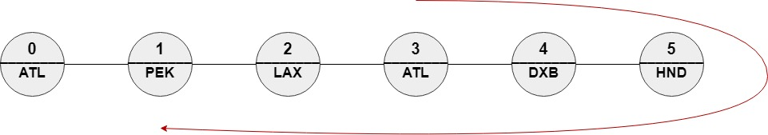

# [1548. The Most Similar Path in a Graph](https://leetcode.com/problems/the-most-similar-path-in-a-graph/)

| Category | Difficulty | Likes | Dislikes |
| :------: | :--------: | :---: | :------: |
| Algorithms | Hard | 380 | 187 |

**Tags:** [`dynamic-programming`](https://leetcode.com/tag/dynamic-programming), [`graph`](https://leetcode.com/tag/graph)

**Companies:** `google`

## Description

We have `n` cities and `m` bi-directional `roads` where `roads[i] = [a_i, b_i]` connects city `a_i` with city `b_i`. Each city has a name consisting of exactly three upper-case English letters given in the string array `names`. Starting at any city `x`, you can reach any city `y` where `y != x` (i.e., the cities and the roads are forming an undirected connected graph).

You will be given a string array `targetPath`. You should find a path in the graph of the **same length** and with the **minimum edit distance** to `targetPath`.

You need to return *the order of the nodes in the path with the minimum edit distance*. The path should be of the same length of `targetPath` and should be valid (i.e., there should be a direct road between `ans[i]` and `ans[i + 1]`). If there are multiple answers return any one of them.

The **edit distance** is defined as follows:



 

**Example 1:**


```

Input: n = 5, roads = [[0,2],[0,3],[1,2],[1,3],[1,4],[2,4]], names = [&quot;ATL&quot;,&quot;PEK&quot;,&quot;LAX&quot;,&quot;DXB&quot;,&quot;HND&quot;], targetPath = [&quot;ATL&quot;,&quot;DXB&quot;,&quot;HND&quot;,&quot;LAX&quot;]
Output: [0,2,4,2]
Explanation: [0,2,4,2], [0,3,0,2] and [0,3,1,2] are accepted answers.
[0,2,4,2] is equivalent to [&quot;ATL&quot;,&quot;LAX&quot;,&quot;HND&quot;,&quot;LAX&quot;] which has edit distance = 1 with targetPath.
[0,3,0,2] is equivalent to [&quot;ATL&quot;,&quot;DXB&quot;,&quot;ATL&quot;,&quot;LAX&quot;] which has edit distance = 1 with targetPath.
[0,3,1,2] is equivalent to [&quot;ATL&quot;,&quot;DXB&quot;,&quot;PEK&quot;,&quot;LAX&quot;] which has edit distance = 1 with targetPath.

```

**Example 2:**


```

Input: n = 4, roads = [[1,0],[2,0],[3,0],[2,1],[3,1],[3,2]], names = [&quot;ATL&quot;,&quot;PEK&quot;,&quot;LAX&quot;,&quot;DXB&quot;], targetPath = [&quot;ABC&quot;,&quot;DEF&quot;,&quot;GHI&quot;,&quot;JKL&quot;,&quot;MNO&quot;,&quot;PQR&quot;,&quot;STU&quot;,&quot;VWX&quot;]
Output: [0,1,0,1,0,1,0,1]
Explanation: Any path in this graph has edit distance = 8 with targetPath.

```

**Example 3:**

****

```

Input: n = 6, roads = [[0,1],[1,2],[2,3],[3,4],[4,5]], names = [&quot;ATL&quot;,&quot;PEK&quot;,&quot;LAX&quot;,&quot;ATL&quot;,&quot;DXB&quot;,&quot;HND&quot;], targetPath = [&quot;ATL&quot;,&quot;DXB&quot;,&quot;HND&quot;,&quot;DXB&quot;,&quot;ATL&quot;,&quot;LAX&quot;,&quot;PEK&quot;]
Output: [3,4,5,4,3,2,1]
Explanation: [3,4,5,4,3,2,1] is the only path with edit distance = 0 with targetPath.
It&#39;s equivalent to [&quot;ATL&quot;,&quot;DXB&quot;,&quot;HND&quot;,&quot;DXB&quot;,&quot;ATL&quot;,&quot;LAX&quot;,&quot;PEK&quot;]

```

 

**Constraints:**

	- `2 <= n <= 100`

	- `m == roads.length`

	- `n - 1 <= m <= (n * (n - 1) / 2)`

	- `0 <= a_i, b_i <= n - 1`

	- `a_i != b_i`

	- The graph is guaranteed to be **connected** and each pair of nodes may have **at most one** direct road.

	- `names.length == n`

	- `names[i].length == 3`

	- `names[i]` consists of upper-case English letters.

	- There can be two cities with **the same** name.

	- `1 <= targetPath.length <= 100`

	- `targetPath[i].length == 3`

	- `targetPath[i]` consists of upper-case English letters.

 

**Follow up:** If each node can be visited only once in the path, What should you change in your solution?

---

**Links:** [Submissions](https://leetcode.com/problems/the-most-similar-path-in-a-graph/) | [Solutions](https://leetcode.com/problems/the-most-similar-path-in-a-graph/)
