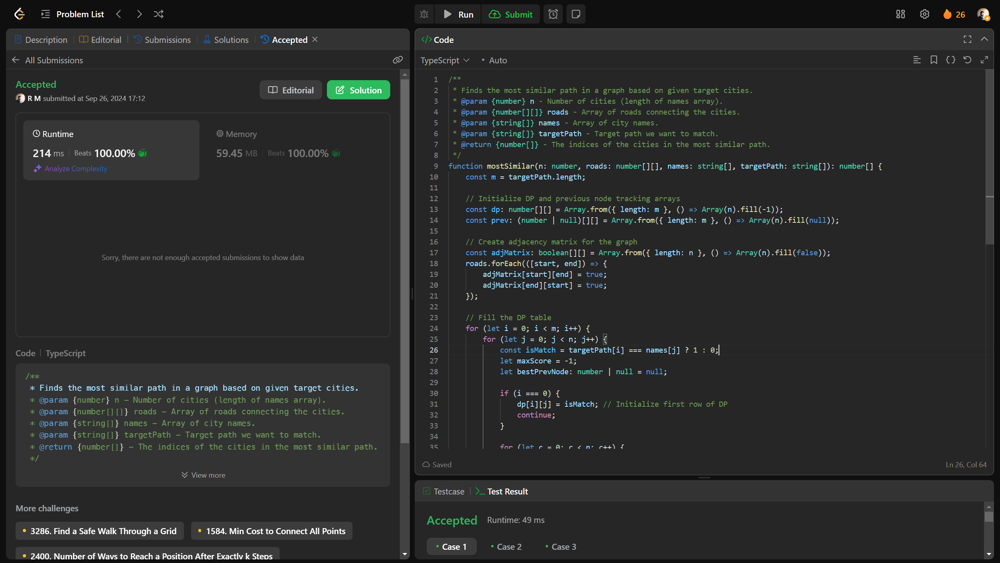

# 💥💥Beats 100% on runtime and memory [EXPLAINED]

**Author:** r9n
**Votes:** 0
**Link:** [https://leetcode.com/problems/the-most-similar-path-in-a-graph/solutions/5837891/](https://leetcode.com/problems/the-most-similar-path-in-a-graph/solutions/5837891/)

---




# Intuition
Find a path through a graph of cities that closely matches a given target sequence of city names. The goal is to minimize the differences between the names along the chosen path and the target path.

# Approach
Use DP to build a table where each entry represents the best score (edit distance) for reaching a city at a specific position in the target path, then backtrack to reconstruct the path based on previous cities.

# Complexity
- Time complexity:
O(M . N2), where m is the length of the target path and n is the number of cities, due to nested loops for each city and potential transitions.

- Space complexity:
O(M . N) for storing the DP table and previous node indices.

# Code
```typescript []
/**
 * Finds the most similar path in a graph based on given target cities.
 * @param {number} n - Number of cities (length of names array).
 * @param {number[][]} roads - Array of roads connecting the cities.
 * @param {string[]} names - Array of city names.
 * @param {string[]} targetPath - Target path we want to match.
 * @return {number[]} - The indices of the cities in the most similar path.
 */
function mostSimilar(n: number, roads: number[][], names: string[], targetPath: string[]): number[] {
    const m = targetPath.length;

    // Initialize DP and previous node tracking arrays
    const dp: number[][] = Array.from({ length: m }, () => Array(n).fill(-1));
    const prev: (number | null)[][] = Array.from({ length: m }, () => Array(n).fill(null));
    
    // Create adjacency matrix for the graph
    const adjMatrix: boolean[][] = Array.from({ length: n }, () => Array(n).fill(false));
    roads.forEach(([start, end]) => {
        adjMatrix[start][end] = true;
        adjMatrix[end][start] = true;
    });

    // Fill the DP table
    for (let i = 0; i < m; i++) {
        for (let j = 0; j < n; j++) {
            const isMatch = targetPath[i] === names[j] ? 1 : 0;
            let maxScore = -1;
            let bestPrevNode: number | null = null;

            if (i === 0) {
                dp[i][j] = isMatch; // Initialize first row of DP
                continue;
            }

            for (let c = 0; c < n; c++) {
                if (adjMatrix[j][c] && dp[i - 1][c] !== -1) {
                    const currentScore = isMatch + dp[i - 1][c];
                    if (currentScore > maxScore) {
                        maxScore = currentScore;
                        bestPrevNode = c; // Track the previous city
                    }
                }
            }

            dp[i][j] = maxScore;
            prev[i][j] = bestPrevNode; // Store the best previous node
        }
    }

    // Find the best ending city and its index
    let lastCityScores = dp[m - 1];
    let bestScore = -1;
    let bestCityIndex = -1;

    lastCityScores.forEach((score, index) => {
        if (score > bestScore) {
            bestScore = score;
            bestCityIndex = index; // Get the index of the best city
        }
    });

    // Reconstruct the path from the previous nodes
    const path: number[] = [];
    for (let i = m - 1; i >= 0; i--) {
        path.unshift(bestCityIndex); // Add the index to the front of the path
        bestCityIndex = prev[i][bestCityIndex]!; // Move to the previous city
    }

    return path;
}

```