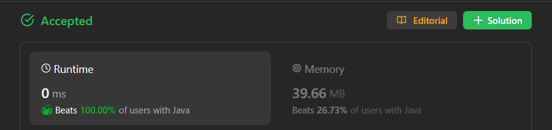

# ✅ Beats 100% - Explained with [ Video ] - Fastest Recursive Solution - Visualized Too

**Author:** lancertech6
**Votes:** 59
**Link:** [https://leetcode.com/problems/minimum-one-bit-operations-to-make-integers-zero/solutions/4344660/](https://leetcode.com/problems/minimum-one-bit-operations-to-make-integers-zero/solutions/4344660/)

---



# YouTube Video Explanation:

[https://youtu.be/GqS1MXRQW_0](https://youtu.be/GqS1MXRQW_0)

**\uD83D\uDD25 Please like, share, and subscribe to support our channel's mission of making complex concepts easy to understand.**

Subscribe Link: https://www.youtube.com/@leetlogics/?sub_confirmation=1

*Current Subscribers: 494*
*Subscribe Goal: 500 Subscribers*

---
# Example Visualization

### Binary Representation and Operations

| Input (Decimal) | Binary Representation | Operation | Output (Decimal) |
|------------------|------------------------|-----------|-------------------|
| 3                | 11                     | -         | -                 |
| 3                | 01                     | Flip 1th bit | 1              |
| 2                | 00                     | Flip 0st bit | 0              |

---

| Input (Decimal) | Binary Representation | Operation | Output (Decimal) |
|------------------|------------------------|-----------|-------------------|
| 6                | 110                    | -         | -                 |
| 6                | 010                    | Flip 1st bit | 2              |
| 4                | 011                    | Flip 0th bit | 3             |
| 5                | 001                    | Flip 1st bit | 1              |
| 1                | 000                    | Flip 0th bit | 0              |


# Intuition
<!-- Describe your first thoughts on how to solve this problem. -->
The goal is to find the minimum number of operations to transform the given integer `n` into 0, where each operation involves changing a specific bit in the binary representation of `n`. The two types of operations involve changing the rightmost bit or changing a bit based on the adjacent bits.

# Approach
<!-- Describe your approach to solving the problem. -->
1. If `n` is less than or equal to 1, the result is `n` itself because no operations are needed in this case.
2. Initialize a variable `count` to 0 and iterate until `(1 << count) <= n` to find the position of the leftmost set bit in the binary representation of `n`.
3. Calculate the result as `((1 << count) - 1) - minimumOneBitOperations(n - (1 << (count - 1)))`. This recursive formula considers the leftmost set bit and calculates the result for the remaining bits.
4. The recursive approach ensures that we consider all possible combinations of operations to minimize the total number of operations.

# Complexity
- Time Complexity: O(log n) - The recursive approach involves dividing the problem into subproblems, and the depth of the recursion is logarithmic in `n`.
- Space Complexity: O(log n) - The space complexity is determined by the maximum depth of the recursion stack.

# Code
```java []
class Solution {
    int min = Integer.MAX_VALUE;
    public int minimumOneBitOperations(int n) {
        if (n <= 1) return n;
        int count = 0;
        while ((1<<count) <= n) count++;
        return ((1<<count)-1) - minimumOneBitOperations(n-(1<<(count-1)));
    }

}
```
```C++ []
class Solution {
public:
    int minimumOneBitOperations(int n) {
        if (n <= 1) return n;
        int count = 0;
        while ((1<<count) <= n) count++;
        return ((1<<count)-1) - minimumOneBitOperations(n-(1<<(count-1)));
    }
};
```
``` Python []
class Solution(object):
    def minimumOneBitOperations(self, n):
        if n <= 1:
            return n
        count = 0
        while (1 << count) <= n:
            count += 1
        return ((1 << count) - 1) - self.minimumOneBitOperations(n - (1 << (count - 1)))
        
```
```JavaScript []
/**
 * @param {number} n
 * @return {number}
 */
var minimumOneBitOperations = function(n) {
    if (n <= 1) return n;
    let count = 0;
    while ((1 << count) <= n) count++;
    return ((1 << count) - 1) - minimumOneBitOperations(n - (1 << (count - 1)));
};
```

