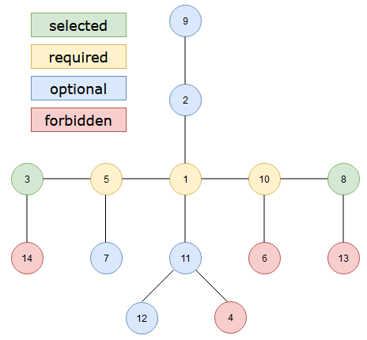

# Beat 100% | O(n^3) | DP | BFS + DFS | Iterate diameters | Explained

**Author:** narfuls
**Votes:** 1
**Link:** [https://leetcode.com/problems/count-subtrees-with-max-distance-between-cities/solutions/4165623/](https://leetcode.com/problems/count-subtrees-with-max-distance-between-cities/solutions/4165623/)

---

# Intuition
<!-- Describe your first thoughts on how to solve this problem. -->
Very hard. My respect for those who come up with this approach.
  
# Approach
<!-- Describe your approach to solving the problem. -->
First we need to know neighbors for each city, so create an adjacency list.
Next we need to know distance between any two cities. Create 2d array distances using BFS.

**Main idea:**
For every pair of cites calculate number subtrees between, such that maximum distance in subtree less or equal diameter.

Take **1 and 2 as diameter**. There is only one subtree because distance from 3 or 4 to 1 is more than the diameter.
Let's take **1 and 3 as diameter**. How many  subtrees between 1 and 3? There are two subtrees (we have to choose 2, but 4 is optional).
We can use DFS to calculate number of subtrees. 
Start from 1 look for adjacent.
Distance from 2 to 1 plus distance from 2 to 3 equals the diameter, so we have to choose 2.
Distance from 4 to 1 plus distance from 4 to 3 more than the diameter, so 4 is optional. Multiply number subtrees by 2.
However, if we take **1 and 4 as diameter** we count full tree twice. How to avoid such situation? We can iterate cities in increasing order and when distance to any diameter edge equals the diameter choose city only if it is greater than other edge.
Distance from 1 to 3 is equal the diameter, but 3 less than 4 so we cannot choose 3.

**More complex example:**

3 and 8 edges of diameter (d=4)
```
dist[5][3] + dist[5][8] == d
dist[1][3] + dist[1][8] == d 
dist[10][3] + dist[10][8] == d
```
We have to choose cities 5, 1 and 10. 
```
dist[13][3] > d
dist[14][8] > d
```
We cannot choose cities 13 and 14. 
```
dist[4][3] == d but 4 < 8
dist[6][3] == d but 6 < 8
```
We cannot choose cities 4 and 6. 
```
dist[7][8] == d and 7 > 3
dist[9][3] == d and 9 > 8
dist[12][3] == d and 12 > 8
```
We may choose or not to choose cities 7,9 and 12. 
```
dist[2][3] < d and dist[2][8] < d
dist[11][3] < d and dist[11][8] < d
```
We may choose or not to choose cities 2 and 11. 

**DFS addition value is 0** for required(1, 5 and 10).
**DFS addition value is 1** for optional(2, 7, 9, 11 and 12)
Forbidden(4, 6,13 and 14) shold be excluded from DFS.

**Number of subtrees between 3 and 8 is DFS(3)**
```
DFS(3) == 0 + DFS(5)
DFS(5) == 0 + DFS(7) * DFS(1)
DFS(7) == 1 + 1
DFS(1) == 0 + DFS(2) * DFS(10) * DFS(11)
DFS(2) == 1 + DFS(9)
DFS(9) == 1 + 1
DFS(10) == 0 + 1 // 6 and 8 is forbidden
DFS(11) == 1 + DFS(12)
DFS(12) == 1 + 1
```
# Complexity
- Time complexity: O(n^3)
<!-- Add your time complexity here, e.g. $$O(n)$$ -->

- Space complexity: O(n^2)
<!-- Add your space complexity here, e.g. $$O(n)$$ -->

# Code
```
public class Solution {
    private byte[][] dist;
    private List<byte>[] adj;
    private void InitAdjecency(int n, int[][] edges)
    {
        adj = Enumerable.Repeat(0, n).Select(_ => new List<byte>()).ToArray();
        foreach (var edge in edges)
        {
            adj[edge[0] - 1].Add((byte)(edge[1] - 1));
            adj[edge[1] - 1].Add((byte)(edge[0] - 1));
        }

    }
    private void DistanceBFS(byte[] disI, byte cur, byte prev)
    {
        foreach (byte next in adj[cur])
        {
            if (next != prev)
            {
                disI[next] = disI[cur]; 
                disI[next]++;
                DistanceBFS(disI, next, cur);
            }
        }
    }
    private void InitDistance(int n)
    {
        dist = new byte[n][];
        for (byte i = 0; i < n; i++)
        {
            dist[i] = new byte[n];
            DistanceBFS(dist[i], i, i);
        }
    }
    private int DFS(byte i, byte j, byte cur, byte prev)
    {
        int optionalValue = dist[i][cur] + dist[j][cur] > dist[i][j] ? 1 : 0;
        int res = 1;
        foreach (byte next in adj[cur])
        {
            if (next != prev &&
               (dist[i][next] < dist[i][j] || dist[i][next] == dist[i][j] && next > j) &&
               (dist[j][next] < dist[i][j] || dist[j][next] == dist[i][j] && next > i)) 
                res *= DFS(i, j, next, cur);
        }
        return res + optionalValue;
    }
    public int[] CountSubgraphsForEachDiameter(int n, int[][] edges)
    {
        InitAdjecency(n, edges);
        InitDistance(n);
        var res = new int[n-1];
        res[0] = n - 1;
        for (byte i = 0; i < n; i++)
        {
            for (byte j = (byte)(i + 1); j < n; j++)
            {
                if(dist[i][j] > 1)
                    res[dist[i][j] - 1] += DFS(i, j, i, 255);
            }
        }
        return res;
    }
}
```