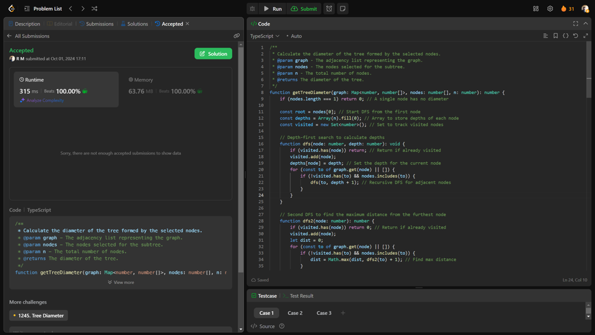

# 💥💥Beats 100% on runtime and memory [EXPLAINED]

**Author:** r9n
**Votes:** 0
**Link:** [https://leetcode.com/problems/count-subtrees-with-max-distance-between-cities/solutions/5857867/](https://leetcode.com/problems/count-subtrees-with-max-distance-between-cities/solutions/5857867/)

---



# Intuition
The problem revolves around understanding trees as a special type of graph where there\u2019s a unique path between any two nodes. Each subtree formed by selecting nodes can have various distances between its furthest nodes, and our goal is to count how many of these subtrees correspond to each possible maximum distance.


# Approach
We first build a graph from the edges, then iterate through all possible subsets of nodes using bit manipulation to determine which nodes are included, checking if the subset forms a single connected component, and if so, calculating its diameter (maximum distance) using depth-first search; we store these counts in an array corresponding to their diameters.


# Complexity
- Time complexity:
O(n . 2n) because we evaluate all subsets (up to 2n) and check the connected components and diameters for each subset.


- Space complexity:
O(n) for storing the graph and auxiliary data structures like visited nodes and depths during the DFS.


# Code
```typescript []
/**
 * Calculate the diameter of the tree formed by the selected nodes.
 * @param graph - The adjacency list representing the graph.
 * @param nodes - The nodes selected for the subtree.
 * @param n - The total number of nodes.
 * @returns The diameter of the tree.
 */
function getTreeDiameter(graph: Map<number, number[]>, nodes: number[], n: number): number {
    if (nodes.length === 1) return 0; // A single node has no diameter

    const root = nodes[0]; // Start DFS from the first node
    const depths = Array(n).fill(0); // Array to store depths of each node
    const visited = new Set<number>(); // Set to track visited nodes

    // Depth-first search to calculate depths
    function dfs(node: number, depth: number): void {
        if (visited.has(node)) return; // Return if already visited
        visited.add(node);
        depths[node] = depth; // Set the depth for the current node
        for (const to of graph.get(node) || []) {
            if (!visited.has(to) && nodes.includes(to)) {
                dfs(to, depth + 1); // Recursive DFS for adjacent nodes
            }
        }
    }

    // Second DFS to find the maximum distance from the furthest node
    function dfs2(node: number): number {
        if (visited.has(node)) return 0; // Return if already visited
        visited.add(node);
        let dist = 0;
        for (const to of graph.get(node) || []) {
            if (!visited.has(to) && nodes.includes(to)) {
                dist = Math.max(dist, dfs2(to) + 1); // Find max distance
            }
        }
        return dist; // Return the maximum distance found
    }

    // Perform first DFS to calculate depths
    dfs(root, 0);
    let maxDepth = -1;
    let furthestNode = -1;

    // Identify the furthest node from the root
    for (const node of nodes) {
        if (depths[node] > maxDepth) {
            maxDepth = depths[node];
            furthestNode = node;
        }
    }

    visited.clear(); // Clear visited set for the second DFS
    return dfs2(furthestNode); // Get the diameter from the furthest node
}

/**
 * Get the size of the connected component for the selected nodes.
 * @param graph - The adjacency list representing the graph.
 * @param nodes - The nodes selected for the component.
 * @param n - The total number of nodes.
 * @returns The size of the connected component.
 */
function getComponentSize(graph: Map<number, number[]>, nodes: number[], n: number): number {
    let count = 0; // Count of connected components
    const visited = Array(n).fill(false); // Array to track visited nodes

    // Depth-first search to mark connected nodes
    function dfs(node: number): void {
        if (visited[node]) return; // Return if already visited
        visited[node] = true; // Mark the node as visited
        for (const to of graph.get(node) || []) {
            if (!visited[to] && nodes.includes(to)) {
                dfs(to); // Recursive DFS for adjacent nodes
            }
        }
    }

    // Iterate through selected nodes to count components
    for (const node of nodes) {
        if (!visited[node]) {
            dfs(node); // Perform DFS for each unvisited node
            count += 1; // Increment count for each component found
        }
    }
    return count; // Return the total number of components
}

/**
 * Count the number of subgraphs for each diameter.
 * @param n - The total number of nodes.
 * @param edges - The edges connecting the nodes.
 * @returns An array with counts of subgraphs for each diameter.
 */
const countSubgraphsForEachDiameter = function (n: number, edges: number[][]): number[] {
    const graph = new Map<number, number[]>(); // Graph representation
    const distMap = new Map<number, number[][]>(); // Map to store distances and corresponding nodes

    // Build the graph from the edges
    for (const [a, b] of edges) {
        const u = a - 1; // Convert to 0-based index
        const v = b - 1;
        if (!graph.has(u)) {
            graph.set(u, []);
        }
        if (!graph.has(v)) {
            graph.set(v, []);
        }
        graph.get(u)!.push(v); // Add edge to the graph
        graph.get(v)!.push(u);
    }

    // Iterate over all subsets of nodes using bit masking
    for (let mask = 0; mask < (1 << n); mask++) {
        const select: number[] = []; // Selected nodes for the current subset
        for (let j = 0; j < n; j++) {
            if (mask & (1 << j)) {
                select.push(j); // Add the node if it's included in the subset
            }
        }

        // Get the size of the connected component for the selected nodes
        const size = getComponentSize(graph, select, n);
        if (size === 1) { // Only consider single components
            const dist = getTreeDiameter(graph, select, n); // Calculate tree diameter
            if (!distMap.has(dist)) {
                distMap.set(dist, []);
            }
            distMap.get(dist)!.push(select); // Store the nodes for the diameter
        }
    }

    const ans = Array(n - 1).fill(0); // Initialize answer array
    for (let d = 1; d <= n - 1; d++) {
        const count = distMap.get(d)?.length || 0; // Count for diameter d
        ans[d - 1] = count; // Store in result
    }
    return ans; // Return the final counts for each diameter
};

```