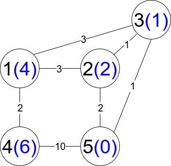
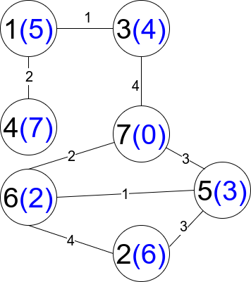

# [1786. Number of Restricted Paths From First to Last Node](https://leetcode.com/problems/number-of-restricted-paths-from-first-to-last-node/)

| Category | Difficulty | Likes | Dislikes |
| :------: | :--------: | :---: | :------: |
| Algorithms | Medium | 1181 | 230 |

**Tags:** [`dynamic-programming`](https://leetcode.com/tag/dynamic-programming), [`graph`](https://leetcode.com/tag/graph), [`topological-sort`](https://leetcode.com/tag/topological-sort), [`heap-priority-queue`](https://leetcode.com/tag/heap-priority-queue), [`shortest-path`](https://leetcode.com/tag/shortest-path)

**Companies:** `google`

## Description

There is an undirected weighted connected graph. You are given a positive integer `n` which denotes that the graph has `n` nodes labeled from `1` to `n`, and an array `edges` where each `edges[i] = [u_i, v_i, weight_i]` denotes that there is an edge between nodes `u_i` and `v_i` with weight equal to `weight_i`.

A path from node `start` to node `end` is a sequence of nodes `[z_0, z_1,_ z_2, ..., z_k]` such that `z_0 = start` and `z_k = end` and there is an edge between `z_i` and `z_i+1` where `0  distanceToLastNode(z_i+1)` where `0 <= i <= k-1`.

Return *the number of restricted paths from node* `1` *to node* `n`. Since that number may be too large, return it **modulo** `10^9 + 7`.

 

**Example 1:**


```

Input: n = 5, edges = [[1,2,3],[1,3,3],[2,3,1],[1,4,2],[5,2,2],[3,5,1],[5,4,10]]
Output: 3
Explanation: Each circle contains the node number in black and its distanceToLastNode value in blue. The three restricted paths are:
1) 1 --&gt; 2 --&gt; 5
2) 1 --&gt; 2 --&gt; 3 --&gt; 5
3) 1 --&gt; 3 --&gt; 5

```

**Example 2:**


```

Input: n = 7, edges = [[1,3,1],[4,1,2],[7,3,4],[2,5,3],[5,6,1],[6,7,2],[7,5,3],[2,6,4]]
Output: 1
Explanation: Each circle contains the node number in black and its distanceToLastNode value in blue. The only restricted path is 1 --&gt; 3 --&gt; 7.

```

 

**Constraints:**

	- `1 <= n <= 2 * 10^4`

	- `n - 1 <= edges.length <= 4 * 10^4`

	- `edges[i].length == 3`

	- `1 <= u_i, v_i <= n`

	- `u_i != v_i`

	- `1 <= weight_i <= 10^5`

	- There is at most one edge between any two nodes.

	- There is at least one path between any two nodes.

---

**Links:** [Submissions](https://leetcode.com/problems/number-of-restricted-paths-from-first-to-last-node/) | [Solutions](https://leetcode.com/problems/number-of-restricted-paths-from-first-to-last-node/)
