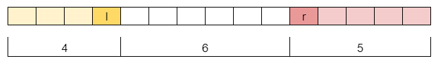
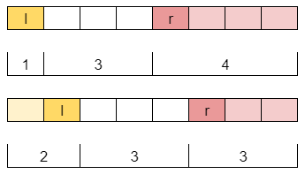

# Recursion, Memo and Optimized Recursion

**Author:** votrubac
**Votes:** 104
**Link:** [https://leetcode.com/problems/the-earliest-and-latest-rounds-where-players-compete/solutions/1268539/](https://leetcode.com/problems/the-earliest-and-latest-rounds-where-players-compete/solutions/1268539/)

---

> We start with the straightforward recursion, then optimize it using memoisation, and finally arrive at the efficient solution using all that insight we gained. 

#### Recursion
We try all combinations, and it should work since  `n` is limited to `28`. For the first round, we have no more than 2  ^ 12 choices (14 pairs, and winners are predefined for 2 pairs), second round - 2 ^ 5, then 2 ^ 2, then 1 choice, and finally we will have just two winners left. Therefore, we will have up to 524,288 total combinations and 5 rounds.

The tricky part is to make it as efficient as possible. For that, I am using `mask` to indicate which players have been eliminated.
 
We move `i` and `j` to pick the pairs; when `i >= j`, we start a new round. When `i` and `j` point to our finalists, we update the min and max rounds.

**C++**
```cpp
int min_r = INT_MAX, max_r = INT_MIN;
void dfs(int mask, int round, int i, int j, int first, int second) {
    if (i >= j)
        dfs(mask, round + 1, 0, 27, first, second);
    else if ((mask & (1 << i)) == 0)
        dfs(mask, round, i + 1, j, first, second);
    else if ((mask & (1 << j)) == 0)
        dfs(mask, round, i, j - 1, first, second);
    else if (i == first && j == second) {
        min_r = min(min_r, round);
        max_r = max(max_r, round);
    }
    else {
        if (i != first && i != second)
            dfs(mask ^ (1 << i), round, i + 1, j - 1, first, second);
        if (j != first && j != second)
            dfs(mask ^ (1 << j), round, i + 1, j - 1, first, second);
    }
}
vector<int> earliestAndLatest(int n, int first, int second) {
    dfs((1 << n) - 1, 1, 0, 27, first - 1, second - 1);
    return { min_r, max_r };
}
```
**Complexity Analysis**
- Time: O(2 ^ n).
- Memory: O(log n) for the recursion.

#### Add Memoisation
I tried to memoise `visited` masks, but it only gave a modest boost. Then I realized that what really matters are the number of players standing before the first (left), in between (mid), and after (right) the second player. So we keep track of `l`, `m`, and `r` - a bit messy but does the job. With this insight, the runtime improved from 500 to 0 ms.

**C++**
```cpp
int min_r = INT_MAX, max_r = INT_MIN;
bool visited[27][27][27] = {};
void dfs(int mask, int round, int i, int j, int first, int second, int l, int m, int r) {
    if (i >= j)
        dfs(mask, round + 1, 0, 27, first, second, l, m, r);
    else if ((mask & (1 << i)) == 0)
        dfs(mask, round, i + 1, j, first, second, l, m, r);
    else if ((mask & (1 << j)) == 0)
        dfs(mask, round, i, j - 1, first, second, l, m, r);
    else if (i == first && j == second) {
        min_r = min(min_r, round);
        max_r = max(max_r, round);
    }
    else if (!visited[l][m][r]) {
        visited[l][m][r] = true;
        if (i != first && i != second)
            dfs(mask ^ (1 << i), round, i + 1, j - 1, first, second, 
                l - (i < first), m - (i > first && i < second), r - (i > second));
        if (j != first && j != second)
            dfs(mask ^ (1 << j), round, i + 1, j - 1, first, second,
                l - (j < first), m - (j > first && j < second), r - (j > second));
    }
}
vector<int> earliestAndLatest(int n, int first, int second) {
    dfs((1 << n) - 1, 1, 0, 27, first - 1, second - 1, first - 1, second - first - 1, n - second);
    return { min_r, max_r };
}
```
**Complexity Analysis**
- Time: O(n ^ 3).
- Memory: O(n ^ 3) for the memoisation.

#### Optimized Recursion
With the insight about tracking the number of players between champions, we can simplify the algorithm by computing possible transitions instead of simulating individual competitions. Say, we have 15 total players; 4 players on the left and 5 - on the right (including champions).



For the second round, we will have 8 total players, and two possible cases: `[1, 4]` (or `[4, 1]`) and `[2, 3]` (or `[3, 2]`).



So, we will track players on the left `l` and right `r`, including champions, and total number of players `n`. If `l == r`, our champions will compete in the current round. 

Determining the valid standings of players `i` and `j` after the round is a bit tricky, but here are ground rules:
- To simplify the calculation, we always make sure `l < r`. We can do it because reult for `[8, 3]` will be the same as for `[3, 8]`. 
- `i` and `j` should be at least one to account for a champion.
- Picking `i` players on the left meaning that `l - i` players lose to players on the right.
	- So we have to pick `l - i  + 1` players on the right or more (`+1` is for the champion).
- Winers on the left and right (`i  + j`) should not exceed the number of players in the next round (`(n + 1) / 2`).
- Loosers on the left and right (`l - i + r - j`) should not exceed the half of players in the current round.

**C++**
```cpp
int min_r = INT_MAX, max_r = INT_MIN;
void dfs(int l, int r, int n, int round) {
    if (l == r) {
        min_r = min(min_r, round);
        max_r = max(max_r, round);
    }
    else
        if (l > r)
            swap(l, r);
        for (int i = 1; i < l + 1; ++i)
            for (int j = l - i + 1; i + j <= min(r, (n + 1) / 2); ++j)
                if (l + r - (i + j) <= n / 2)
                    dfs(i, j, (n + 1) / 2, round + 1);
}
vector<int> earliestAndLatest(int n, int first, int second) {
    dfs(first, n - second + 1, n, 1);
    return { min_r, max_r };
}
```