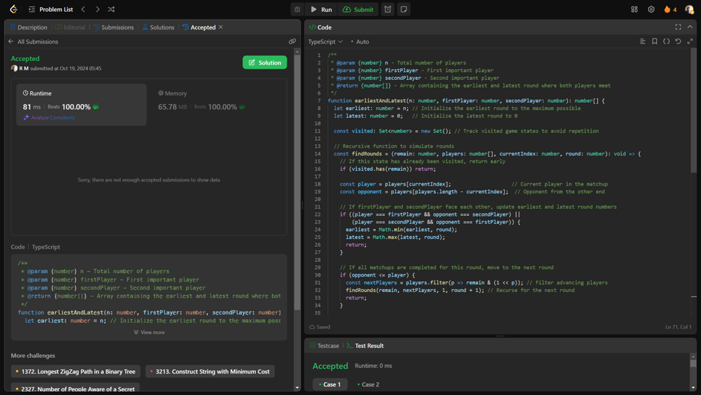

# 💥💥Beats 100% on runtime and memory [EXPLAINED]

**Author:** r9n
**Votes:** 0
**Link:** [https://leetcode.com/problems/the-earliest-and-latest-rounds-where-players-compete/solutions/5936208/](https://leetcode.com/problems/the-earliest-and-latest-rounds-where-players-compete/solutions/5936208/)

---




# Intuition
Simulate a knockout tournament where players face off in pairs, and two special players must be tracked to find out when they compete against each other. The goal is to identify the earliest and latest rounds where these two players can meet based on their winning potential.

# Approach
Use a recursive function to simulate rounds of the tournament, tracking remaining players, and determine matchups until the two special players face each other, while leveraging bit manipulation to manage player states and ensuring that visited states are stored to avoid unnecessary calculations.

# Complexity
- Time complexity:
O(n log n) because each round eliminates half of the players, and we process each player multiple times.

- Space complexity:
O(n) for storing the visited states and the players array.
# Code
```typescript []
/**
 * @param {number} n - Total number of players
 * @param {number} firstPlayer - First important player
 * @param {number} secondPlayer - Second important player
 * @return {number[]} - Array containing the earliest and latest round where both players meet
 */
function earliestAndLatest(n: number, firstPlayer: number, secondPlayer: number): number[] {
  let earliest: number = n; // Initialize the earliest round to the maximum possible
  let latest: number = 0;   // Initialize the latest round to 0

  const visited: Set<number> = new Set(); // Track visited game states to avoid repetition

  // Recursive function to simulate rounds
  const findRounds = (remain: number, players: number[], currentIndex: number, round: number): void => {
    // If this state has already been visited, return early
    if (visited.has(remain)) return;

    const player = players[currentIndex];                    // Current player in the matchup
    const opponent = players[players.length - currentIndex];  // Opponent from the other end

    // If firstPlayer and secondPlayer face each other, update earliest and latest round numbers
    if ((player === firstPlayer && opponent === secondPlayer) ||
        (player === secondPlayer && opponent === firstPlayer)) {
      earliest = Math.min(earliest, round);
      latest = Math.max(latest, round);
      return;
    }

    // If all matchups are completed for this round, move to the next round
    if (opponent <= player) {
      const nextPlayers = players.filter(p => remain & (1 << p)); // Filter advancing players
      findRounds(remain, nextPlayers, 1, round + 1); // Recurse for the next round
      return;
    }

    // Simulate both outcomes where player or opponent wins
    const remainIfPlayerWins = remain ^ (1 << opponent);  // Player wins, opponent eliminated
    const remainIfOpponentWins = remain ^ (1 << player);  // Opponent wins, player eliminated
    const nextIndex = currentIndex + 1;

    // Recursion based on which player is important
    if (player === firstPlayer || player === secondPlayer) {
      findRounds(remainIfPlayerWins, players, nextIndex, round);
      return;
    }
    if (opponent === firstPlayer || opponent === secondPlayer) {
      findRounds(remainIfOpponentWins, players, nextIndex, round);
      return;
    }

    // Recurse for both outcomes
    findRounds(remainIfPlayerWins, players, nextIndex, round);
    findRounds(remainIfOpponentWins, players, nextIndex, round);

    // Mark the current state as visited
    visited.add(remain);
  };

  // Create a list of players (1-indexed)
  const players: number[] = Array.from({ length: n + 1 }, (_, i) => i);

  // Bitmask to represent all players remaining
  const ALL_PLAYERS_REMAIN = (1 << (n + 1)) - 1;

  // Start the search from the first round
  findRounds(ALL_PLAYERS_REMAIN, players, 1, 1);

  // Return the earliest and latest round where the two players meet
  return [earliest, latest];
}

```