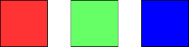

# [1931. Painting a Grid With Three Different Colors](https://leetcode.com/problems/painting-a-grid-with-three-different-colors/)

| Category | Difficulty | Likes | Dislikes |
| :------: | :--------: | :---: | :------: |
| Algorithms | Hard | 898 | 57 |

**Tags:** [`dynamic-programming`](https://leetcode.com/tag/dynamic-programming)

**Companies:** `intuit`, `google`

## Description

You are given two integers `m` and `n`. Consider an `m x n` grid where each cell is initially white. You can paint each cell **red**, **green**, or **blue**. All cells **must** be painted.

Return* the number of ways to color the grid with **no two adjacent cells having the same color***. Since the answer can be very large, return it **modulo** `10^9 + 7`.

 

**Example 1:**


```

Input: m = 1, n = 1
Output: 3
Explanation: The three possible colorings are shown in the image above.

```

**Example 2:**


```

Input: m = 1, n = 2
Output: 6
Explanation: The six possible colorings are shown in the image above.

```

**Example 3:**

```

Input: m = 5, n = 5
Output: 580986

```

 

**Constraints:**

	- `1 <= m <= 5`

	- `1 <= n <= 1000`

---

**Links:** [Submissions](https://leetcode.com/problems/painting-a-grid-with-three-different-colors/) | [Solutions](https://leetcode.com/problems/painting-a-grid-with-three-different-colors/)
