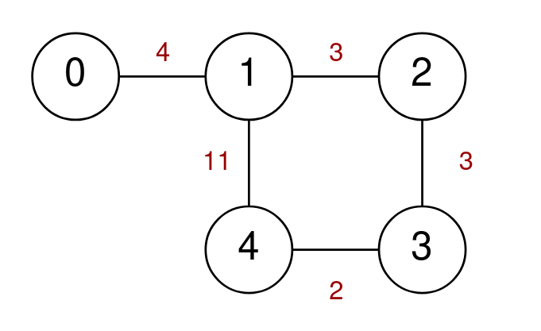
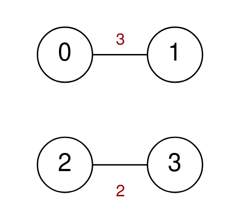

# [2247. Maximum Cost of Trip With K Highways](https://leetcode.com/problems/maximum-cost-of-trip-with-k-highways/)

| Category | Difficulty | Likes | Dislikes |
| :------: | :--------: | :---: | :------: |
| Algorithms | Hard | 63 | 0 |

**Tags:** [`dynamic-programming`](https://leetcode.com/tag/dynamic-programming), [`bit-manipulation`](https://leetcode.com/tag/bit-manipulation), [`graph`](https://leetcode.com/tag/graph), [`bitmask`](https://leetcode.com/tag/bitmask)


## Description

A series of highways connect `n` cities numbered from `0` to `n - 1`. You are given a 2D integer array `highways` where `highways[i] = [city1_i, city2_i, toll_i]` indicates that there is a highway that connects `city1_i` and `city2_i`, allowing a car to go from `city1_i` to `city2_i` and **vice versa** for a cost of `toll_i`.

You are also given an integer `k`. You are going on a trip that crosses **exactly** `k` highways. You may start at any city, but you may only visit each city **at most** once during your trip.

Return* the **maximum** cost of your trip. If there is no trip that meets the requirements, return *`-1`*.*

 

**Example 1:**


```

Input: n = 5, highways = [[0,1,4],[2,1,3],[1,4,11],[3,2,3],[3,4,2]], k = 3
Output: 17
Explanation:
One possible trip is to go from 0 -&gt; 1 -&gt; 4 -&gt; 3. The cost of this trip is 4 + 11 + 2 = 17.
Another possible trip is to go from 4 -&gt; 1 -&gt; 2 -&gt; 3. The cost of this trip is 11 + 3 + 3 = 17.
It can be proven that 17 is the maximum possible cost of any valid trip.

Note that the trip 4 -&gt; 1 -&gt; 0 -&gt; 1 is not allowed because you visit the city 1 twice.

```

**Example 2:**


```

Input: n = 4, highways = [[0,1,3],[2,3,2]], k = 2
Output: -1
Explanation: There are no valid trips of length 2, so return -1.

```

 

**Constraints:**

	- `2 <= n <= 15`

	- `1 <= highways.length <= 50`

	- `highways[i].length == 3`

	- `0 <= city1_i, city2_i <= n - 1`

	- `city1_i != city2_i`

	- `0 <= toll_i <= 100`

	- `1 <= k <= 50`

	- There are no duplicate highways.

---

**Links:** [Submissions](https://leetcode.com/problems/maximum-cost-of-trip-with-k-highways/) | [Solutions](https://leetcode.com/problems/maximum-cost-of-trip-with-k-highways/)
