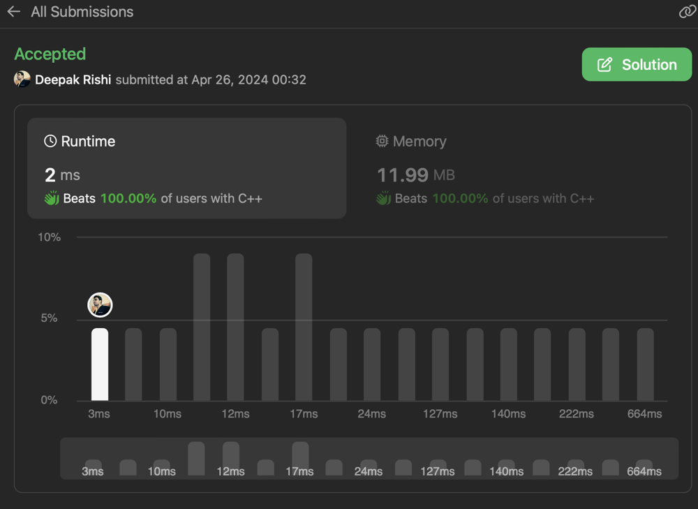

# N times Dijkstra's beats 100% of all solutions

**Author:** deerishi
**Votes:** 0
**Link:** [https://leetcode.com/problems/maximum-cost-of-trip-with-k-highways/solutions/5073848/](https://leetcode.com/problems/maximum-cost-of-trip-with-k-highways/solutions/5073848/)

---

image.png



# Complexity
- Time complexity:
<!-- Add your time complexity here, e.g. $$O(n)$$ -->
O(N*(V+E)logE)

- Space complexity:
<!-- Add your space complexity here, e.g. $$O(n)$$ -->

# Code
```
class Solution {
    int helper(int n, vector<vector<array<int,2>>> & graph, int k,int src){
        priority_queue<array<int,3>,vector<array<int,3>>> pq;
        int res=-1;
        pq.push({0,src,k});

        vector<bool> visited(n,false);

        while(pq.size()){
            auto [dist,node,kl]=pq.top();pq.pop();
            //cout<<"node="<<node<<", dist="<<dist<<", k="<<k<<"\
";
            if(visited[node]) continue;
            if(kl==0){
                res=max(res,dist);
                continue;
            }
            
            visited[node]=true;

            for(auto [ne,c]:graph[node]){
                if(!visited[ne]){
                    pq.push({dist+c,ne,kl-1});
                }
            }
        }

        return res;
    }
public:
    int maximumCost(int n, vector<vector<int>>& highways, int k) {
        vector<vector<array<int,2>>> graph(n+1);

        for(auto h:highways){
            int x=h[0],y=h[1],cost=h[2];
            graph[x].push_back({y,cost});
            graph[y].push_back({x,cost});
        }

        int res=-1;
        for(auto i=0;i<n;i++){
            res=max(res,helper(n,graph,k,i));
            cout<<"\
--------\
";
        }

        return res;
    }
};
```