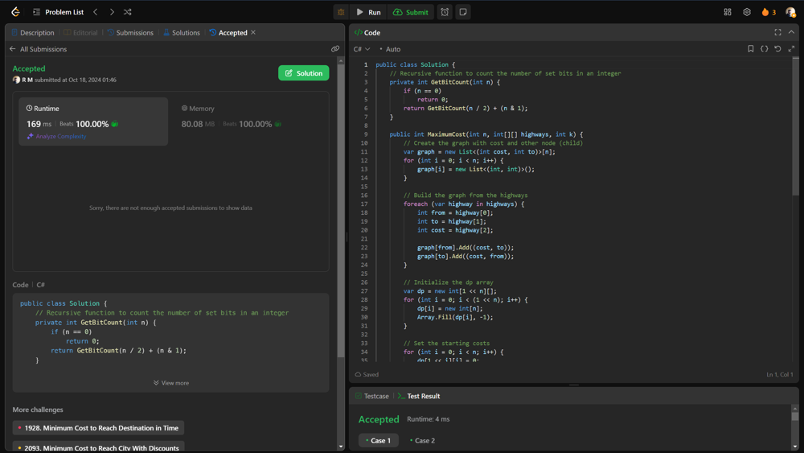

# 💥💥 Beats 100% on runtime and memory [EXPLAINED]

**Author:** r9n
**Votes:** 0
**Link:** [https://leetcode.com/problems/maximum-cost-of-trip-with-k-highways/solutions/5929950/](https://leetcode.com/problems/maximum-cost-of-trip-with-k-highways/solutions/5929950/)

---




# Intuition
Finding the maximum cost of traveling through a network of cities connected by highways while crossing exactly a specified number of highways. The goal is to consider different paths and accumulate toll costs, ensuring each city is visited only once.

# Approach
Use DP with bitmasking to track visited cities and their corresponding costs, iterating through all possible combinations of cities to find the maximum toll for paths that use exactly k highways.

# Complexity
- Time complexity:
O(n * 2^n), where n is the number of cities, due to the need to evaluate each subset of cities.

- Space complexity:
O(n * 2^n) for the dynamic programming table that stores the maximum costs for each subset of visited cities.

# Code
```csharp []
public class Solution {
    // Recursive function to count the number of set bits in an integer
    private int GetBitCount(int n) {
        if (n == 0)
            return 0;
        return GetBitCount(n / 2) + (n & 1);
    }

    public int MaximumCost(int n, int[][] highways, int k) {
        // Create the graph with cost and other node (child)
        var graph = new List<(int cost, int to)>[n];
        for (int i = 0; i < n; i++) {
            graph[i] = new List<(int, int)>();
        }

        // Build the graph from the highways
        foreach (var highway in highways) {
            int from = highway[0];
            int to = highway[1];
            int cost = highway[2];

            graph[from].Add((cost, to));
            graph[to].Add((cost, from));
        }

        // Initialize the dp array
        var dp = new int[1 << n][];
        for (int i = 0; i < (1 << n); i++) {
            dp[i] = new int[n];
            Array.Fill(dp[i], -1);
        }

        // Set the starting costs
        for (int i = 0; i < n; i++) {
            dp[1 << i][i] = 0;
        }

        // Process the dynamic programming table
        for (int mask = 0; mask < (1 << n); mask++) {
            for (int i = 0; i < n; i++) {
                if ((mask >> i & 1) == 1) {
                    // Remaining mask after removing the i-th node
                    int remainingMask = mask ^ (1 << i);

                    foreach (var (cost, child) in graph[i]) {
                        // Check if the child is in the remaining mask
                        if ((remainingMask >> child & 1) == 0)
                            continue;

                        // Update dp table
                        if (dp[remainingMask][child] != -1) {
                            dp[mask][i] = Math.Max(dp[mask][i], dp[remainingMask][child] + cost);
                        }
                    }
                }
            }
        }

        int ans = -1;

        // Find the maximum cost with exactly k highways used
        for (int mask = 0; mask < (1 << n); mask++) {
            int count = GetBitCount(mask);
            if (count == k + 1) {
                ans = Math.Max(ans, dp[mask].Max());
            }
        }

        return ans;
    }
}

```