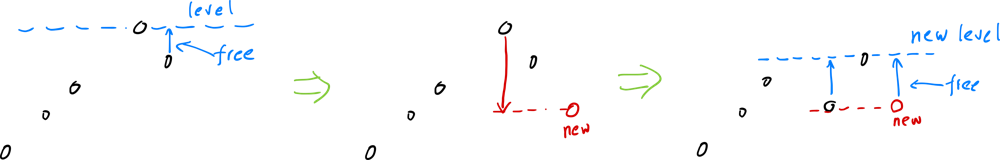

# DP, Heap, detailed explanation

**Author:** yuanzhi247012
**Votes:** 51
**Link:** [https://leetcode.com/problems/make-array-non-decreasing-or-non-increasing/solutions/2010254/](https://leetcode.com/problems/make-array-non-decreasing-or-non-increasing/solutions/2010254/)

---

**DP O(n^2):**
We only need to look at \u201Dincreasing\u201C case, decreasing is same as increasing with reversed nums.
dp(i, level) means the minimum operations needed to make nums increasing until nums[i], with **nums[i] <= level**.
dp(i, level) = min(dp(i-1, level0) + abs(nums[i]-level0)) for all "level0<=level".

Here "dp(i-1, level) + abs(nums[i] - level)" means minimum operations needed to make nums increasing until nums[i], with **nums[i] == level**. This is the result for **nums[i] == level**, but not **nums[i]<= level** as defined by DP. So we calculate same way for all levels that <= "level", the minimum result will be dp(i, level).

For python, the key not getting TLE is to NOT checking every single level, instead checking only those levels that exists in nums.
Both ways have same time complexity, but one get passed, one get TLE. That's why I think this quesiton is too strict for python.

**Python**
```
    def convertArray(self, nums: List[int]) -> int:
        levels = sorted(set(nums))
        def helper(nums):
            dp = defaultdict(int)
            for num in nums:
                cur_res = math.inf
                for cur_level in levels:
                    cur_res = min(cur_res,dp[cur_level]+abs(num-cur_level))
                    dp[cur_level] = cur_res
            return dp[levels[-1]]
        return min(helper(nums),helper(nums[::-1]))
```

**C++**
```
    int helper(vector<int>& nums, set<int>& levels) {
        unordered_map<int,int> dp;
        for(auto num : nums) {
            int cur_res = INT_MAX;
            for(auto level : levels) {
                cur_res = min(cur_res, dp[level]+abs(num-level));
                dp[level] = cur_res;
            }
        }
        return dp[*--levels.end()];
    }
    int convertArray(vector<int>& nums) {
        set<int> levels(nums.begin(),nums.end());
        vector<int> nums2 = nums;
        reverse(nums2.begin(),nums2.end());
        return min(helper(nums,levels),helper(nums2,levels));
    }
```
**Java**
```java
    int helper(int[] nums, int[] levels) {
        var dp = new HashMap<Integer,Integer>();
        for(var num : nums) {
            var cur_res = Integer.MAX_VALUE;
            for(var level : levels) {
                var prev_res = dp.getOrDefault(level,0);
                cur_res = Math.min(cur_res, prev_res+Math.abs(num-level));
                dp.put(level,cur_res);
            }
        }
        return dp.get(levels[levels.length-1]);
    }
    public int convertArray(int[] nums) {
        var levels = Arrays.stream(nums).distinct().sorted().toArray();
        var nums2 = new int[nums.length];
        for(int i=0; i<nums.length; i++){
            nums2[nums.length-1-i]=nums[i];
        }
        return Math.min(helper(nums, levels),helper(nums2, levels));
    }
```

**Max Heap O(nlg(n)):**
This one is hard to understand.
Same way, we only look at "increasing\u201C case. Decreasing is same as increasing with reversed nums.
Suppose we only have 2 numbers [10,6], then we can either move "6" upward 4 steps, or move "10" downward 4 steps, either way the cost is "4". Meanwhile at this very same cost we can also make [7,7] or [8,8] or [9,9] or [10,10]. 
Let's say we pay the cost of "4" and make it [10,6]->[6,6], and since we already paid the cost, later if we changed our mind, we are free to move [6,6] upward to [7,7], [8,8], ..., without extra cost, because [7,7], [8,8] ,[9,9]... all cost "4" steps which we already paid. The numbers [6,6] are now "upward free".
**An "upward free" number is free to go up until the largest number before it, and is stored as its lowest value.** For each number, we find its "upward free" number, and making an "upward free" array. It is guaranteed that we can always make an increasing array using this "upward free" array. For example if the upward free array is [1,**7**,6,3], it means that we can make an increasing array of [1,**7**,7,7] with zero cost, because the last 6,3 are upward free.
If next number is "5", then we reduce **7** -> 5 at cost of 2, the new upward free array becomes [1,**7**,6,3] -> [1,**5**,6,3,**5**], and this array can become an increasing sequence of [1,5,6,6,6] with zero cost.
In conclusion, if the new number is bigger than the biggest "upward free" number so far, then just append it because the sequence is already increasing. But if not, then reduce the biggest "upward free" number to the same as the new number at the cost of the difference, both the 2 numbers are now "upward free". And the "second biggest number" now becomes the new water level.
We use max heap to store these "upward free" numbers so that we can find the biggest one in O(lg(n)) time.


**Python**
```python
    def convertArray(self, nums: List[int]) -> int:
        def helper(nums):
            que = [] # stores negative number, to make max heap.
            res = 0
            for num in nums:
                if que and num<(-que[0]):
                    res += abs(num-(-heapq.heappop(que)))
                    heapq.heappush(que,-num) # reduce max to num, then push back
                heapq.heappush(que,-num)
            return res
        return min(helper(nums),helper(nums[::-1]))
```

**C++**
```cpp
    int helper(vector<int>& nums) {
        int res = 0;
        priority_queue<int> que;
        for(auto num: nums) {
            if(!que.empty() && que.top()>num) {
                res += que.top() - num;
                que.pop();
                que.push(num);
            }
            que.push(num);
        }
        return res;
    }
    int convertArray(vector<int>& nums) {
        vector<int> nums2 = nums;
        reverse(nums2.begin(),nums2.end());
        return min(helper(nums),helper(nums2));
    }
```
**Java**
```java
    int helper(int[] nums, int[] levels) {
        var que = new PriorityQueue<Integer>();
        var res = 0;
        for(var num : nums) {
            if(!que.isEmpty() && num<(-que.peek())) {
                res += (-que.poll())-num;
                que.offer(-num);
            }
            que.offer(-num);
        }
        return res;
    }
    public int convertArray(int[] nums) {
        var levels = Arrays.stream(nums).distinct().sorted().toArray();
        var nums2 = new int[nums.length];
        for(int i=0; i<nums.length; i++){
            nums2[nums.length-1-i]=nums[i];
        }
        return Math.min(helper(nums, levels),helper(nums2, levels));
    }
```


For this particular question, Max Heap is rougly x5 faster than DP. C++ is roughly x4 faster than Python, x2 faster than Java.
Python DP O(1000\\*n) barely passed TLE.


