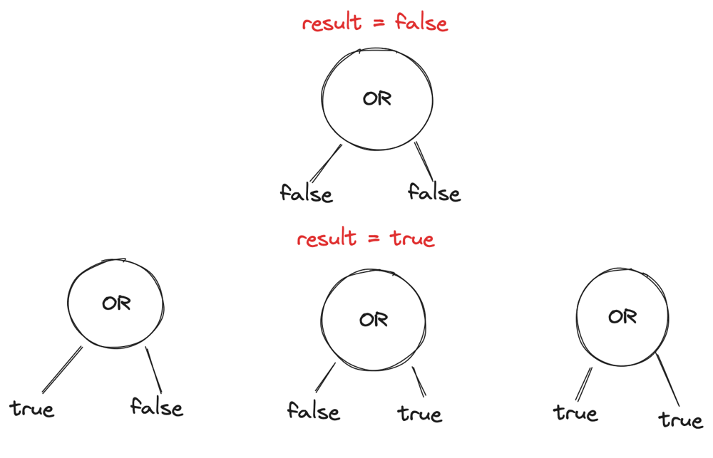
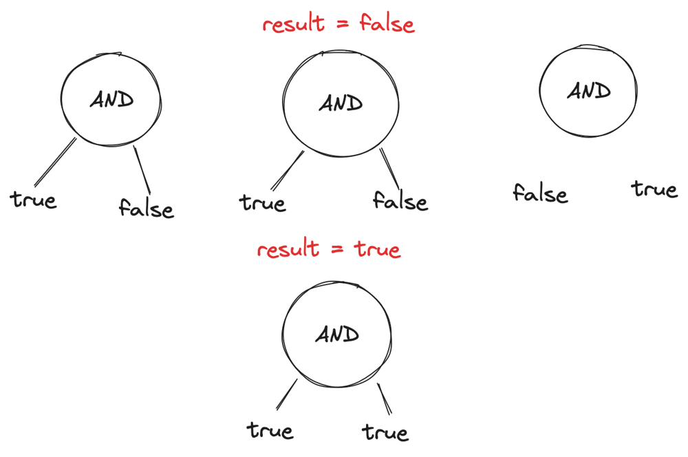
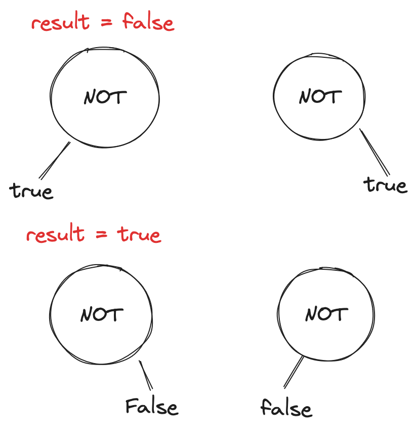
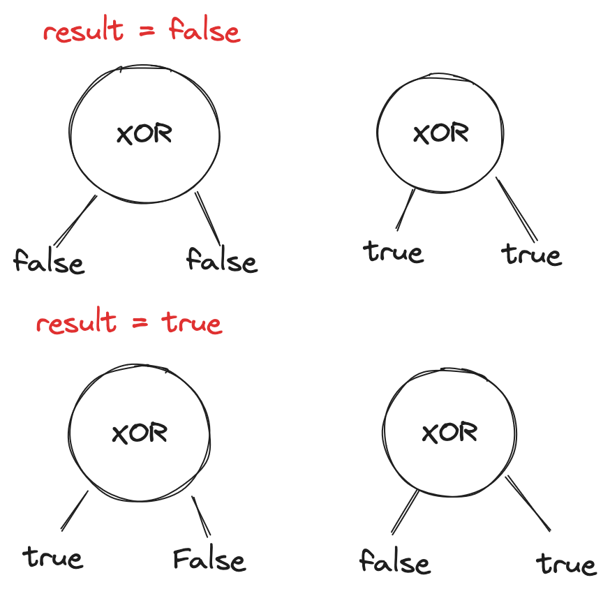

# DFS, Super Detailed Explanation

**Author:** jerrychu424
**Votes:** 8
**Link:** [https://leetcode.com/problems/minimum-flips-in-binary-tree-to-get-result/solutions/3726352/](https://leetcode.com/problems/minimum-flips-in-binary-tree-to-get-result/solutions/3726352/)

---

# Intuition
<!-- Describe your first thoughts on how to solve this problem. -->
The solution is inspired by: [https://leetcode.com/problems/minimum-flips-in-binary-tree-to-get-result/solutions/2187968/python-pure-dfs/]() . But too bad no explanations were given, why are y'all like this? Guess I will do so

before we code, lets first analyze base cases. Lets say we only have 1 node, of either true or false and we want to know the minimum flip required for them:

1. node is true
    1. if result = false, minimum flip = 1
    2. if result = true, minimum flip = 0
2. node is false
    1. if result = false, minimum flip = 0
    2. if result = true, minimum flip = 1
    
Now Let\u2019s say we only have 1 parent of evaluations, with leaf nodes. Now lets figure out all the cases

1. when root is OR
    1. if we want to get result = false, left and right leaf nodes can only = false
    2. if we want to get result = true, either both left/right leaf nodes has to be true, or either has to be true
    


2. when root node is AND


3. when root node is NOT


4. when root node is XOR


# Approach
<!-- Describe your approach to solving the problem. -->
Now we have all the cases, it\u2019s a lot easier to translate into code. The below code is commented in full detail of the cases

NOTE: DFS helper function returns 2 values, when the result is true/false. We will return according to what the input is.
# Complexity
- Time complexity: O(N)
<!-- Add your time complexity here, e.g. $$O(n)$$ -->

- Space complexity: O(N)
<!-- Add your space complexity here, e.g. $$O(n)$$ -->


# Code
```
/**
 * Definition for a binary tree node.
 * struct TreeNode {
 *     int val;
 *     TreeNode *left;
 *     TreeNode *right;
 *     TreeNode() : val(0), left(nullptr), right(nullptr) {}
 *     TreeNode(int x) : val(x), left(nullptr), right(nullptr) {}
 *     TreeNode(int x, TreeNode *left, TreeNode *right) : val(x), left(left), right(right) {}
 * };
 */
class Solution {
public:
    pair<int,int> dfs(TreeNode* root){
        // if leaf is false, return 1 if result=true, 0 if result=false
        if(root->val == 0){
            return {1,0};
        }
        // if leaf is true, return 0 if result=true, 0 if result=false
        if(root->val == 1){
            return {0,1};
        }
        // if current node is NOT:
        if(root->val == 5){
            // NOT only have 1 child, which evaluates to inverse leaf val
            auto child = root->left ? root->left : root->right;
            auto [trueState, falseState] = dfs(child);
            return {falseState, trueState};
        }
        auto [leftTrue, leftFalse] = dfs(root->left);
        auto [rightTrue, rightFalse] = dfs(root->right);
        // if current not is OR:
        if(root->val == 2){
            // calculate the case when result = true, we will compare 3 cases:
            // - 1. left and right subtree evaluates to true
            // - 2. left subtree evaluates to false, right subtree evaluates to true
            // - 3. left subtree evaluatest to true, right subtree evaluates to false
            auto trueState = min({leftTrue + rightTrue, leftFalse + rightTrue, leftTrue+rightFalse});
            // calculate the case when result = false, we will only have 1 case:
            // 1. left and right subtree evaluates to false
            auto falseState = leftFalse + rightFalse;
            return {trueState, falseState};
        }
        // if current node is AND:
        if(root->val == 3){
            // calculate the case when result = true, we will have only 1 case:
            // 1. both left and right subtree evaluates to true
            auto trueState = leftTrue+rightTrue;
            // calculate the case when result = false, we will have 3 cases:
            // 1. left subtree = true, right subtree = false
            // 2. left subtree = false, right subtree = true
            // 3. left subtree = false, right subtree = false
            auto falseState = min({leftTrue+rightFalse, leftFalse+rightTrue, 
            leftFalse+rightFalse});
            return { trueState, falseState};
        }
        // if current node is XOR
        if(root->val == 4){
            // calculate the case when result = true, we will have 2 cases
            // 1. left subtree = false, right subtree = true
            // 2. left substree = true, right subtree = false
            auto trueState = min(leftFalse + rightTrue, leftTrue+rightFalse);
            // calculate the case when result = false, we will have 2 cases
            // 1. left subtree = true, right subtree = true
            // 2. left substree = false, right subtree = false
            auto falseState = min(leftTrue + rightTrue, leftFalse + rightFalse);
            return {trueState, falseState};
        }
        // we will never reach here since the input values are always valid
        return {0,0};
    }
    int minimumFlips(TreeNode* root, bool result) {
        auto [trueState, falseState] = dfs(root);
        // we return true or false state base on what the result wants
        return result ? trueState : falseState;
    }
};
```