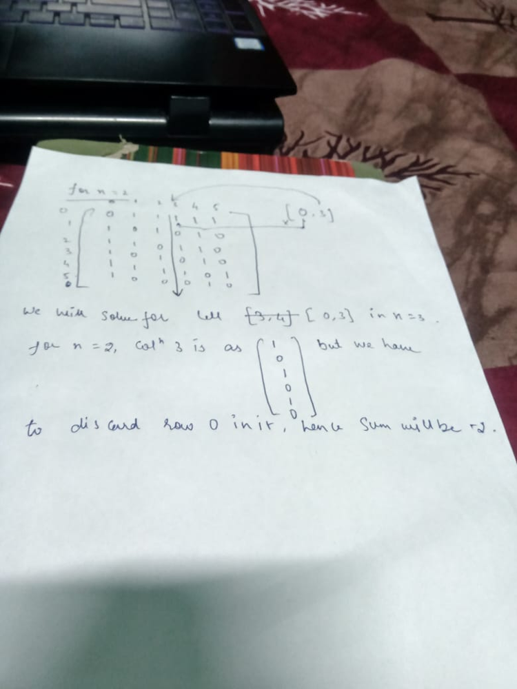

# Tabulation || Simple DP || Readable || TC: O(216*n) || SC: O(36)

**Author:** devta108
**Votes:** 4
**Link:** [https://leetcode.com/problems/number-of-distinct-roll-sequences/solutions/2220844/](https://leetcode.com/problems/number-of-distinct-roll-sequences/solutions/2220844/)

---

The solution is preety intuitive,
for n = 1, distinct sequence will be 6 which sort of a base case,
we proceed forward with n=2, which is giving us 22 distinct sequnece,
**Intution for DP**
we are needed to remember that what are the previous 2 roll values are, coz condition is clear that a number can only repeat after 2 more rolls, that is  the reason, we are tabulating the last 2 rolls,
*for cell [0,3]* it represents that previous element was 4 and 1 is previous to 4,
Now DP comes into the picture, what we will do is go to the column 4 and scan all the way to last row from 1st row and maintain sum of all the elements, except row 0 for this case as it is invaid to consider this.

```
class Solution {
    static long[][] dp;
    public int distinctSequences(int n) {
        if(n==1) return 6;
        int mod = 1_000_000_007;
        dp =new long[][]
                {
                    {0,1,1,1,1,1},
                    {1,0,1,0,1,0},
                    {1,1,0,1,1,0},
                    {1,0,1,0,1,0},
                    {1,1,1,1,0,1},
                    {1,0,0,0,1,0}
                };
        for(int i=2;i<n;i++){
            long[][] temp = new long[6][6];
            for(int j=0;j<6;j++){
                for(int k=0;k<6;k++){
                    long total = 0;
                    if(dp[j][k] == 0) continue;
                    for(int l=0;l<6;l++){
                        total = (total + ((l==k)?0:dp[l][j]))%mod;
                    }
                    temp[j][k] = total;
                }
            }
            dp = temp;
        }
        long result = 0;
        for(int i=0;i<6;i++){
            for(int j=0;j<6;j++){
                result = (result + dp[i][j])%mod;
            }
        }
        return (int)(result);
    }
}
```
Happy Leetcoding