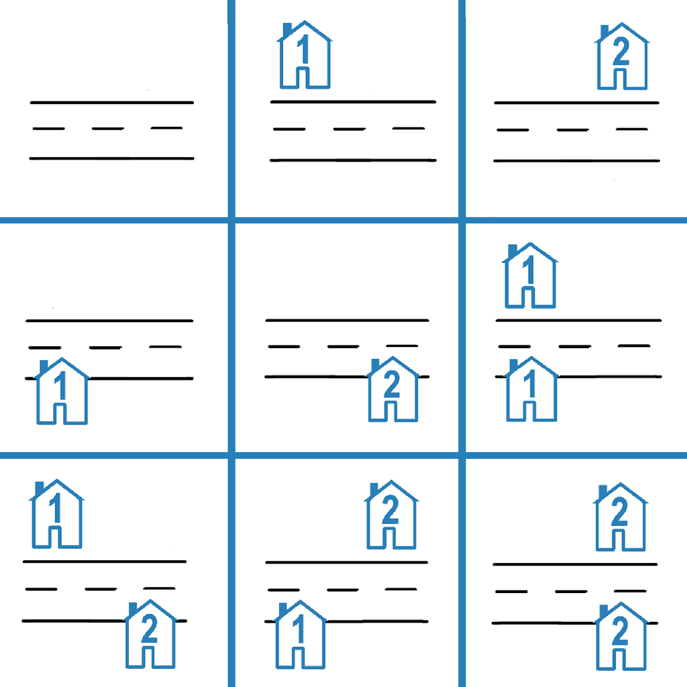

# [2320. Count Number of Ways to Place Houses](https://leetcode.com/problems/count-number-of-ways-to-place-houses/)

| Category | Difficulty | Likes | Dislikes |
| :------: | :--------: | :---: | :------: |
| Algorithms | Medium | 635 | 202 |

**Tags:** [`dynamic-programming`](https://leetcode.com/tag/dynamic-programming)

**Companies:** `google`, `amazon`, `nagarro`

## Description

There is a street with `n * 2` **plots**, where there are `n` plots on each side of the street. The plots on each side are numbered from `1` to `n`. On each plot, a house can be placed.

Return *the number of ways houses can be placed such that no two houses are adjacent to each other on the same side of the street*. Since the answer may be very large, return it **modulo** `10^9 + 7`.

Note that if a house is placed on the `i^th` plot on one side of the street, a house can also be placed on the `i^th` plot on the other side of the street.

 

**Example 1:**

```

Input: n = 1
Output: 4
Explanation: 
Possible arrangements:
1. All plots are empty.
2. A house is placed on one side of the street.
3. A house is placed on the other side of the street.
4. Two houses are placed, one on each side of the street.

```

**Example 2:**


```

Input: n = 2
Output: 9
Explanation: The 9 possible arrangements are shown in the diagram above.

```

 

**Constraints:**

	- `1 <= n <= 10^4`

---

**Links:** [Submissions](https://leetcode.com/problems/count-number-of-ways-to-place-houses/) | [Solutions](https://leetcode.com/problems/count-number-of-ways-to-place-houses/)
