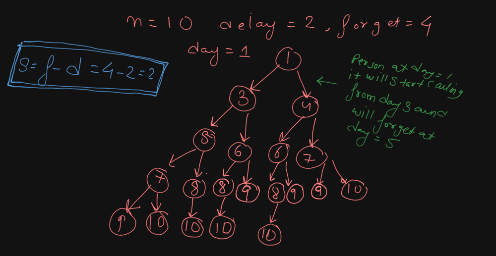

# C++ DP solution || Full Intution and Approach ✅

**Author:** Devansh_79
**Votes:** 8
**Link:** [https://leetcode.com/problems/number-of-people-aware-of-a-secret/solutions/4488060/](https://leetcode.com/problems/number-of-people-aware-of-a-secret/solutions/4488060/)

---

# Intuition
<!-- Describe your first thoughts on how to solve this problem. -->
The Intution behind this problem is looking for the pattern in which the progression of secret shairing is happening , here you can see that the first person will only start shairing when he has completed his delay time. therefore we can say that every person will call for **forget - delay** states 
i.e lets say for n=6 , delay = 2 , forget = 4 here every person can share the secret with atmax 2 (4-2) person. we also need to keep in mind that we should remove the person from our answer who forget the secret. 

# Approach
<!-- Describe your approach to solving the problem. -->
The approach is simple and you will be able to fogure out the dp state once you see this recursive tree given in the image here you can see that each person is calling at max (forget - delay) persons. 



# Complexity
- Time complexity: time complexity of this problem is **O(n * (forget-delay))** and in worst case where delay = 0 and forget = n the Tc reaches **O(n^2)**;
<!-- Add your time complexity here, e.g. $$O(n)$$ -->

- Space complexity: space complexity is **O(n+n)** i.e the dp array and o(n) for stack space. 
<!-- Add your space complexity here, e.g. $$O(n)$$ -->

# Code
```
class Solution {
int dp[1001];
#define mod 1000000007
public:
    int solve(int idx,int d,int f,int n){
        if(idx+d>n)return 1;
        if(dp[idx]!=-1)return dp[idx];
        int ans=1;
        for(int i=idx+d;i <= min(n,idx+f);i++){
            if(i==idx+f){
                ans-=1;
                break;
            }
            ans= (ans%mod + solve(i,d,f,n)%mod)%mod;
        }
        return dp[idx]=ans;
    }
    int peopleAwareOfSecret(int n, int delay, int forget) {
        memset(dp,-1,sizeof(dp));
       return solve(1,delay,forget,n); 
    }
};
```