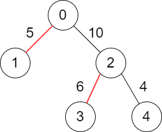
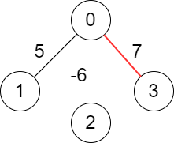

# [2378. Choose Edges to Maximize Score in a Tree](https://leetcode.com/problems/choose-edges-to-maximize-score-in-a-tree/)

| Category | Difficulty | Likes | Dislikes |
| :------: | :--------: | :---: | :------: |
| Algorithms | Medium | 59 | 13 |

**Tags:** [`dynamic-programming`](https://leetcode.com/tag/dynamic-programming), [`tree`](https://leetcode.com/tag/tree), [`depth-first-search`](https://leetcode.com/tag/depth-first-search)

**Companies:** `sprinklr`

## Description

You are given a **weighted** tree consisting of `n` nodes numbered from `0` to `n - 1`.

The tree is **rooted** at node `0` and represented with a **2D** array `edges` of size `n` where `edges[i] = [par_i, weight_i]` indicates that node `par_i` is the **parent** of node `i`, and the edge between them has a weight equal to `weight_i`. Since the root does **not** have a parent, you have `edges[0] = [-1, -1]`.

Choose some edges from the tree such that no two chosen edges are **adjacent** and the **sum** of the weights of the chosen edges is maximized.

Return *the **maximum** sum of the chosen edges*.

**Note**:

	- You are allowed to **not** choose any edges in the tree, the sum of weights in this case will be `0`.

	- Two edges `Edge_1` and `Edge_2` in the tree are **adjacent** if they have a **common** node.
	
		In other words, they are adjacent if `Edge_1` connects nodes `a` and `b` and `Edge_2` connects nodes `b` and `c`.

	
	

 

**Example 1:**


```

Input: edges = [[-1,-1],[0,5],[0,10],[2,6],[2,4]]
Output: 11
Explanation: The above diagram shows the edges that we have to choose colored in red.
The total score is 5 + 6 = 11.
It can be shown that no better score can be obtained.

```

**Example 2:**


```

Input: edges = [[-1,-1],[0,5],[0,-6],[0,7]]
Output: 7
Explanation: We choose the edge with weight 7.
Note that we cannot choose more than one edge because all edges are adjacent to each other.

```

 

**Constraints:**

	- `n == edges.length`

	- `1 = 1`.

	- `par_i != i`

	- `-10^6 = 1`.

	- `edges` represents a valid tree.

---

**Links:** [Submissions](https://leetcode.com/problems/choose-edges-to-maximize-score-in-a-tree/) | [Solutions](https://leetcode.com/problems/choose-edges-to-maximize-score-in-a-tree/)
