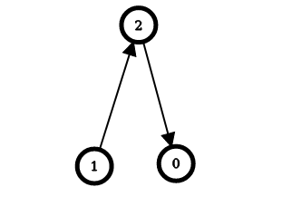

# [2858. Minimum Edge Reversals So Every Node Is Reachable](https://leetcode.com/problems/minimum-edge-reversals-so-every-node-is-reachable/)

| Category | Difficulty | Likes | Dislikes |
| :------: | :--------: | :---: | :------: |
| Algorithms | Hard | 387 | 8 |

**Tags:** [`dynamic-programming`](https://leetcode.com/tag/dynamic-programming), [`depth-first-search`](https://leetcode.com/tag/depth-first-search), [`breadth-first-search`](https://leetcode.com/tag/breadth-first-search), [`graph`](https://leetcode.com/tag/graph)

**Companies:** `microsoft`, `uber`, `cashfree`, `paypal`, `mathworks`, `meesho`

## Description

There is a **simple directed graph** with `n` nodes labeled from `0` to `n - 1`. The graph would form a **tree** if its edges were bi-directional.

You are given an integer `n` and a **2D** integer array `edges`, where `edges[i] = [u_i, v_i]` represents a **directed edge** going from node `u_i` to node `v_i`.

An **edge reversal** changes the direction of an edge, i.e., a directed edge going from node `u_i` to node `v_i` becomes a directed edge going from node `v_i` to node `u_i`.

For every node `i` in the range `[0, n - 1]`, your task is to **independently** calculate the **minimum** number of **edge reversals** required so it is possible to reach any other node starting from node `i` through a **sequence** of **directed edges**.

Return *an integer array *`answer`*, where *`answer[i]`* is the** * ***minimum** number of **edge reversals** required so it is possible to reach any other node starting from node *`i`* through a **sequence** of **directed edges**.*

 

**Example 1:**


```

Input: n = 4, edges = [[2,0],[2,1],[1,3]]
Output: [1,1,0,2]
Explanation: The image above shows the graph formed by the edges.
For node 0: after reversing the edge [2,0], it is possible to reach any other node starting from node 0.
So, answer[0] = 1.
For node 1: after reversing the edge [2,1], it is possible to reach any other node starting from node 1.
So, answer[1] = 1.
For node 2: it is already possible to reach any other node starting from node 2.
So, answer[2] = 0.
For node 3: after reversing the edges [1,3] and [2,1], it is possible to reach any other node starting from node 3.
So, answer[3] = 2.

```

**Example 2:**



```

Input: n = 3, edges = [[1,2],[2,0]]
Output: [2,0,1]
Explanation: The image above shows the graph formed by the edges.
For node 0: after reversing the edges [2,0] and [1,2], it is possible to reach any other node starting from node 0.
So, answer[0] = 2.
For node 1: it is already possible to reach any other node starting from node 1.
So, answer[1] = 0.
For node 2: after reversing the edge [1, 2], it is possible to reach any other node starting from node 2.
So, answer[2] = 1.

```

 

**Constraints:**

	- `2 <= n <= 10^5`

	- `edges.length == n - 1`

	- `edges[i].length == 2`

	- `0 <= u_i == edges[i][0] < n`

	- `0 <= v_i == edges[i][1] < n`

	- `u_i != v_i`

	- The input is generated such that if the edges were bi-directional, the graph would be a tree.

---

**Links:** [Submissions](https://leetcode.com/problems/minimum-edge-reversals-so-every-node-is-reachable/) | [Solutions](https://leetcode.com/problems/minimum-edge-reversals-so-every-node-is-reachable/)
